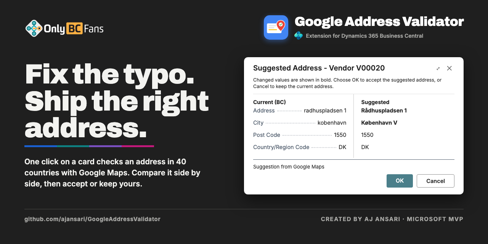

# OnlyBCFans Google Address Validator

## 📖 [Full documentation: setup, configuration and use](https://ajansari.github.io/GoogleAddressValidator/)

**Start here:** <https://ajansari.github.io/GoogleAddressValidator/> has the **User Guide** (how to validate addresses and read the results), the **Documentation** (configuration, permissions, objects and troubleshooting) and the **Google Setup** guide (getting and restricting your API key). It is the same page the app's **Help** link in Extension Management opens.

A Microsoft Dynamics 365 Business Central per-tenant extension that checks an address
(from version 1.2, in any of the 40 countries Google covers) against the **Google Maps Platform Address Validation API** from the card of the record that holds
it (the Customer Card and, from version 1.1, 15 more master-data cards), shows the current and
suggested address side by side, and lets the user accept or ignore the suggestion.

Built by **AJ Ansari / OnlyBCFans** using the
[OnlyCopilotFans Agentic Development Framework](https://github.com/ajansari/ocpfBcAgenticDevFramework).

| Version | Contents | Status |
|---|---|---|
| `1.3.0.3` | Release candidate, supports address validation in 40 countries | **Release package** |

## Why

Business Central has no built-in address validation. Customer addresses are typed by hand, so
misspelled streets, wrong ZIP Codes and missing suite numbers reach invoices and shipping labels.
This extension lets a user confirm an address with one click while they are on the customer, with
no batch jobs, no background calls and no data leaving the tenant except the single address being
checked.

The project started against the USPS Addresses API. When USPS moved that API to a licensed, paid
model in August 2026 and onboarding could not be completed, the provider was switched to Google.
The USPS-build documents are kept under `docs/4-prove/USPSbuild/` and as `*.USPSbuild-*.md` files
for history; the folder name still carries the original name.

## What it does

- **Validate Address** action on the Customer Card (and, from 1.1, on the other cards below). Unsaved changes are saved first, then the
  main address (Address, Address 2, City, State, ZIP Code) is sent to Google with the country code of the record. USPS CASS
  processing is on for the United States and Puerto Rico only.
- **Suggested Address window.** Current and suggested values side by side, changed values in
  bold, the source of the suggestion, and delivery notes (missing or unconfirmed suite number,
  not deliverable per USPS, vacant, business, PO box). OK accepts, Cancel keeps the current
  address. Accepting also updates the linked Contact through the standard sync.
- **Confirmed addresses** need no action: a message says so and nothing is changed except the
  indicator below. Differences in case, punctuation and spacing alone do not count.
- **Address Validated** read-only field on the customer, set when Google confirms or the user
  accepts, and reset by any later edit of the address fields. From 1.1.0.4 the country is part of
  the validated address: changing Country/Region Code (also from blank to the US code, and the
  company's Ship-to Country/Region Code) resets it even when Business Central keeps the address.
- **Google Address Validation Log.** Every check that reaches Google is logged with its result
  (Confirmed, Suggestion Accepted, Suggestion Ignored, Not Found, Error), HTTP status and
  Google's own message. Reachable from the card or by searching for "Google" or "address validation". Each line shows the source table and a Record No. (the customer, vendor or employee number; "C00010 / MAIN" for a ship-to address; blank for Company Information); Customer No., Source and Source Table No. are hidden by default and can be shown through Personalization. A retention policy
  (two years) is registered at install, disabled by default. From 1.1.0.4 a user sees only the
  entries whose source table the user may read (administrators read the whole log); the log
  keeps a record's key and address until the retention policy deletes the row, also after the
  record is deleted or privacy-blocked.
- **Version 1.1: the same check on 15 more cards.** Each has Validate Address, a read-only Address
  Validated field and a Google Address Validation Log action showing only that record's entries:
  - *Sales and customer:* Ship-to Address, Customer Bank Account.
  - *Purchasing and vendor:* Vendor, Order Address, Remit Address, Vendor Bank Account.
  - *Company and organization:* Company Information (two actions, one for the company address and
    one for the ship-to address, each with its own indicator), Location, Responsibility Center,
    Bank Account.
  - *People:* Employee, Alternative Address, Contact (companies and persons), Contact Alternative
    Address, Resource.
- **Linked records follow (1.1).** When Business Central keeps a linked record in step (Customer,
  Vendor and Bank Account with their Contact; a Contact with its Customer, Vendor, Bank Account,
  Employee and a company's persons; an Employee with its Resource), the Address Validated field
  follows. A Confirmed or Not Found on a Customer, Vendor, Bank Account or Employee also runs the
  standard update of the linked Contact (or Resource), only when its indicator differs, so the
  linked record's Last Date Modified and Change Log entries change; a failure there never undoes
  the check. For a Contact source that update is part of the same write and a failure is an Error
  (confirmed by AJ Ansari, 2026-10-18: it is standard Business Central behaviour and is kept).
- **Country filled in (FR-18.6; from 1.2.0.0 for every country).** When a check ends in Accept, or in Confirmed for a user who may modify the record, and the record's Country/Region Code is blank, it is filled in with the Country/Region whose ISO Code matches the country Google found (for example DE for Germany), or with the country that was assumed for the check when Google names none (the Default Country/Region Code under Use default country, or the US or Canada when the address looked like one; the record's own address block: the Company Information ship-to block fills the ship-to country). A non-blank country is never changed, and Not Found never fills it in. The Suggested Address window shows the line "The Country/Region will be set to ..." when that will happen.
- **Version 1.2: the 40 countries Google covers (SC-4).** Argentina, Austria, Australia, Belgium, Bulgaria, Brazil, Canada, Switzerland, Chile, Colombia, Czechia, Germany, Denmark, Estonia, Spain, Finland, France, United Kingdom, Croatia, Hungary, Ireland, India (preview), Italy, Japan (preview), Lithuania, Luxembourg, Latvia, Mexico, Malaysia, Netherlands, Norway, New Zealand, Poland, Puerto Rico, Portugal, Sweden, Singapore, Slovenia, Slovakia and the United States, as read from Google's coverage page on 2026-10-18 (<https://developers.google.com/maps/documentation/address-validation/coverage>). The page **Google Address Validation Supported Countries** (reachable from the setup card and by Tell Me) lists them with their Preview, Residential Data and USPS Delivery Data flags; the only editable field is **Enabled**. The record's Country/Region Code is matched to Google's region through its ISO Code. A country Google does not cover is refused ("Google Maps can't validate addresses in ..."), a country an administrator switched off is refused ("Address validation isn't turned on for ..."), and an address Google finds in another country than the record's is Not Found with a message naming both. In the US and Puerto Rico a street plus a ZIP Code or a city and state is needed, in Canada a street plus a postal code or a city and province, elsewhere a street plus a city or postal code (no state needed). **Blank country (SC-5, SC-5a; from 1.2.0.3).** The setup option **Blank Country Handling** decides what a record without a Country/Region Code gets. **Let Google decide** (the default, also after an upgrade, with no upgrade step: administrators should review it) takes a record to be a **US** address when its State is a US state or territory code (the 50 states, DC, PR, AA, AE, AP) and its ZIP Code has 5 or 9 digits (US USPS delivery data is then requested), a **Canadian** address when its postal code looks like A1A 1A1, and otherwise sends no country so that Google works it out (a Danish address is found in Denmark and the country is filled in); the country Google finds must be supported and enabled, else the check is Not Found. When a guessed US or Canadian country ends in Not Found the request is repeated once without a country (one extra billable request only in that case). **Use default country** checks every such record as an address in the **Default Country/Region Code** (blank = no country sent, no guessing). Limits: a US record without a recognizable state and ZIP code gets no USPS data under Let Google decide (choose Use default country in US-only companies); Google's real answers outside the US and for these cases have not been seen.
- **Privacy Blocked (1.1).** A customer, vendor, contact, employee or resource with Privacy Blocked
  on, and the child records of a blocked one, are not validated: nothing is sent and nothing is
  logged. This applies to customers too.
- **Log with a source (1.1).** Each entry records the table, the record (by system ID), the address
  type and a description made of the table name and key, never a name (stored in the language of the
  user who ran the check). Customer No. is filled only for customers.
- **Upgrade from 1.0.0.0 (1.1).** In place, Schema Sync Mode Add. Old log entries become Customer
  entries and validated customers' contacts are marked validated, once per company.
- **Setup once per company.** An Assisted Setup wizard ("Set up Google address validation") takes the
  API key; the Google Address Validation Setup card holds Enabled, Blank Country Handling, Default Country/Region Code, Timeout and a
  **Test Connection** action that checks key, API and billing without sending an address.
- **The API key is never readable.** Stored in Isolated Storage, passed as `SecretText`, sent
  only in the request header, never written to a table, log, URL or message.
- **Privacy notice.** A Business Central privacy notice ("Google Address Validation") must be
  agreed to before anything is sent. **From 1.2 all 40 countries are switched on at install and upgrade, so addresses outside the United States (employee and contact addresses included) can be sent to Google when a user validates; administrators should switch off the countries they do not want on the Supported Countries page.**
- **Provider behind an interface.** Google sits behind `"obcfgav Address Provider"`; a second
  provider would be one codeunit and one enum value.

## Out of scope

- Automatic, batch or scheduled validation, and validation from the Customer List.
- Documents and transactions: sales, purchase, transfer, service, reminder and finance charge
  documents, their archives and posted versions, and journals. Also Job, Job Task, Service Item,
  Work Center, Machine Center, Union, templates and Standard Address.
- Validate Address on any list page.
- Countries Google does not cover (for example Russia): they are refused before anything is sent.
- Languages other than English (United States).

## Requirements

- Business Central **SaaS, 28.0 or later** (`app.json`: platform and application 28.0.0.0,
  runtime 17.0, target Cloud). No dependencies beyond the Base Application.
- **"Allow HttpClient Requests"** switched on for the extension in Extension Management, and
  outbound access to `addressvalidation.googleapis.com`.
- A **Google Cloud project** with billing enabled, the Address Validation API enabled, and an API
  key restricted to that API. Google includes 5,000 free Pro requests a month, then about $17 per
  1,000; every check is one request on your account, and the allowance is shared by all countries
  (a billing account on India pricing gets 35,000 free). Nothing of 1.2 has been run against the live service: try real
  addresses per country (Brazil, Mexico, India and Japan especially) before relying on it. `docs/4-prove/GoogleSetupGuide.md` walks through it.
- Permission sets `OBCFGAV GAV, USE` (run checks; indirect access to the log) and
  `OBCFGAV GAV, ADMIN` (setup, direct read and delete on the log), plus the standard modify permission on the table being checked, and on any linked
  record Business Central updates with it (for example Contact), to accept a suggestion. The
  permission sets were not widened for the 15 tables added in 1.1.
- Before uploading 1.1, check in Extension Management that no other per-tenant extension uses
  object IDs 92800 to 92829 or has added field 92800 to the 15 standard tables the app extends
  (enum 92801 to Company Information).

## Getting started

1. Upload the package from `outputAppPackage/` (see `docs/4-prove/SandboxInstall.md` for a
   sandbox, `docs/4-prove/Deployment.md` for production). `1.1.x` and `1.2.x` install over `1.0.0.0` in
   place with Schema Sync Mode **Add**.
2. Follow `docs/4-prove/GoogleSetupGuide.md` to create the Google Cloud project, key, daily cap
   and budget alert.
3. In Business Central, run **Assisted Setup → Set up Google address validation**, enter the key, then
   open **Google Address Validation Setup**, switch **Enabled** on and choose **Test Connection**.
4. Open **Google Address Validation Supported Countries**, switch off any country whose addresses you do not want sent to Google, then open a customer in a supported country, or any card listed above, and choose **Validate Address**.
   `docs/4-prove/UserGuide.md` covers every task and message.

## Repository layout

| Path | Contents |
|---|---|
| `src/` | AL source: `Setup/` (setup table, card, wizard, credentials, install, the supported-countries table and page), `Validation/` (validation codeunits, Google client, HTTP transport, log, compare page, Customer extensions), `Sources/` (1.1: the address engine, the table and page extensions of the 15 other cards, the linked-record sync, the write guard and the country management), `Upgrade/` (1.1 and 1.2: upgrade codeunits and tags), `logo/` |
| `outputAppPackage/` | Every built package, one file per version, never overwritten |
| `docs/` | Project documents by phase (below) |
| `requirements/` | The original raw requirements, kept verbatim |
| `images/` | App icon sources |
| `Translations/` | Generated `.g.xlf` only (gitignored); the app ships en-US with no translation files |
| `ProjectProgress.md` | Which framework step the project is on, and the usage and cost table |

The separate test app (155 automated tests: 61 from 1.0.0.0, 73 for 1.1 and 21 for 1.2, never run) lives in the
sibling repository `USPSAddressValidator.Tests`; it is for sandboxes only, and a crashed run can
leave Company Information, Marketing Setup or a General Ledger Setup switch altered in the TEST
company (recovery: `docs/4-prove/AutomatedTestGuide.md` section 2).

## Documentation

| Document | Audience |
|---|---|
| [`docs/4-prove/UserGuide.md`](docs/4-prove/UserGuide.md) | End users: every task, window and message, and the cards that have Validate Address |
| [`docs/4-prove/GoogleSetupGuide.md`](docs/4-prove/GoogleSetupGuide.md) | The Google account administrator: project, billing, API, key, cap, alert |
| [`docs/4-prove/Deployment.md`](docs/4-prove/Deployment.md) | Business Central administrators: pre-checks, install, permissions, key rotation, rollback |
| [`docs/4-prove/SandboxInstall.md`](docs/4-prove/SandboxInstall.md) | Uploading the current build to a sandbox |
| [`docs/4-prove/Documentation.md`](docs/4-prove/Documentation.md) | Developers: architecture, public AL surface, events, permission sets, error table, license |
| [`docs/4-prove/HumanUnitTestScript.md`](docs/4-prove/HumanUnitTestScript.md) | Testers: the step-by-step release test |
| [`docs/4-prove/AutomatedTestGuide.md`](docs/4-prove/AutomatedTestGuide.md) | Running the automated tests in a sandbox |
| [`docs/2-design/FRD.md`](docs/2-design/FRD.md) | Functional requirements (2.0, as-built baseline; Appendix C is the 1.1 scope change) |
| [`docs/2-design/TDD.md`](docs/2-design/TDD.md) | Technical design; section 15 is the 1.1 specification |
| [`docs/4-prove/PostDevTDD.md`](docs/4-prove/PostDevTDD.md) | As-built technical design (Part F is version 1.1) |
| [`docs/0-project/ChangeLog.md`](docs/0-project/ChangeLog.md) | Every deviation and decision, with reasoning |
| [`docs/0-project/Acknowledgements.md`](docs/0-project/Acknowledgements.md) | Tooling and third-party credits |

## License

[PolyForm Shield License 1.0.0](https://polyformproject.org/licenses/shield/1.0.0), source-available,
not open source. You may use, copy, modify and redistribute this extension for any purpose,
including commercially and inside paid implementations, except providing a product that competes
with it or with any product of the licensor. See [`LICENSE`](LICENSE) for the full terms.

Required Notice: Copyright 2026 AnsariCo, Inc. dba OnlyBCFans (https://OnlyBCFans.com)

No third-party source code is bundled in this extension; see `docs/0-project/Acknowledgements.md`
for the development tooling used to build it.

---

Created by [AJ Ansari](https://github.com/ajansari) · Microsoft MVP · [OnlyBCFans](https://OnlyBCFans.com)
