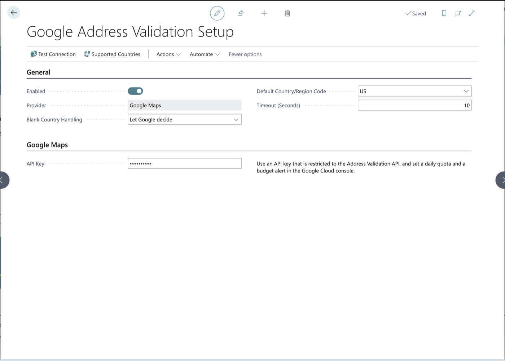

# Google Address Validator — Technical Documentation

**Version:** 1.3.0.0 (previous builds 1.2.0.5 and 1.2.0.4; test app 0.0.0.24) · **Date:** 2026-10-19 · **Generated from:** the AL source in `src/` (main app 1.3.0.0; object and field IDs renumbered per object type, see `docs/1-define/ObjectRegister.md`). Sections 1 to 9 were first written for 0.0.0.7 and 1.0.0.0, and each section that 1.1 or 1.2 changes says so. The as-built reference for 1.1 is `docs/4-prove/PostDevTDD.md` Part F, for 1.2 Part G.

## 1. Overview
Google Address Validator (publisher OnlyBCFans, namespace `OnlyBCFans.GoogleAddress`, prefix `obcfgav`, App Code `GAV`, object ID range 92800–92829, allocated per object type (from 1.3.0.0; 1.0.0.0 to 1.2.x used 60093–60192), target Cloud, runtime 17.0, platform and application 28.0.0.0, no dependencies) adds one action to the Customer Card, **Validate Address**. **From version 1.1 the same action, a read-only Address Validated indicator and an Google Address Validation Log action are on 15 more cards** (§2.3), and Company Information has two address blocks, each with its own action. Wherever this document says "the customer" in §1 to §3.6, read "the record being checked"; §3.2 and §2.3 give the 1.1 changes. It sends the customer's main address (Address, Address 2, City, State held in County, ZIP Code held in Post Code) to the Google Maps Platform Address Validation API (`POST https://addressvalidation.googleapis.com/v1:validateAddress`, USPS CASS processing switched on for US and Puerto Rico addresses only). The user then sees the Business Central address and Google's suggested address side by side and accepts or ignores the suggestion. Every check that reaches the provider is logged, and a read-only **Address Validated** indicator on the customer shows whether the current address was confirmed by, or accepted from, the provider.

It is for interactive use only and, from 1.2, works in the 40 countries Google covers (§2.4): the record's country decides the region (for a record without one, the Blank Country Handling setting: the country is worked out from the address, or the Default Country/Region Code is used), and a country that Google does not cover, or that an administrator turned off on the Supported Countries page, is refused before anything is sent. (Versions 1.0.0.0 to 1.1.x were US only.) Nothing runs automatically, in batch, or on a schedule. An administrator creates a Google Cloud API key, enters it once per company (Assisted Setup wizard or setup card), turns the service on, and uses Test Connection. The provider sits behind the interface `"obcfgav Address Provider"`, so a second provider would be one new codeunit and one enum value; none is built.

**This extension has no API pages and no API queries.** Nothing is exposed over OData or REST. The "API" other extensions can use is the public AL surface described in §3 (public codeunits, two interfaces, the Customer table-extension field, the log table). Section 3 replaces the template's per-API-page sections. Every one of those entry points runs a caller check (§3.3), so in a production environment only this app can call them.

## 2. Architecture
### 2.1 Schema diagram
Redrawn for version 1.1.0.8 and rendered before this document was committed (for 1.1.0.10 one attribute line, the log's Record No. field 29, was added to the diagram text below by hand; the diagram was **not re-rendered** after that): `node --version` printed `v24.11.1`, `npx --yes @mermaid-js/mermaid-cli --version` printed `12.0.0`, and `npx --yes @mermaid-js/mermaid-cli -i erd.mmd -o erd.svg` exited 0 and produced an SVG (source and SVG in the Step 11 scratchpad, not committed). The SVG was produced but **not opened and looked at by the author** (a PNG render failed in the same environment, exit 1, so no image was seen); the renderer accepted the syntax, but the layout has not been checked by eye. Tables owned by this app: `OBCFGAV_SETUP` (table 92800), `OBCFGAV_VALIDATION_LOG` (table 92801) and `OBCFGAV_ADDRESS_BUFFER` (table 92802, temporary: it never exists in the database). `SOURCE_RECORD` is not a table: it stands for any one of the 16 standard tables below it, which the log and the buffer identify by Source Table No. and Source SystemId.

```mermaid
erDiagram
    COUNTRY_REGION ||--o{ OBCFGAV_SETUP : "US Country/Region Code = Default Country/Region Code (TableRelation)"
    OBCFGAV_SUPPORTED_COUNTRY }o--o{ COUNTRY_REGION : "Region Code = ISO Code (matched in code, no TableRelation; added by hand for 1.2, not re-rendered)"
    CUSTOMER ||--o{ OBCFGAV_VALIDATION_LOG : "Customer No. (TableRelation, customers only)"
    USER ||--o{ OBCFGAV_VALIDATION_LOG : "User ID (TableRelation, not validated)"
    OBCFGAV_VALIDATION_LOG }o--|| SOURCE_RECORD : "Source Table No. + Source SystemId (no TableRelation)"
    OBCFGAV_ADDRESS_BUFFER }o--|| SOURCE_RECORD : "temporary, in memory only"
    RETENTION_POLICY_SETUP ||--o| OBCFGAV_VALIDATION_LOG : "Table Id 92801, Checked At, 2 years"

    CUSTOMER ||--o{ SHIP_TO_ADDRESS : "has"
    CUSTOMER ||--o{ CUSTOMER_BANK_ACCOUNT : "has"
    VENDOR ||--o{ ORDER_ADDRESS : "has"
    VENDOR ||--o{ REMIT_ADDRESS : "has"
    VENDOR ||--o{ VENDOR_BANK_ACCOUNT : "has"
    EMPLOYEE ||--o{ ALTERNATIVE_ADDRESS : "has"
    CONTACT ||--o{ CONTACT_ALT_ADDRESS : "has"
    CONTACT ||--o{ CONTACT : "person belongs to company"
    CUSTOMER |o--o| CONTACT : "Contact Business Relation (standard sync)"
    VENDOR |o--o| CONTACT : "Contact Business Relation (standard sync)"
    BANK_ACCOUNT |o--o| CONTACT : "Contact Business Relation (standard sync)"
    EMPLOYEE |o--o| CONTACT : "Contact Business Relation (standard sync)"
    EMPLOYEE |o--o| RESOURCE : "Resource No."

    OBCFGAV_SUPPORTED_COUNTRY {
        Code2 RegionCode PK
        Text50 Name
        Boolean Enabled
        Boolean Preview
        Boolean ResidentialData
        Boolean USPSDeliveryData
    }
    OBCFGAV_SETUP {
        Code10 PrimaryKey PK
        Boolean Enabled
        Enum Provider
        Code10 USCountryRegionCode FK
        Enum BlankCountryHandling
        Integer TimeoutSeconds
    }
    OBCFGAV_VALIDATION_LOG {
        Integer EntryNo PK
        Code20 CustomerNo FK
        DateTime CheckedAt
        Code50 UserID FK
        Enum Result
        Boolean Accepted
        Integer HTTPStatus
        Enum Provider
        Integer SourceTableNo "24"
        Enum AddressType "25"
        Guid SourceSystemId "26"
        Text SourceDescription "27"
        Text RecordNo "29"
    }
    OBCFGAV_ADDRESS_BUFFER {
        Integer PrimaryKey PK
        Text OriginalAddressFields
        Text SuggestedAddressFields
        Boolean NotFound
        Integer SourceTableNo
        Guid SourceSystemId
    }
    SOURCE_RECORD {
        Text Note "one of the 16 tables below"
    }
    CUSTOMER {
        Boolean obcfgav_AddressValidated "field 92800"
    }
    SHIP_TO_ADDRESS {
        Boolean obcfgav_AddressValidated "field 92800"
    }
    CUSTOMER_BANK_ACCOUNT {
        Boolean obcfgav_AddressValidated "field 92800"
    }
    VENDOR {
        Boolean obcfgav_AddressValidated "field 92800"
    }
    ORDER_ADDRESS {
        Boolean obcfgav_AddressValidated "field 92800"
    }
    REMIT_ADDRESS {
        Boolean obcfgav_AddressValidated "field 92800"
    }
    VENDOR_BANK_ACCOUNT {
        Boolean obcfgav_AddressValidated "field 92800"
    }
    BANK_ACCOUNT {
        Boolean obcfgav_AddressValidated "field 92800"
    }
    EMPLOYEE {
        Boolean obcfgav_AddressValidated "field 92800"
    }
    ALTERNATIVE_ADDRESS {
        Boolean obcfgav_AddressValidated "field 92800"
    }
    CONTACT {
        Boolean obcfgav_AddressValidated "field 92800"
    }
    CONTACT_ALT_ADDRESS {
        Boolean obcfgav_AddressValidated "field 92800"
    }
    RESOURCE {
        Boolean obcfgav_AddressValidated "field 92800"
    }
    LOCATION {
        Boolean obcfgav_AddressValidated "field 92800"
    }
    RESPONSIBILITY_CENTER {
        Boolean obcfgav_AddressValidated "field 92800"
    }
    COMPANY_INFORMATION {
        Boolean obcfgav_AddressValidated "field 92800"
        Boolean obcfgav_ShipToValidated "field 92801"
    }
    USER
    COUNTRY_REGION
    RETENTION_POLICY_SETUP
```

**What 1.1 adds to the 1.0.0.0 diagram:** log fields 24 to 29 (29 `Record No.` from 1.1.0.10) and the key `SourceCheckedAt` (§3.5); buffer fields 30 to 34 (34 `Record No.` from 1.1.0.10) (§3.5); field 92800 `"obcfgav Address Validated"` on 15 more tables, and field 92801 `"obcfgav Ship-to Validated"` on Company Information (§2.3). The log's `Customer No.` is now filled only for Customer entries; every entry carries `Source Table No.` and `Source SystemId`, a plain relation to the checked record by its system ID, with no TableRelation (so a source record can be deleted and its log rows stay).

How to read it: the standard side of every relationship is the one named in capitals without an `OBCFGAV_` prefix (`COUNTRY_REGION`, `CUSTOMER`, `USER`, `RETENTION_POLICY_SETUP`, `CONTACT` and the other standard tables). The attribute lists show only the key, the relation fields and a few representative fields; §3.5 lists every field. The marker FK means "has a TableRelation", not a database foreign key.
- **Setup to Country/Region:** the setup table has one row per company (Primary Key blank), so in practice it is 1 to 0..1. The relation exists only to pick the Default Country/Region Code (since 1.2 it may be blank). **1.2:** `OBCFGAV_SUPPORTED_COUNTRY` (table 92803, §2.4) has no TableRelation; its Region Code is matched in code with the Country/Region **ISO Code** (diagram lines added by hand for 1.2 and not re-rendered).
- **Customer to Validation Log:** one customer, many log rows. The relation lets a customer rename carry through to the log. The app adds no delete handling for any source record: the log rows of a deleted record stay until the Retention Policy deletes them (§7, §8); what the `Customer No.` TableRelation does on a customer delete is standard platform behaviour and was not checked.
- **Source record to Validation Log (1.1):** `Source Table No.` + `Source SystemId` identify the checked record of any of the 16 sources; there is no TableRelation, and the key `SourceCheckedAt` serves the card's log action.
- **User to Validation Log:** `User ID` has `ValidateTableRelation = false`, so a log row survives when the user is later deleted.
- **Customer to Address Buffer:** the buffer is a temporary table, filled from one customer for one check and discarded. It is not stored.
- **Retention Policy Setup to Validation Log:** the app registers one Retention Policy Setup row for table 92801 (filter field `Checked At`), custom period `OBCFGAV-2Y` (`<-2Y>`), created **disabled** (§7).
- **Customer, Vendor, Bank Account, Employee to Contact; Employee to Resource:** notes, not app tables. The extension asks Business Central to keep the linked record in step through the standard sync (§4, §8).
- **Customer table extension 92800** adds field 92800 to the standard Customer table; the field belongs to the Customer table, the extension object belongs to this app.

### 2.2 Modules and objects
Source folders: `src/Setup/`, `src/Validation/`, and (1.1) `src/Sources/` and `src/Upgrade/`; app icon `src/logo/AppLogo.png`. Test app (separate, never deployed to production): `Google Address Validator Tests`, id `ebe1c8ca-a413-4f2b-9de7-37d8c1ae4d5a`, ID range 92830–92849, version 0.0.0.24, depends on this app at 1.3.0.0, 155 automated tests (61 from 1.0.0.0 plus 73 for 1.1 plus 21 for SC-4, SC-5 and SC-5a: 24 + 29 + 8 + 54 + 19 + 21; none has been run).

| Module | Objects (ID — type — name) | Purpose |
|---|---|---|
| Setup | field 92800 — enum — `obcfgav Validation Result` | Outcome of a check: ` ` (0), Confirmed (1), Suggestion Accepted (2), Suggestion Ignored (3), Not Found (4), Error (5). `Extensible = false`. |
| Setup | field 92801 — enum — `obcfgav Address Provider` | Provider: ` ` (0), Google (1, caption "Google Maps"). `Extensible = false`. |
| Setup | table 92800 — table — `obcfgav Setup` | One row per company: Enabled, Provider, Default Country/Region Code (field name "US Country/Region Code"), Blank Country Handling (field 6, SC-5), timeout. |
| Setup | page 92800 — page (Card) — `obcfgav Setup` | "Google Address Validation Setup": settings, API key entry, Test Connection. |
| Setup | page 92801 — page (NavigatePage) — `obcfgav Setup Wizard` | "Set Up Google Address Validation" Assisted Setup wizard (1.3.0.1): the API key (kept and shown masked when one is already saved), then the Default Country/Region Code and Blank Country Handling, on a temporary copy of the setup record that is saved on Finish. |
| Setup | codeunit 92800 — codeunit — `obcfgav Credential Mgt.` | Stores and reads the API key in isolated storage; owns the caller check. `Access = Public`. |
| Setup | codeunit 92801 — codeunit (Install) — `obcfgav Install` | Runs `RegisterAll()` on install. `Access = Internal`. |
| Setup | codeunit 92802 — codeunit — `obcfgav Setup Registration` | Registers the retention policy, the Assisted Setup entry and the privacy notice; subscribes to company initialization. `Access = Internal`. |
| Setup | permission set 92800 — permission set — `OBCFGAV GAV, USE` | Use the feature. |
| Setup | permission set 92801 — permission set — `OBCFGAV GAV, ADMIN` | Administer; includes USE. |
| Validation | table 92801 — table — `obcfgav Validation Log` | Audit log of every check that reached the provider (and every accept). |
| Validation | page 92802 — page (List) — `obcfgav Log Entries` | "Google Address Validation Log", read-only. |
| Validation | table 92802 — table (Temporary) — `obcfgav Address Buffer` | In-memory carrier between the Customer, the provider and the dialog. |
| Validation | page 92803 — page (StandardDialog) — `obcfgav Address Compare` | "Suggested Address": side-by-side comparison, OK accepts, Cancel ignores. |
| Validation | codeunit 92803 — codeunit — `obcfgav Address Validation` | The orchestrator and the public entry point. `Access = Public`. |
| Validation | codeunit 92804 — codeunit — `obcfgav Address Service` | Resolves provider and transport, runs the provider call. `Access = Public`. |
| Validation | codeunit 92805 — codeunit — `obcfgav Http Transport Impl.` | Default HTTP transport (`HttpClient`). `Access = Public`; implements `"obcfgav Http Transport"`. |
| Validation | table extension 92800 — table extension — `obcfgav Customer` (extends Customer) | Field 92800 "Address Validated" and the reset-on-edit triggers. |
| Validation | page extension 92800 — page extension — `obcfgav Customer Card` (extends Customer Card) | The Validate Address action, the Address Validated field, the log link. |
| Validation | codeunit 92806 — codeunit — `obcfgav Validation Writer` | Writes the customer and the log inside one failure boundary (`Run`). `Access = Internal`. |
| Validation | codeunit 92807 — codeunit — `obcfgav Google Address Client` | Builds the Google request, reads the answer; implements `"obcfgav Address Provider"`. `Access = Internal`. |
| Validation | interface — `obcfgav Http Transport` | `Send(...)`. |
| Validation | interface — `obcfgav Address Provider` | `ValidateAddress`, `TestConnection`, `HasCredentials`, `DisplayName`. |

Interfaces carry no object ID. There is no event publisher. **Version 1.1 adds upgrade codeunits** (codeunit 92811, codeunit 92812, and from 1.1.0.10 codeunit 92814); there were none in 1.0.0.0.

### 2.3 Objects added in version 1.1 (SC-1)
Source of the list: `docs/1-define/ObjectRegister.md`, which gives every object's ID (since 1.3.0.0 allocated per object type from 92800) and its pre-1.3 ID.

**Engine and upgrade** (all `Access = Internal` unless noted)
| ID | Type | Name | Purpose |
|---|---|---|---|
| enum 92802 | enum | `obcfgav Address Type` | `Main` (0), `Ship-to` (1). `Extensible = false`. Ship-to is valid only for Company Information. |
| codeunit 92808 | codeunit (`EventSubscriberInstance = Manual`) | `obcfgav Write Guard` | While bound by the writer around an Accept, suppresses the standard duplicate-contact form (`Contact.OnBeforeLaunchDuplicateForm`, `IsHandled := true`). |
| codeunit 92809 | codeunit | `obcfgav Address Source` | The table-agnostic engine: the per-table address field map, reading and writing the address through a RecordRef, the Privacy Blocked test, the key description for the log, and the per-table save (§3.2). |
| codeunit 92810 | codeunit | `obcfgav Upgrade Tags` | The three upgrade tags `OBCFGAV-SC1-LogSource-20261017`, `OBCFGAV-SC1-ContactFlag-20261017` and (1.1.0.10) `OBCFGAV-SC1-RecordNo-20261018`; sets them on a fresh install; registers them with `Upgrade Tag.OnGetPerCompanyUpgradeTags`. |
| codeunit 92811 | codeunit (Upgrade) | `obcfgav Upgrade Log Source` | One-time, per company: gives every 1.0.0.0 log row a source (§7). |
| codeunit 92812 | codeunit (Upgrade) | `obcfgav Upgrade Contact Flag` | One-time, per company: marks the linked Contact of every validated Customer (§7). |
| codeunit 92814 | codeunit (Upgrade) | `obcfgav Upgrade Record No.` | *(1.1.0.10, SC-2)* One-time, per company: fills the log's Record No. on existing rows (§7). |
| codeunit 92813 | codeunit | `obcfgav Address Sync Subscr.` | The linked-record update (`OnRun`, run after the check is committed) and the subscribers that keep Address Validated in step on Contact, Employee and Resource (§4). |

**Per source: table extension and page extension** (each table extension adds field 92800 and the reset-on-edit triggers; each page extension adds the field, **Validate Address**, a promoted action reference and **Google Address Validation Log**)
| Source (table) | Table ext. / page ext. | Card page extended | Notes |
|---|---|---|---|
| Ship-to Address (222) | table extension 92801 / page extension 92801 | Ship-to Address (300) | |
| Customer Bank Account (287) | table extension 92802 / page extension 92802 | Customer Bank Account Card (423) | |
| Vendor (23) | table extension 92803 / page extension 92803 | Vendor Card (26) | |
| Order Address (224) | table extension 92804 / page extension 92804 | Order Address (368) | |
| Remit Address (2224) | table extension 92805 / page extension 92805 | Remit Address (2368) | |
| Vendor Bank Account (288) | table extension 92806 / page extension 92806 | Vendor Bank Account Card (425) | |
| Company Information (79) | table extension 92807 / page extension 92807 | Company Information (1) | Also field 92801 "Ship-to Validated" (caption "Ship-to Address Validated") and a second action, **Validate Ship-to Address**. |
| Location (14) | table extension 92808 / page extension 92808 | Location Card (5703) | |
| Responsibility Center (5714) | table extension 92809 / page extension 92809 | Responsibility Center Card (5714) | |
| Bank Account (270) | table extension 92810 / page extension 92810 | Bank Account Card (370) | |
| Employee (5200) | table extension 92811 / page extension 92811 | Employee Card (5200) | |
| Alternative Address (5201) | table extension 92812 / page extension 92812 | Alternative Address Card (5203) | |
| Contact (5050) | table extension 92813 / page extension 92813 | Contact Card (5050) | Companies and persons. |
| Contact Alt. Address (5051) | table extension 92814 / page extension 92814 | Contact Alt. Address Card (5056) | |
| Resource (156) | table extension 92815 / page extension 92815 | Resource Card (76) | Persons and machines. |
| Customer (18, 1.0.0.0) | table extension 92800 / page extension 92800 | Customer Card (21) | Unchanged object IDs; table extension 92800 gains the Country/Region reset (§3.4). |

**Shared field number.** Every source table gets `field(92800; "obcfgav Address Validated")`. One number is reused across the table extensions on purpose: standard Business Central copies Customer, Vendor, Bank Account and Contact into one another with `TransferFields`, which copies by field number, so the indicator travels with the address. Company Information additionally has `field 92801`.

**Changed 1.0.0.0 objects:** page 92800 (tooltip texts), codeunit 92801 (install also sets the upgrade tags), codeunit 92802 (Assisted Setup description now "Enter the Google Maps API key used to validate addresses." for newly created companies only), permission set 92800, table 92801, page 92802, table 92802, page 92803 (tooltips), codeunit 92803, table extension 92800 (Country/Region reset), codeunit 92806. `app.json` version 1.1.0.10 (IDs as then numbered; see the Object Register for the 1.3.0.0 numbers).

**Changed by SC-2 (1.1.0.10):** captions and search terms: table 92800 and page 92800 "Google Address Validation Setup", page 92801 "Set Up Google Address Validation", table 92801 and page 92802 "Google Address Validation Log", the log action on all 16 cards (Customer Card and the 15 others) "Google Address Validation Log", the Assisted Setup entry "Set up Google address validation" (short title "Google address validation", description "Enter the Google Maps API key used to validate addresses."), and `AdditionalSearchTerms` on pages 92800 and page 92802 (found in Tell Me search by "Google", "Google Maps" or "address validation"; the wizard page 92801 is reached through Assisted Setup, whose entry is re-registered by a subscriber to Guided Experience `OnRegisterAssistedSetup` so a changed title reaches existing companies); log field 29 and buffer field 34 "Record No." with `RecordKeyText` in codeunit 92809 (new public procedure of the internal engine, returns Text[100]), the buffer load in codeunit 92809, the writer codeunit 92806 and page 92802; new upgrade codeunit 92814 and its tag in codeunit 92810 (set on install and registered). Test app 0.0.0.18: `AssertLogSource` also asserts Record No. The schema change is additive (Schema Sync Mode Add).

**Changed after the Step 09 Code Review (1.1.0.4 and 1.1.0.8, ChangeLog SC-1h):** permission set 92800 (`tabledata "obcfgav Validation Log"` from `Ri` to `ri`, indirect); page 92802 (`Permissions = tabledata "obcfgav Validation Log" = r` and an `OnOpenPage` filter on Source Table No. from `ReadableSourceFilter()` of codeunit 92809); table 92801 field 26 (now inherits `CustomerContent`); the 17 reset procedures in the table extensions (the country joined the compare; Company Information's `Ship-to Country/Region Code` gained a trigger); and the four propagation compares (codeunit 92813 three times, codeunit 92812), which now include the country. No object was added or removed; the schema did not change.

**Test app (not deployed to production):** codeunit 92836 `obcfgav Source Tests` (54 tests, including TestAcceptSetsUsCountry, TestConfirmedSetsUsCountry and TestNotFoundKeepsBlankCountry for FR-18.6), codeunit 92837 `obcfgav Sync Tests` (19 tests), and additions to the helper codeunit 92831 `obcfgav Test Library`.

### 2.4 Objects added in version 1.2 (SC-4, 40 countries; SC-5 / SC-5a, blank-country handling)
Version 1.2 (carried into 1.3.0.0) validates addresses in the 40 countries Google's Address Validation API covers. Read from the code; not installed or run. Rules: FRD FR-19; as-built detail: `docs/4-prove/PostDevTDD.md` Part G.

| ID | Type | Name | Purpose |
|---|---|---|---|
| table 92803 | table | `obcfgav Supported Country` | One row per region Google covers: Region Code (Code[2], key), Name, Enabled (default Yes), Preview, Residential and Commercial Data, USPS Delivery Data. Seeded with 40 rows. |
| page 92804 | page (List) | `obcfgav Supported Countries` | "Google Address Validation Supported Countries": opened from the setup card (action Supported Countries) or Tell Me. Only **Enabled** is editable; no insert, no delete; it seeds an empty table on open for a user who may write it. |
| codeunit 92815 | codeunit (Internal) | `obcfgav Country Mgt.` | Seeds the rows; maps a Business Central country to a region (ISO Code; `UK` to `GB`; a 2-letter code as it is); checks that a region is covered and enabled; finds the Business Central code for a region; names the countries for messages. SC-5 / SC-5a add `RegionForRecord(CountryCode; State; PostalCode; var Region; var CountryName; var Inferred): Boolean` (the region for a record; sets `Inferred` when the region was guessed from the address), `LooksLikeUnitedStates(State; PostalCode)` (state in the list of the 50 states, DC, PR, AA, AE, AP, and a Post Code of 5 or 9 digits once spaces and hyphens are removed) and `HasUsableCanadianPostalCode(PostCode)` (moved here from Address Validation). `RegionForCheck(CountryCode; var Region; var CountryName)` is kept for the Setup page's default-country warning. |
| codeunit 92816 | codeunit (Upgrade) | `obcfgav Upgrade Countries` | Once per company on upgrade: seeds the 40 rows, tag `OBCFGAV-SC4-Countries-20261018` (also set on a fresh install). |
| enum 92803 | enum | `obcfgav Blank Country Handling` | SC-5: **Let Google decide** (0, the default) and **Use default country** (1). `Extensible = false` (a closed two-value setting, SC-5a decision). Used by Setup field 6. |
| codeunit 92838 | codeunit (Test), test app | `obcfgav Country Tests` | 21 tests (15 for SC-4, 4 added for SC-5 and 2 for SC-5a; test app 0.0.0.23). |

**Changed objects:** Setup table field 4 (name `US Country/Region Code` kept; caption now "Default Country/Region Code": the country used for a blank-country record when Blank Country Handling is Use default country; blank is allowed and then no region is sent) and the new **field 6 `Blank Country Handling`** (enum 92803; schema change, additive: Schema Sync Mode Add); Setup page 92800 (caption, tooltips, the Blank Country Handling field, action Supported Countries, a warning when the default country is not covered, turned off or has no ISO Code); Country Mgt. codeunit 92815 (above); Address Validation codeunit 92803 (`CheckPreconditions` takes the record's state and ZIP code and returns whether the region was inferred; `RunValidation` repeats the request once without a region when an inferred region ends in Not Found); Address Buffer table 92802 (temporary) fields 35 Country/Region Code (Code[10]), 36 Region Code (Code[2], the region sent) and 37 Result Region Code (Code[2], the region Google returned); Address Validation codeunit 92803 (region choice and per-region input rules); Google Address Client codeunit 92807 (region only when known, CASS for US and PR only, region check on the answer, address lines and sublocality to Address 2); Address Source codeunit 92809 (`SetCountryIfBlank` replaces `SetUsCountryIfBlank`); Validation Writer codeunit 92806; Address Compare page 92803 (country line, captions "State / Province" and "ZIP / Postal Code"); Upgrade Tags codeunit 92810; Setup Registration codeunit 92802 (seeds the rows); permission sets USE (read the table, run the page and codeunit) and ADMIN (full access to the table).

**How the region is chosen (`RegionForRecord`):** the record's Country/Region Code through the Country/Region **ISO Code** (`UK` maps to `GB`, a 2-letter code with no ISO Code is used as it is). When the code is blank, the Setup field **Blank Country Handling** decides. *Use default country:* the Default Country/Region Code is mapped the same way; if it is blank, no region is sent and nothing is guessed. *Let Google decide* (the default; also the value an upgraded Setup row gets, because the enum's first value is 0): a Canadian postal code (A1A 1A1, spaces and hyphens ignored) gives CA; else a State in the US list with a 5- or 9-digit Post Code gives US (so `enableUspsCass` is requested); else no region is sent and Google works the country out. A guessed region is flagged `Inferred`. A chosen region must be in the table and **Enabled**.

**The repeat (SC-5a):** in `RunValidation`, when the region was inferred and the first answer is Not Found, the region is cleared, the buffer is filled again and the request is sent once more with no region. Only the second answer is used and logged. This costs one extra billable request, and only in that case. After a request with no region, the result region (if any) must be covered and enabled, else the check ends as Not Found with that message.

**Input rules:** US and PR — street plus a ZIP (first five characters digits) or city and state; Canada — street plus a postal code like A1A 1A1 or city and province; every other region — street plus a city or a postal code. State or province, when given for US, PR or CA, is a 2-letter code.

**Request and result:** `regionCode` only when known; `enableUspsCass` only for US and PR; a result in a different region is a Not Found (US and PR count as one); for a record without a country, a result in a country that is not covered or not enabled is a Not Found; outside US, CA and PR a missing state, city or postal code in the answer keeps the record's own value; extra address lines (else the sublocality) become Address 2. On Accept and Confirmed a blank Country/Region Code is filled in from the result region, else the region that was sent; the dialog shows "The Country/Region will be set to X." when that will happen. The Test Connection probe still sends region US with no address.

**Cost and privacy:** the same Address Validation Pro SKU in every country: 5,000 free requests a month, then about $17 per 1,000, shared by all countries (Google gives a higher free allowance (35,000 a month) only to billing accounts that are billed at India pricing; that depends on your Google billing account, not on the country of the address, and no separate API key is needed for India). All 40 countries are enabled on install and on upgrade, so addresses outside the US (customers, vendors, employees, contacts and the other sources) can be sent to Google when a user runs Validate Address; administrators should turn off the countries they do not want.

## 3. API reference
**There are no API pages and no API queries in this extension** (no `PageType = API`, no `query` object). Nothing is reachable through OData or the Business Central API endpoints. What follows is the AL surface and the data an administrator or another extension can see.

### 3.1 Quick-start for an administrator
1. **Google Cloud.** In the Google Cloud console create (or pick) a project, **enable billing** on it, **enable the Address Validation API**, and create an **API key**.
2. **Restrict the key.** Under the key's restrictions choose "Restrict key" and select **only the Address Validation API**. Do not leave the key unrestricted.
3. **Cap the spend.** Set a **daily request quota cap** for the API (for example 100 per day) and a **budget alert** (for example $1). Each check is one billable request; the design relies on the free monthly allowance and these two limits.
4. **Business Central.** Assign the permission set `OBCFGAV GAV, ADMIN` to the administrator and `OBCFGAV GAV, USE` to the users who validate customers (users also need their normal Customer and Contact permissions, §5).
5. **Enter the key.** Open **Assisted Setup > Set up Google address validation** (the wizard asks for the API key, the default country and Blank Country Handling) or open **Google Address Validation Setup** (search for "Google") and type the key into **API Key**. The key is stored for this company in isolated storage (encrypted when encryption is on), shown masked, and cannot be read back.
6. **Turn it on.** On **Google Address Validation Setup** set **Enabled** to Yes. Choose **Blank Country Handling**: **Let Google decide** (the default) works the country out of each record without one; **Use default country** (choose it in a company that only checks one country, for example US-only) checks every such record as an address in the **Default Country/Region Code** (`US` unless your records without a country are elsewhere; if blank, no country is sent). Open **Supported Countries** from the card to turn off any of the 40 countries you do not want (all are on by default). Leave **Timeout (Seconds)** at 10 unless Google is slow for you (allowed 1 to 60). The wizard does not enable the service.
   
7. **Test Connection.** Choose **Test Connection**. The first time, the platform asks you to agree to the privacy notice; if you do not, the test stops ("The privacy notice for sending addresses to Google Maps has not been agreed to, so the connection was not tested."). On success: "The connection to Google Maps works. The API key was accepted." The test sends one deliberately incomplete request (no address lines); no address and no customer data is sent.
   
8. **Validate a customer.** Open a US customer on the Customer Card, choose **Validate Address** (promoted, also under Actions > Functions), and accept or ignore the suggestion. **Google Address Validation Log** (under Customer) shows the history.
9. **Optional.** Turn on the retention policy (§7) so log rows older than two years are deleted.

### 3.2 Public AL surface for other extensions
All procedures below run the caller check described in §3.3 unless the table says "no check". `Access = Public` here means the symbol is visible to other apps; the check is what stops them in production. Return values are as in the code.

**Codeunit 92803 `"obcfgav Address Validation"` (`Access = Public`) — the orchestrator**

| Procedure | Signature | Access | Caller check | Behaviour |
|---|---|---|---|---|
| `SetTransport` | `(NewTransport: Interface "obcfgav Http Transport")` | public | yes | Replaces the HTTP layer (used by tests). |
| `SetProvider` | `(NewProvider: Interface "obcfgav Address Provider")` | public | yes | Replaces the provider (used by tests). |
| `ValidateCustomerAddress` | `(CustomerNo: Code[20])` | public | yes | **Kept unchanged in 1.1** (same signature, same behaviour for the caller; it is the Customer Card's action). Runs `TryValidateCustomerAddress`; on failure raises `Error` with the user text; otherwise shows the result text with `Message`. This is what the Customer Card action calls. |
| `TryValidateCustomerAddress` | `(CustomerNo: Code[20]; var Outcome: Enum "obcfgav Validation Result"; var UserMessage: Text): Boolean` | public | yes | The check itself: customer lookup, preconditions (§3.6), privacy-notice approval, provider call, the comparison dialog, then the write and the log. Returns false for refusals and failures; `Outcome` and `UserMessage` are filled. Commits as described in §8. |
| `ValidateAddress` *(1.1)* | `(SourceTableNo: Integer; SourceSystemId: Guid; AddressType: Enum "obcfgav Address Type")` | public | yes | The generic form of `ValidateCustomerAddress`: runs the check for one address of one record of any of the 16 supported tables, identified by table number and `SystemId`; on failure raises `Error` with the user text, otherwise shows the result text with `Message`. This is what every new card's action calls (after `CurrPage.SaveRecord()` and `Commit()`). `AddressType` is `Main` except for Company Information's ship-to block. |
| `TryValidateAddress` *(1.1)* | `(SourceTableNo: Integer; SourceSystemId: Guid; AddressType: Enum "obcfgav Address Type"; var Outcome: Enum "obcfgav Validation Result"; var UserMessage: Text): Boolean` | public | yes | The generic check without the `Error`/`Message` wrapper. Returns false and fills `UserMessage` for a table or block that is not supported (*Address validation is not available for this record.*), a record that is not found (*The record was not found.*), a Privacy Blocked record or child of one (*Address validation is not available for this record because it is blocked due to privacy.*; nothing sent, nothing logged), and every refusal or failure of §3.6. |
| `CanModifySource` *(1.1)* | `(SourceTableNo: Integer): Boolean` | public | no check | True when the user's effective permission on that table's data includes Modify. Read-only. `CanModifyCustomers()` now calls it with the Customer table. |
| `ValuesDiffer` | `(BCValue: Text; ProviderValue: Text): Boolean` | public | no check | True when the two values differ after upper-casing, removing periods and commas, and collapsing repeated spaces (FR-3). Pure function. |
| `CanModifyCustomers` | `(): Boolean` | public | no check | True when the current user's effective permission on Customer table data includes Modify. Read-only. |
| `DeliveryWarning` | `(TempAddressBuffer: Record "obcfgav Address Buffer" temporary): Text` | **internal** | n/a | Delivery warning line from DPV code `D` or next action `CONFIRM_ADD_SUBPREMISES` (suite missing), `S` (suite unconfirmed), `N` (not deliverable); blank otherwise. |

**Codeunit 92804 `"obcfgav Address Service"` (`Access = Public`) — provider and transport resolution**

| Procedure | Signature | Access | Caller check | Behaviour |
|---|---|---|---|---|
| `SetTransport` | `(NewTransport: Interface "obcfgav Http Transport")` | public | yes | Replaces the HTTP layer. |
| `SetProvider` | `(NewProvider: Interface "obcfgav Address Provider")` | public | yes | Replaces the provider. |
| `ValidateAddress` | `(var TempAddressBuffer: Record "obcfgav Address Buffer" temporary): Boolean` | public | yes (first statements, added at Step 09) | Clears the result fields, loads setup, resolves the provider, checks credentials, calls the provider with the setup timeout, saves the buffer row. Does **not** check `Enabled`; the orchestrator does. |
| `TestConnection` | `(var ErrorText: Text): Boolean` | public | yes | Setup, provider and credential checks, then the provider's test. |
| `ProviderDisplayName` | `(): Text` | public | no check | Provider name for messages (`Google Maps`), blank when setup is missing. |
| `SetupIncompleteText` | `(): Text` | internal | n/a | The "not set up" message text. |

**Codeunit 92800 `"obcfgav Credential Mgt."` (`Access = Public`) — the API key**

| Procedure | Signature | Access | Caller check | Behaviour |
|---|---|---|---|---|
| `SetApiKey` | `(NewValue: SecretText)` | public, `[NonDebuggable]` | yes | Stores the key (`SetEncrypted` when encryption is enabled, otherwise `Set`), `DataScope::Company`, storage key `OBCFGAV-ApiKey`. An empty value deletes the key. Marks the Assisted Setup entry complete when a key exists. |
| `HasApiKey` | `(): Boolean` | public | no check | True when a key is stored. Never returns the key. |
| `GetApiKey` | `(): SecretText` | internal, `[NonDebuggable]` | n/a | Returns the key as `SecretText`; used only by the Google client. |
| `CheckCallerAllowed` | `(CallerModuleInfo: ModuleInfo)` | internal | n/a | The caller check itself (§3.3). |

**Codeunit 92802 `"obcfgav Setup Registration"` (`Access = Internal`)** — not visible to other apps. `RegisterAll()` (retention policy, Assisted Setup entry, privacy notice), `PrivacyNoticeId(): Code[50]` (`OBCFGAV-ADDRESS`), `EnsurePrivacyNotice()` (creates the notice when missing; safe to call repeatedly).

**Codeunit 92805 `"obcfgav Http Transport Impl."` (`Access = Public`, implements the transport interface)** — `Send(var Request: HttpRequestMessage; TimeoutMs: Integer; var HttpStatus: Integer; var ResponseBody: Text): Boolean`, `[NonDebuggable]`, no caller check. Sets the client timeout, sends, returns false when no HTTP response arrived (`HttpStatus` 0), otherwise fills status and body.

**Interface `"obcfgav Http Transport"`** — `Send(var Request: HttpRequestMessage; TimeoutMs: Integer; var HttpStatus: Integer; var ResponseBody: Text): Boolean`.

**Interface `"obcfgav Address Provider"`**

| Procedure | Signature |
|---|---|
| `ValidateAddress` | `(var TempAddressBuffer: Record "obcfgav Address Buffer" temporary; Transport: Interface "obcfgav Http Transport"; TimeoutMs: Integer): Boolean` — true when validated; false when not found or the call failed (the buffer carries the user message) |
| `TestConnection` | `(Transport: Interface "obcfgav Http Transport"; TimeoutMs: Integer; var ErrorText: Text): Boolean` |
| `HasCredentials` | `(): Boolean` |
| `DisplayName` | `(): Text` |

Implemented by internal codeunit 92807 `"obcfgav Google Address Client"`. Other apps can pass their own implementation to `SetProvider`, but only in a sandbox from the test app (§3.3).

**Internal and local helpers** (not callable from other apps). *1.1:* codeunit 92809 `"obcfgav Address Source"` (`GetMap`, `IsSupported`, `GetTableCaption`, `OpenSource`, `GetValue`, `GetLength`, `FillOriginal`, `DiffersFromSnapshot`, `AssignSuggested`, `SetCountryIfBlank(var SourceRecRef: RecordRef; AddressType; TempAddressBuffer): Boolean` (SC-4, 1.2; replaces `SetUsCountryIfBlank` of 1.1.0.12, FR-18.6: when the block's country is blank, assigns the Business Central code of the result region, else the region sent, directly, without field validation, and returns true; false when the country is not blank or no code is found; `AssignSuggested` calls it after the five values), `GetValidated`, `SetValidated`, `SaveSource(var SourceRecRef: RecordRef; AddressWritten: Boolean)`, `IsPrivacyBlocked(var SourceRecRef: RecordRef): Boolean`, `Describe`, and from 1.1.0.4 `ReadableSourceFilter(): Text`, which opens the 16 source tables once and returns the table numbers the user may read as a `|` filter, `0` when none; page 92802 uses it), codeunit 92813 `"obcfgav Address Sync Subscr."` (`Init`, `OnRun`), codeunit 92808, codeunit 92810, codeunit 92811, codeunit 92812. The writer codeunit 92806 below is described as of 1.0.0.0; in 1.1 its `Init` no longer takes a customer number (`Init(NewOutcome; var TempResult; NewAccepted: Boolean; NewCanModify: Boolean)`), and `InsertLogEntry` no longer takes one either (`InsertLogEntry(LogResult; var TempResult; LogAccepted: Boolean)`); the identity travels in the buffer. Codeunit 92806 (1.0.0.0 signatures) `"obcfgav Validation Writer"` (`Access = Internal`): `OnRun` (writes the customer for Suggestion Accepted, sets Address Validated Yes for Confirmed, No for Not Found, then writes the log row), `Init(NewCustomerNo: Code[20]; NewOutcome: Enum "obcfgav Validation Result"; var TempResult: Record "obcfgav Address Buffer" temporary; NewAccepted: Boolean; NewCanModify: Boolean)`, `WasAddressChanged(): Boolean`, `InsertLogEntry(LogCustomerNo: Code[20]; LogResult: Enum "obcfgav Validation Result"; var TempResult: Record "obcfgav Address Buffer" temporary; LogAccepted: Boolean)`. Page 92803 `SetData(var TempAddressBuffer: Record "obcfgav Address Buffer" temporary; NewCanAccept: Boolean; NewAcceptBlockedReason: Text; ProviderName: Text)`.

### 3.3 Caller-check rules
- The public procedures marked "yes" above begin with `NavApp.GetCallerModuleInfo(...)` followed by `CredentialMgt.CheckCallerAllowed(...)`. The caller module must be read inside the public procedure itself, never inside a helper, otherwise it would always name this app (stated in the code comment).
- `CheckCallerAllowed` passes when the caller module id equals this app's id, or when the caller is the test app (id `ebe1c8ca-a413-4f2b-9de7-37d8c1ae4d5a`) **and** the environment is a sandbox (`Environment Information.IsSandbox()`). Anything else raises: "This procedure can only be called by the Google Address Validator app."
- In production nothing but this app can change the transport or provider, run a check, test the connection, or store the key. The no-check procedures (`HasApiKey`, `ValuesDiffer`, `CanModifyCustomers`, `ProviderDisplayName`, the transport `Send`) are read-only or pure.
- Not covered: the check identifies the calling app, not the calling user. A user's rights over Customer data are enforced by standard Business Central permissions, not by this check.
- Not verified at runtime: nothing was installed or run, so the check has been compiled and read, not exercised (§8).

### 3.4 Customer table extension
Table extension 92800 `"obcfgav Customer"` extends Customer (table 18); page extension 92800 `"obcfgav Customer Card"` extends Customer Card.

| Item | Value |
|---|---|
| Field | field 92800 `"obcfgav Address Validated"`, Boolean |
| Caption / classification | `Address Validated` · `CustomerContent` |
| Properties | `InitValue = false`, `Editable = false` |
| Who sets it | Only the extension: Yes on Confirmed or Suggestion Accepted (and, from 1.1.0.12, a blank country is filled in with the country Google found, else the region sent, at the same time (SC-4; 1.1.0.12 to 1.1.x used the setup's US code), which does not reset it); No on Not Found (for a user who can modify customers). Unchanged on Ignored, Error and when the user cannot modify customers. |
| Reset on edit | `OnAfterValidate` triggers on Address, Address 2, City, County (State), Post Code and (from 1.1.0.4) Country/Region Code set it to No when the value differs from `xRec` and the flag was Yes. **The country is part of the validated address:** blank to the US code counts as a change, and so does a change that Business Central does not follow by clearing the address (General Ledger Setup `Req.Country/Reg. Code in Addr.` on). This supersedes the 1.0.0.0 rule that the country does not count. Writes that skip field validation (some imports and integrations) may not be detected. |
| Card placement | Field shown after Post Code on the Customer Card, read-only, tooltip explains the rules. |
| Actions | **Validate Address** (Functions group, promoted in Process; image Map): saves the record, commits, calls `ValidateCustomerAddress`, re-reads the customer, refreshes the page. **Google Address Validation Log** (under Customer): opens page 92802 filtered by `Customer No.`, newest first. |

**Version 1.1 changes to Customer.** In addition to the 1.0.0.0 behaviour above: (a) a `Country/Region Code` `OnAfterValidate` trigger now runs the same comparison with the country included, so any country change resets Address Validated to No, whether or not Business Central clears City, State or ZIP (1.1.0.4; in 1.1.0.2 and 1.1.0.3 only a change that cleared the address did); (b) Privacy Blocked = Yes refuses the check; (c) a Confirmed or Not Found also runs the standard update of the linked Contact (`CustCont-Update.OnModify`; after the commit, failure swallowed), so the Contact's Last Date Modified and Change Log entries change, and only when the Contact's indicator actually differs from the Customer's; (d) the duplicate-contact form is suppressed during Accept; (e) a customer deleted while the dialog is open gives the generic *The Customer record no longer exists, so nothing was updated.* (the same message, with the table caption, for every source); (f) from 1.1.0.12 (FR-18.6, every source): a blank `Country/Region Code` is filled in with the setup's `US Country/Region Code` on Accept (inside `AssignSuggested`, part of the same write) and on Confirmed for a user who may modify the record (`SetAddressValidated` calls `SetUsCountryIfBlank`, then writes through `SaveSource` when the indicator or the country changed). The value is assigned directly, with no field validation, so the `OnAfterValidate` reset triggers do not run and Address Validated is not reset by it; for linked records the standard update copies the country. A non-blank country is never changed, Not Found never fills it in, and for Company Information the ship-to block fills the Ship-to country. All 1.0.0.0 message texts are unchanged.

### 3.4a Source table extensions and cards (1.1)
All 15 new table extensions follow the Customer pattern (§3.4): field 92800 `"obcfgav Address Validated"` (Boolean, caption `Address Validated`, `DataClassification = CustomerContent`, `InitValue = false`, `Editable = false`); `OnAfterValidate` triggers on Address, Address 2, City, County, Post Code and Country/Region Code that set it to No when any of the six address values (the country included, from 1.1.0.4) differs from `xRec` and the flag was Yes. Company Information has two blocks: the company fields reset field 92800, and Ship-to Address, Ship-to Address 2, Ship-to City, Ship-to County, Ship-to Post Code and (from 1.1.0.4) Ship-to Country/Region Code reset field 92801. Each page extension adds the read-only field (tooltip "Specifies whether the current address was confirmed by, or accepted from, the address validation service. It is set by Validate Address and cleared when the address is edited."), the **Validate Address** action (image Map; promoted), and **Address Validation Log** (image Log; `RunPageLink` on `"Source Table No."` = the table's ID and `"Source SystemId"` = `SystemId`, sorted newest first). The action is in the page's `Functions` group where it has one (Vendor, Employee, Contact, Resource, Customer), otherwise in `Processing`.

| Table (ID) | Address / Address 2 / City / County / Post Code / Country field numbers |
|---|---|
| Customer (18), Ship-to Address (222), Vendor (23), Order Address (224), Remit Address (2224), Bank Account (270), Contact (5050) | 5 / 6 / 7 / 92 / 91 / 35 |
| Customer Bank Account (287), Vendor Bank Account (288) | 6 / 7 / 8 / 18 / 9 / 17 |
| Company Information (79), company block | 4 / 5 / 6 / 31 / 30 / 36 |
| Company Information (79), ship-to block | 24 / 25 / 26 / 33 / 32 / 37 |
| Location (14) | 5701 / 5702 / 5703 / 5715 / 5714 / 5720 |
| Responsibility Center (5714) | 3 / 4 / 5 / 15 / 6 / 7 |
| Employee (5200) | 8 / 9 / 10 / 12 / 11 / 25 |
| Alternative Address (5201), Contact Alt. Address (5051) | 5 / 6 / 7 / 9 / 8 / 14 (Alternative Address), 5 / 6 / 7 / 9 / 8 / 10 (Contact Alt. Address) |
| Resource (156) | 6 / 7 / 8 / 54 / 53 / 59 |

The field numbers are those in `docs/2-design/TDD.md` §15.22 (checked against the Base Application 28.5 symbols on 2026-10-17); the code builds the same map with typed `FieldNo()` calls, so the compiler checks them. In every table the lengths are 100 / 50 / 30 / 30 / Code 20 / Code 10. County holds the State and Post Code holds the ZIP Code, as for Customer.

### 3.5 Tables and fields
All captions are the English (US) captions in the code. Field lengths are as declared.

**Table 92800 `"obcfgav Setup"`** — caption "Google Address Validation Setup" ("Address Validation Setup" through 1.1.0.8), `DataClassification = CustomerContent`, primary key `PK` = Primary Key (clustered). One row per company, created on first open of the setup card.

| No. | Field | Type | Properties |
|---|---|---|---|
| 1 | Primary Key | Code[10] | |
| 2 | Enabled | Boolean | `InitValue = false` |
| 3 | Provider | Enum `obcfgav Address Provider` | `InitValue = Google` |
| 4 | US Country/Region Code | Code[10] | `TableRelation = "Country/Region"`. No initial value since 1.3.0.1 (it was `'US'`); asked in the Assisted Setup wizard; may be blank. Caption "Default Country/Region Code" since 1.2 (SC-4) |
| 6 | Blank Country Handling | Enum `obcfgav Blank Country Handling` | SC-5, 1.2.0.3. Default (first value) is Let Google decide. Listed here in field-number order after 4 although it sits before field 5 in the source file |
| 5 | Timeout (Seconds) | Integer | `InitValue = 10`, `MinValue = 1`, `MaxValue = 60` |

The API key is **not** a field; it lives in isolated storage (§3.2).

**Table 92801 `"obcfgav Validation Log"`** — caption "Google Address Validation Log" ("Address Validation Log" through 1.1.0.8), `DataClassification = CustomerContent`, lookup and drill-down page 92802. Keys: `PK` = Entry No. (clustered); `CustomerCheckedAt` = Customer No., Checked At; *(1.1)* `SourceCheckedAt` = Source Table No., Source SystemId, Checked At. Trigger *(1.1)*: `OnInsert` requires Source Table No., and requires Customer No. only when Source Table No. is the Customer table (in 1.0.0.0 it required Customer No. for every row). Rows are written with `Insert(true)`.

| No. | Field | Type | Properties / caption |
|---|---|---|---|
| 1 | Entry No. | Integer | `AutoIncrement = true` |
| 2 | Customer No. | Code[20] | `TableRelation = Customer."No."` |
| 3 | Checked At | DateTime | Filter field of the retention policy |
| 4 | User ID | Code[50] | `DataClassification = EndUserIdentifiableInformation`, `TableRelation = User."User Name"`, `ValidateTableRelation = false` |
| 5 | Result | Enum `obcfgav Validation Result` | |
| 6 | Accepted | Boolean | |
| 7 | Original Address | Text[100] | |
| 8 | Original Address 2 | Text[50] | |
| 9 | Original City | Text[30] | |
| 10 | Original State | Text[30] | |
| 11 | Original ZIP Code | Code[20] | |
| 12 | Suggested Address | Text[250] | filled only for Confirmed and Suggestion Accepted |
| 13 | Suggested Address 2 | Text[250] | same |
| 14 | Suggested City | Text[250] | same |
| 15 | Suggested State | Text[250] | same |
| 16 | Suggested ZIP Code | Text[250] | same |
| 17 | DPV Confirmation | Code[10] | caption "Delivery Point Confirmation" |
| 18 | Validation Granularity | Text[30] | |
| 19 | Next Action | Text[30] | |
| 20 | Provider Message | Text[2048] | Google's text, or the error text |
| 21 | HTTP Status | Integer | 0 = no response |
| 22 | Provider | Enum `obcfgav Address Provider` | |
| 23 | Address Complete | Boolean | |
| 24 | Source Table No. *(1.1)* | Integer | Table number of the checked record, for example 23 for Vendor |
| 25 | Address Type *(1.1)* | Enum `obcfgav Address Type` | Main, or Ship-to for the company's ship-to block |
| 26 | Source SystemId *(1.1)* | Guid | Inherits the table's `CustomerContent` (it was `SystemMetadata` in 1.1.0.0 to 1.1.0.3; changed in 1.1.0.4 because it keys a person's record). The checked record's system ID; it survives a rename |
| 27 | Source Description *(1.1)* | Text[250] | Caption "Source". Table caption plus the key values, for example `Vendor 10000`; for the ship-to block the type is appended, as `<description> (<type>)`, for example `Company Information (Ship-to)`. **Never contains a name.** It is stored text, written in the language of the user who ran the check, and is not re-translated later |
| 28 | Source Table Caption *(1.1)* | Text[249] | FlowField, read-only: the caption of the source table (`AllObjWithCaption`) |
| 29 | Record No. *(1.1.0.10)* | Text[100] | Caption "Record No.". The number or key of the checked record: the non-blank parts of its first key, joined with " / " (for example `10000`, `C00010 / MAIN`); blank for Company Information. Written by the Validation Writer from the buffer; filled on old rows by the upgrade codeunit 92814 (§7). Never a name |

Field 2 `Customer No.` is filled only for checks of a Customer's address (it keeps its TableRelation to Customer and its key); for every other source it is blank (decision OQ-39). The page hides it by default (Record No. replaces it for reading), but it still drives the Customer Card's log action. Entries written by 1.0.0.0 are given fields 24 to 27 by the upgrade codeunit 92811 and field 29 by codeunit 92814 (§7). The log never stores a customer, vendor, contact, employee or resource name. **The log keeps the record's key and address until the Retention Policy deletes the row, also after the source record is deleted or Privacy Blocked** (§7).

What the log stores: the address sent, always; the suggested address only for Confirmed and Suggestion Accepted (decision Q1, Google's storage terms); the provider's status and message; who and when. It never stores the API key. Setup tables hold no secrets.

**Table 92803 `"obcfgav Supported Country"` *(1.2, SC-4)*** — caption "Google Address Validation Supported Country", `DataClassification = CustomerContent`, primary key Region Code (clustered), lookup and drill-down page 92804. Fields: 1 Region Code (Code[2], NotBlank), 2 Name (Text[50]), 3 Enabled (Boolean, `InitValue = true`), 4 Preview (Boolean), 5 Residential Data (Boolean, caption "Residential and Commercial Data"), 6 USPS Delivery Data (Boolean).

**Table 92802 `"obcfgav Address Buffer"`** — caption "Address Buffer", `TableType = Temporary`, `DataClassification = CustomerContent`, key `PK` = Primary Key (clustered). Never persisted.

| No. | Field | Type |
|---|---|---|
| 1 | Primary Key | Integer |
| 2 | Customer No. | Code[20] |
| 3–7 | Original Address (Text[100]), Original Address 2 (Text[50]), Original City (Text[30]), Original State (Text[30]), Original ZIP Code (Code[20]) | as listed |
| 8–12 | Suggested Address, Suggested Address 2, Suggested City, Suggested State, Suggested ZIP Code | Text[250] each |
| 13 | DPV Confirmation | Code[10] |
| 14, 15 | Vacant, Business | Boolean |
| 16 | Validation Granularity | Text[30] |
| 17 | Next Action | Text[30] |
| 18 | Provider Message | Text[2048] |
| 19 | HTTP Status | Integer |
| 20 | Not Found | Boolean |
| 21 | User Message | Text[2048] |
| 22 | Provider | Enum `obcfgav Address Provider` |
| 23–29 | Address Complete, Has Replaced, Has Inferred, Has Spell Corrected, Has Unconfirmed, PO Box (Boolean); Missing Components (Text[250]) | as listed |
| 30 *(1.1)* | Source Table No. | Integer |
| 31 *(1.1)* | Address Type | Enum `obcfgav Address Type` |
| 32 *(1.1)* | Source SystemId | Guid |
| 33 *(1.1)* | Source Description | Text[250] |
| 34 *(1.1.0.10)* | Record No. | Text[100] |
| 35 *(1.2, SC-4)* | Country/Region Code | Code[10] (the block's country) |
| 36 *(1.2, SC-4)* | Region Code | Code[2] (the region sent) |
| 37 *(1.2, SC-4)* | Result Region Code | Code[2] (the region in Google's answer) |

Field 2 Customer No. is still on the buffer and is filled only for a Customer source.

**Pages.** page 92800 Card "Google Address Validation Setup" (`AdditionalSearchTerms`; `UsageCategory = Administration`; no insert, no delete; actions Test Connection (promoted) and Assisted Setup). page 92801 NavigatePage "Set Up Google Address Validation" (`AdditionalSearchTerms`; steps Welcome, API key, Finish; Back/Next/Finish). page 92802 List "Google Address Validation Log" (`AdditionalSearchTerms`; `UsageCategory = Lists`; read-only; no insert or modify; newest first; shown by default: Entry No., Source Table (caption), **Record No.** (1.1.0.10), Address Type, Checked At, User ID, Result, Accepted, the original and suggested address columns and the rest of the 1.0.0.0 columns; **hidden by default (Personalization can show them): Customer No., Source (description) and Source Table No.**; **from 1.1.0.4 its `OnOpenPage` sets a filter (filter group 2) on Source Table No. to the source tables the user may read, via `ReadableSourceFilter()`**, and the page carries `Permissions = tabledata "obcfgav Validation Log" = r`. The filter is not applied to someone who reads the table another way, so it is a courtesy for users with indirect read and not a boundary for ADMIN; see §5. The behaviour of Open in Excel and analysis mode with this filter is unverified). page 92803 StandardDialog "Suggested Address" (source: the buffer; changed values shown in bold; attribution "Suggestion from Google Maps"; delivery warning, delivery notes and, when Accept is blocked, the reason; OK accepts, Cancel ignores).

### 3.6 Validation outcomes and preconditions
Preconditions, in order, all refused before anything is sent and none logged: setup missing, not Enabled, no provider or no key; the country (the record's, else the one Blank Country Handling gives, or none) cannot be mapped to a region (ISO Code missing), is not covered by Google, or is turned off on the Supported Countries page; the address lacks what its region needs (US and PR: street plus ZIP or city and state; Canada: street plus a postal code like A1A 1A1 or city and province; other regions: street plus a city or a postal code); State or Province not a two-letter code (US, PR, CA only); privacy notice not approved (§2.4). Before 1.2 the rule was US only.

| Result (log) | When | Customer | Address Validated |
|---|---|---|---|
| Confirmed | Google validated to `PREMISE` or `SUB_PREMISE` and the suggestion equals the BC address (FR-3) | unchanged | Yes (only when the user can modify customers) |
| Suggestion Accepted | Validated, values differ, the user chose OK, the suggestion fits the customer field lengths and the user can modify customers | address replaced | Yes |
| Suggestion Ignored | Validated, values differ, and the user chose Cancel, closed the dialog, could not accept (no permission, value too long), or the customer was edited while the dialog was open | unchanged | unchanged |
| Not Found | Google answered 200 with a verdict below building level (`ROUTE`, `PREMISE_PROXIMITY`, `BLOCK`, `OTHER`, unspecified, missing) | unchanged | No (only when the user can modify customers) |
| Error | Any failure after the preconditions (§6.1), including a failed customer save | unchanged | unchanged |

The suggestion comes from the USPS-standardized address (`uspsData.standardizedAddress`) when Google returned one with a first line, else from Google's `postalAddress`. A nine-digit ZIP is shown as ZIP+4 with a dash.

## 4. Events
| Published / subscribed | Event | Object | Purpose |
|---|---|---|---|
| Subscribed | `Codeunit "Company-Initialize"`, `OnCompanyInitialize` | codeunit 92802 `"obcfgav Setup Registration"` (`RegisterOnCompanyInitialize`, local) | Registers the retention policy, Assisted Setup entry and privacy notice in a company created after the app is installed. |
| Published | none | — | The app publishes no integration or business events. |
| Subscribed *(1.1)* | `Codeunit "Upgrade Tag"`, `OnGetPerCompanyUpgradeTags` | codeunit 92810 `"obcfgav Upgrade Tags"` (`RegisterPerCompanyTags`, local) | Registers the two SC-1 upgrade tags. Whether this internal publisher fires a PTE subscriber at runtime is not verified (FRD test 34). |
| Subscribed *(1.1)* | `Table Contact`, `OnBeforeIsUpdateNeeded` | codeunit 92813 | Makes a flag-only change count as an update. |
| Subscribed *(1.1)* | `Table Contact`, `OnAfterSyncAddress` | codeunit 92813 | Copies the indicator to the person contact when the addresses (country included) match and the flags differ, **only when the company's address or indicator changed** in this save (a person whose own indicator was set separately is not overwritten by an unrelated company edit). |
| Subscribed *(1.1)* | `Table Contact`, `OnAfterInheritCompanyToPersonData` | codeunit 92813 | A person takes the company's indicator when the addresses (country included) are the same. |
| Subscribed *(1.1)* | `Codeunit "CustVendBank-Update"`, `OnAfterUpdateEmployee` | codeunit 92813 | Copies the Contact's indicator to the Employee and updates the Resource. |
| Subscribed *(1.1)* | `Codeunit "Employee/Resource Update"`, `OnAfterUpdateResource` | codeunit 92813 | The Resource takes the Employee's indicator. |
| Subscribed *(1.1)* | `Codeunit "Employee/Resource Update"`, `OnAfterCalculateResourceUpdateNeeded` | codeunit 92813 | A flag-only change counts as a reason to update the Resource. |
| Subscribed *(1.1, manual)* | `Table Contact`, `OnBeforeLaunchDuplicateForm` | codeunit 92808 `"obcfgav Write Guard"` | Bound only while the writer saves an accepted suggestion; sets `IsHandled := true` so no modal duplicate form interrupts the write. |

The table-extension `OnAfterValidate` triggers (Customer and, in 1.1, the 15 others) are field triggers, not event subscriptions. `Guided Experience`.`OnRegisterAssistedSetup` and `Reten. Pol. Allowed Tables`.`OnRefreshAllowedTables` are deliberately not used (internal in the target System Application); registration happens directly at install and on company initialization.

## 5. Permission sets
| Set | Grants | Intended for |
|---|---|---|
| permission set 92800 `OBCFGAV GAV, USE` — "Google Address Validator - Use" (`Assignable`) | Setup: read (`tabledata` R, table X). Credential Mgt., Address Service, Google Address Client, Http Transport Impl., Address Validation, Validation Writer, Setup Registration: execute. Address Buffer: RIMD. Validation Log: **indirect** read and insert (`ri`; direct `Ri` in 1.0.0.0 to 1.1.0.3), table X. Pages Log Entries and Address Compare: execute. | Everyone who runs Validate Address. |
| permission set 92801 `OBCFGAV GAV, ADMIN` — "Google Address Validator Admin" (`Assignable`; includes USE) | Adds Setup RIMD, Validation Log **direct read and delete (`RD`)**, pages Setup and Setup Wizard execute, Setup Registration execute. | The administrator who sets up the key and manages the log. |

**Version 1.2 (SC-4).** USE adds `tabledata "obcfgav Supported Country" = R`, `table … = X`, `page "obcfgav Supported Countries" = X` and `codeunit "obcfgav Country Mgt." = X`; ADMIN adds `tabledata "obcfgav Supported Country" = RIMD`, so only an administrator can turn a country on or off. The country codeunit and the upgrade codeunit 92816 carry their own `Permissions` for the table (`ri`).

**Version 1.1.** **Log visibility (1.1.0.4, CR-1.1-01):** because the log copies the address of every source (including Employee, Alternative Address, Resource, Contact and the bank accounts), USE no longer reads the log table directly; the Log Entries page shows a user only the rows whose source table the user may read. ADMIN has direct read and delete (the Retention Policy job needs delete), so a table URL or another way of reading the table bypasses the page filter for an administrator, by design. This was not covered by an automated test and has not been tried with a USE-only user in a client, in Open in Excel or in analysis mode (`docs/4-prove/HumanUnitTestScript.md` TC-39). USE adds `codeunit "obcfgav Address Source" = X`, `"obcfgav Write Guard" = X`, `"obcfgav Upgrade Tags" = X` and `"obcfgav Address Sync Subscr." = X`. ADMIN is unchanged. **No `tabledata` grant was added**: there is no new table, and the sets are not widened to the 15 source tables, because that would widen users' rights. The two upgrade codeunits carry their own `Permissions` property, so the installing user's rights do not matter.

The sets cover only this extension's objects. A user also needs the normal Business Central permissions: **read and modify on the table being checked** (Customer in 1.0.0.0; in 1.1 also Vendor, Ship-to Address, and so on for each card, to accept a suggestion or change Address Validated; Company Information normally needs an administrator) and, where Business Central updates a linked record, **modify on that table** (Contact for Customer, Vendor and Bank Account; Customer, Vendor, Bank Account and Employee for a Contact; Resource for an Employee). Where the linked update runs, it is Business Central's standard update, so the linked record's Last Date Modified and Change Log entries change; it runs only when the linked indicator differs. For **Customer** this is **modify Contact** (the customer update asks Business Central to sync the linked Contact; a user who may modify customers but not contacts gets a logged Error and an unchanged customer). A user without Customer modify permission can still run a check; Accept is disabled with a reason, and Address Validated is not changed.

## 6. Setup and configuration
- **Setup table and card.** Table 92800, one row per company, page 92800 "Google Address Validation Setup" (search for "Google" or "address validation", or Assisted Setup). Settings: Enabled (default No), Provider (Google Maps, read-only), Default Country/Region Code (field name "US Country/Region Code", default `US`, may be blank; 1.2), Blank Country Handling (Let Google decide, the default, or Use default country; 1.2.0.3), Timeout (Seconds) (default 10, 1 to 60), API Key (masked, write-only). The card shows guidance: use an API key restricted to the Address Validation API and set a daily quota and a budget alert in the Google Cloud console. Typing the mask back in does not change the key.
- **Assisted Setup wizard.** Page 92801, registered as "Set up Google address validation" (short title "Google address validation", about 5 minutes, group Connect). It asks for the API key only; it does not enable the service, test the connection or change other settings. The entry is marked complete once a key exists.
- **API key storage.** `IsolatedStorage`, company scope, key `OBCFGAV-ApiKey`, encrypted when encryption is enabled. It is passed as `SecretText`, sent only in the `X-Goog-Api-Key` request header, and never written to a table, URL, log, message or the debugger (`[NonDebuggable]` on the code that touches it).
- **Privacy notice.** Id `OBCFGAV-ADDRESS`, name "Google Address Validation", link `https://policies.google.com/privacy`. Created at install, on company initialization and before every approval check, so an upgraded app has it too. Approval is checked after the preconditions and before any request, and also before Test Connection. The link and wording are unconfirmed (§8).
- **Retention policy.** Registered at install: table 92801 allowed for retention with filter field Checked At; period code `OBCFGAV-2Y`, custom, `<-2Y>`; policy "apply to all records", **created disabled**.
- **Outbound HTTP.** The environment must allow outbound HttpClient requests for the extension ("Allow HttpClient Requests" on the extension in Extension Management) and the tenant must reach `addressvalidation.googleapis.com`. The production default is not verified (§8).

### 6.1 Error messages (shown to the user) and troubleshooting
Messages are the labels in the code (all English, US). "Logged" is the log Result.

| Situation (FR-7) | Message | Logged | What to do |
|---|---|---|---|
| Setup missing or disabled, no provider, or no key | Address validation is not set up. Contact your administrator. | No | Open Google Address Validation Setup: set Enabled, enter the key. |
| Test Connection with no key | Enter the API key first. | No | Enter the key (wizard or setup card). |
| Country not covered by Google (since 1.2) | Google Maps can't validate addresses in %1. | No | %1 is the country's name. Only the 40 countries of §2.4 can be validated. (Until 1.1.x: "Address validation works for US addresses only.") |
| Country covered but turned off | Address validation isn't turned on for %1. Ask your administrator to turn it on in Google Address Validation Supported Countries. | No | An administrator turns it on in Supported Countries. |
| Country without an ISO Code | Google Maps can't tell which country %1 is. Fill in the ISO Code of this country or region on the Countries/Regions page and try again. | No | Fill in the ISO Code of the Country/Region. |
| Google finds the address in another country | Google Maps found this address in %1, but the record says %2. Check the country and try again. | Not Found | Correct the country or the address. |
| Address blank, or the parts the region needs are missing | Enter a street address and either a ZIP / postal code or a city (in the US and Canada, a city needs its state or province too). | No | Complete the address. (1.0.0.0 text: "Enter a street address and either city and state or ZIP Code.") |
| State or province not two letters (US, PR, CA) | Enter the 2-letter state or province code in the State field. | No | Use `TX` or `ON`, not `Texas`. (1.0.0.0 text: "Enter the 2-letter state code in the State field.") |
| Privacy notice not agreed to | The privacy notice for sending addresses to Google Maps has not been agreed to, so nothing was sent. (Test Connection: "...so the connection was not tested.") | No | An administrator agrees to the notice; ask the person who manages privacy approvals in the tenant. |
| Customer not found | The customer was not found. | No | Reopen the card. |
| Record not found (1.1, any other source) | The record was not found. | No | Reopen the card. |
| Table or block not supported (1.1) | Address validation is not available for this record. | No | Report if seen on a card of §2.3. |
| Privacy Blocked record, or child of one (1.1; Customer too) | Address validation is not available for this record because it is blocked due to privacy. | No (nothing sent) | None unless the block is wrong. |
| Record deleted while the dialog was open (1.1, every source, Customer included) | The <table caption> record no longer exists, so nothing was updated. | Error | None. |
| Record edited while the dialog was open (1.1, non-Customer sources) | The address was changed while the suggested address was open, so nothing was updated. Run Validate Address again. | Suggestion Ignored | Run it again. |
| Key rejected (400 `API_KEY_INVALID`, or 401) | Google Maps rejected the API key. Contact your administrator. | Error | Re-enter the key; check it in Google Cloud. |
| API not enabled (403 `SERVICE_DISABLED`) | The Address Validation API is not enabled in the Google Cloud project of this API key. Contact your administrator. | Error | Enable the Address Validation API in that project. |
| Billing off (403 `BILLING_DISABLED`) | Billing is not enabled for the Google Cloud project of this API key. Contact your administrator. | Error | Enable billing on the project. |
| Key restricted (403, reason `API_KEY_…_BLOCKED`) | The API key is not allowed to call the Address Validation API. Check the key's restrictions. Contact your administrator. | Error | Add the Address Validation API to the key's allowed APIs. |
| Any other 403 | Google Maps refused the request: <Google message> | Error | Read Google's message; check key, project, IP or referrer restrictions. |
| Other 400 | Google Maps could not read the address: <Google message> | Error | Check the address; see the log's Provider Message. |
| 429 | The Google Maps request limit has been reached. Try again later. | Error | Wait; raise the daily cap if the limit is yours. |
| 5xx, timeout, no connection | Google Maps is not responding. Try again later. | Error | Retry; check outbound access and the timeout setting. |
| Unreadable answer (bad JSON, no verdict, validated but street, city, state or ZIP blank) | Unexpected response from Google Maps. Contact your administrator. | Error | Report to the developer with the log row. |
| Not validated to building level | Google Maps couldn't confirm this address. Please check the <parts>, then try again. (the parts sentence only when Google names them) | Not Found | Correct or complete the address (often the suite or house number). |
| Saving the customer fails after the answer (e.g. Contact cannot be updated, another extension blocks it) | The failure text from Business Central | Error | Check Customer and Contact permissions. |
| Customer edited while the dialog was open | The customer's address was changed while the suggested address was open, so nothing was updated. Run Validate Address again. | Suggestion Ignored | Run it again. |
| Cannot accept: no Customer modify permission | You can't accept the suggested address because you don't have permission to change customers. Choose OK or Cancel to close without changes. | Suggestion Ignored | Ask for Customer modify permission. |
| Cannot accept: value too long | You can't accept the suggested address because the suggested value for <field> is longer than <n> characters. Choose OK or Cancel to close without changes. | Suggestion Ignored | Edit the customer by hand. |
| Test Connection failed | The connection to Google Maps failed. <reason> (Google message appended when there is one) | n/a | As for the matching error above. |
| Test Connection succeeded | The connection to Google Maps works. The API key was accepted. | n/a | — |
| Confirmed | The address is confirmed by Google Maps. No changes are needed. (with " Note: …" for a delivery warning) | Confirmed | — |
| Delivery warnings (dialog and Confirmed note) | The suite or apartment number is missing. / The suite or apartment number could not be confirmed. / USPS could not confirm this address as deliverable. | — | Check the unit with the customer. |

Other labels: dialog notes "Part of the address was replaced, for example the ZIP Code.", "Missing parts of the address were added.", "The spelling of part of the address was corrected.", "Some parts of the address could not be confirmed.", "USPS data reports that this address is vacant.", "This is a business address.", "This is a PO box."; dialog instruction "Changed values are shown in bold. Choose OK to accept the suggested address, or Cancel to keep the current address."; "Suggestion from %1". Fixed wire strings (`POST`, `X-Goog-Api-Key`, JSON property names, DPV codes) are `Locked` labels.

**First checks when something fails:** open **Google Address Validation Log**, find the row, read Result, HTTP Status and Provider Message (Google's own text is kept there even where the user sees a fixed message). HTTP Status 0 means no response arrived. A key problem can be re-tested from the setup card with **Test Connection**.

## 7. Upgrade behaviour
- **Install.** Codeunit 92801 (`Subtype = Install`, `OnInstallAppPerCompany`) calls `RegisterAll()`: the 40 supported-country rows (1.2), retention policy, Assisted Setup entry, privacy notice. The new Customer field arrives with default No for every existing customer.
- **1.0.0.0:** no upgrade codeunit and no obsolete objects.
- **Upgrading 1.0.0.0 to 1.1.x (Schema Sync Mode Add; additive only, no reinstall).** The schema change adds fields and a key only: log fields 24 to 29 and key `SourceCheckedAt`, buffer fields (temporary), and field 92800 or field 92801 on 15 standard tables. Nothing is removed, shrunk, retyped or re-keyed. Three upgrade codeunits (the third, codeunit 92814, from 1.1.0.10) run once per company, each guarded by its upgrade tag so a second run changes nothing:
  - **codeunit 92811 `obcfgav Upgrade Log Source`** (tag `OBCFGAV-SC1-LogSource-20261017`): for every log row with `Source Table No.` = 0, sets Source Table No. to the Customer table, Address Type to Main, Source SystemId to the customer's `SystemId` when the customer still exists (blank when not), and Source Description to *Customer <No.>*.
  - **codeunit 92812 `obcfgav Upgrade Contact Flag`** (tag `OBCFGAV-SC1-ContactFlag-20261017`): for each Customer with Address Validated = Yes, finds its linked Contact through Contact Business Relation and sets the Contact's indicator when the Contact's address equals the Customer's and the indicator is not yet set.
  - **codeunit 92814 `obcfgav Upgrade Record No.`** *(1.1.0.10, SC-2)* (tag `OBCFGAV-SC1-RecordNo-20261018`): for every log row whose Record No. is blank, sets it from Customer No. when that is filled, otherwise opens the table named by Source Table No., finds the record by Source SystemId and stores `RecordKeyText` of it; a source that no longer exists, or one whose key is blank (Company Information), leaves it blank. It uses `Modify(false)`. Runs on any upgrade to 1.1.0.10 or later where the tag is not yet set (including from 1.0.0.0, after codeunit 92811 has given the rows their source).
  Customer indicators are kept. Every record in the 15 new tables starts at No.
- **Fresh install of 1.1.** `obcfgav Install` registers the setup (`RegisterAll()`) and sets all three upgrade tags up front (`SetTagsOnInstall`), so the upgrade codeunits do nothing. Explicit tags are used instead of `SetAllUpgradeTags()` by decision of AJ Ansari (2026-10-17): `SetAllUpgradeTags()` raises the tag event to every installed app and would mark other extensions' pending upgrades as done when this app is installed into an existing company. This departs from Standards §9.3's preferred form.
- **Upgrading from 1.2.0.2 or earlier to 1.2.0.3 or later (SC-5; Schema Sync Mode Add, additive only).** The schema change is the new field 6 on the Setup table and the new enum 92803. There is **no upgrade step**: an existing Setup row gets the field's default, **Let Google decide**, so blank-country records are no longer checked as the Default Country/Region Code until an administrator sets **Use default country** (decision SC-5a, recorded in the ChangeLog; administrators should review the setting after the upgrade; Standards §9.1). A fresh install gets the same default.
- **Upgrading 1.1.x to 1.2.0.2 (SC-4; Schema Sync Mode Add, additive only).** The schema change is the new table 92803; buffer fields 35 to 37 are on a temporary table; the Setup change is a caption. No 1.2.0.0 or 1.1.x package other than the ones named in the install guide has been installed. Codeunit **92816 `obcfgav Upgrade Countries`** (tag `OBCFGAV-SC4-Countries-20261018`) seeds the 40 rows once per company, all **enabled**; a fresh install runs no upgrade (it sets the tag). Seeding only adds missing rows and never changes Enabled. **Consequence:** after the upgrade, addresses outside the US can be sent to Google when a user runs Validate Address; turn off the countries you do not want on the Supported Countries page.
- **Builds 1.1.0.1 to 1.1.0.4 were never installed**, so the only upgrade path that exists is 1.0.0.0 to 1.1.0.12 (1.1.0.8 was built but, so far as these documents record, never installed either); the schema did not change after 1.1.0.0 except for SC-2 (1.1.0.10: log field 29, buffer field 34, additive), and 1.1.0.4 to 1.1.0.8 changed code and one permission only; 1.1.0.11 (an action icon) and 1.1.0.12 (the FR-18.6 country fill-in) changed code only, with no schema change (Schema Sync Mode Add).
- **Not verified:** none of this has run in a tenant. FRD test 34 (upgrade in two companies, second run changes nothing, fresh install runs no upgrade) is a manual test.
- **Resource and ID check before the first upload.** The extension's ID range is 92800–92829. Check **Extension Management** in the target tenant that no other per-tenant extension uses an object ID in 92800–92829 of the same object type.
- **Schema (1.0.0.0).** The first install adds three objects with data (setup table, log table, customer field). The buffer is temporary. Package each later build at the next Revision (`app.json` version); additive-only builds upload with Schema Sync Mode Add.
- **If a USPS Address Validator build was ever installed** (it was not, per AJ Ansari), uninstall it with "Delete extension data" before installing this one, because its old secrets, privacy notice and retention period would remain behind (GA-26).
- **Retention.** Log rows are never deleted by the app, **also not when the source record is deleted or Privacy Blocked**: the row keeps the record's key and address until the policy deletes it. The policy is created disabled; an administrator turns it on in Retention Policies to delete rows older than two years by Checked At.

## 8. Known limitations
Plain statements of what is not known or not done:
- **Blank-country limits (SC-5 / SC-5a).** (1) A US record without a recognizable state and ZIP shape gets no USPS delivery data under Let Google decide (no region is sent); US-only companies should choose Use default country. (2) Existing tenants switch to Let Google decide on upgrade with no upgrade step. (3) A US or Canadian guess that ends in Not Found costs a second billable request. (4) Google's real answers when no region is sent (Danish, Italian) and outside the US have not been seen. (5) The guess cannot tell a US address from another country's address with a US state code and a 5-digit postal code; the repeat without a region is the remedy.
- **Automated tests.** The 155 automated tests (`docs/4-prove/AutomatedTestGuide.md`) have never been run. The manual release test passed on 1.2.0.4 on 2026-10-19 (`docs/4-prove/ReleaseTestResults.md`). Not verified by a test of its own: `TransferFields` carrying the shared field number between Customer, Vendor, Bank Account and Contact, which the manual round exercised.
- **Decisions confirmed by AJ Ansari on 2026-10-18 (taken by the main role under his instruction to continue without questions, then confirmed):** (a) for a Contact source, the update of the linked Customer, Vendor, Bank Account, Employee and persons is part of the same write and a failure there is an **Error** (decision D3, OQ-50; for the other sources the linked update is separate and silent): confirmed, it is standard Business Central behaviour and is kept; (b) USE has indirect read on the log and the Log Entries page filters by source-table read permission (CR-1.1-01, OQ-51): confirmed; (c) the country is part of the validated address (CR-1.1-04, OQ-52): confirmed, superseding the 1.0 rule. Also confirmed: GF-04 (the log's Record No. is a snapshot).
- **Test baselines are not persisted.** The automated tests save Company Information, Marketing Setup and General Ledger Setup `Req.Country/Reg. Code in Addr.` in memory and restore them at clean-up; a crashed run can leave them altered in the TEST company (`docs/4-prove/AutomatedTestGuide.md` §2). The tests also create `GAVUT*` records, Business Relation codes `GAVUTC`, `GAVUTV`, `GAVUTB`, `GAVUTE`, and insert the countries US and CA when missing.
- **The log keeps the key and address** of a record until the Retention Policy deletes the row, also after the record is deleted or Privacy Blocked; the `Source` text is stored in the language of the user who ran the check and is not re-translated.
- **Writes that skip field validation** (imports, configuration packages, the assisted company-setup wizard, other extensions) are not detected on any table, as for Customer in 1.0.0.0.
- **Not covered in 1.1:** every transaction and document table and their archives and posted versions; Job, Job Task, Service Item, Work Center, Machine Center, Union, templates and Standard Address; employee alternative-address activation; any list-page action; bulk or automatic validation.
- **Spare IDs are pooled:** the main app has 31 unused IDs, and the buffers in modules B and D are smaller than the Standards ask (recorded deviation; TDD §15.2).
- **Nothing has been installed or run in a tenant.** The only evidence beyond reading is a compile with 0 errors and 0 warnings and the analyzers (ChangeLog 09-3). The 61 automated tests in the test app have not been run, and no manual test has been performed (GA-23; waived by AJ Ansari by name for now, required before Step 12).
- **Google's live behaviour is unverified** (OQ-33, GA-24). In particular: that Google accepts the key in the `X-Goog-Api-Key` header (the fallback is the key in the query string); which `reason` values Google returns for an invalid key, disabled API, disabled billing and a restricted key; that an incomplete request (no address lines) returns 400 and is not billed, which Test Connection depends on; the text form of JSON booleans (the code upper-cases and compares to `TRUE`, and `dpvVacant` to `Y`); what the second address line holds; the ZIP format; whether a standardized address is ever partial; that an error message never contains the key. If the live answers differ, the response mapping must change.
- **Platform behaviour unverified** (GA-10, GA-25): whether `HttpClient.Send` returns false rather than raising when outbound requests are blocked (if it raises, no Error row is written); that the linked Contact is really kept in step after Accept; the US captions "State" and "ZIP Code" on the Customer Card (OQ-19); the production default of "Allow HttpClient Requests" (OQ-20).
- **The privacy notice link is unconfirmed** (OQ-31, GA-12): `https://policies.google.com/privacy` and the name were chosen by the developer. The platform's consent text says data is shared with "Microsoft services" and cannot be changed by the app. In an evaluation company with no administrator decision, approval may pass without showing the notice. The app's own Privacy Policy (OQ-29) is open and `app.json` `privacyStatement` is blank; `EULA` now points at the PolyForm Shield license (§9), which is a software license, not a privacy statement.
- **Interactive use only.** There is no automatic, batch or scheduled validation and no list-page action (out of scope, FRD §1.1). In 1.0.0.0 only the Customer Card was supported; from 1.1 the 16 sources of §2.3 are. Countries Google does not cover are refused (§2.4). **Not proven against live responses (SC-4):** the shape of Google's administrative area outside the US (a code or a name; a name longer than the 30-character County field blocks Accept with a 'too long' message), the use of the sublocality as Address 2, and the address shapes of Brazil, Mexico, India and Japan (India and Japan are preview in Google's list). A live probe per country with real addresses is recommended before relying on a country. Review items not done: a warning when the default country is not covered, the mismatch wording when the hint comes from the default, names resolved through Country/Region, logging the regions (FRD OQ-60). The Test Connection probe still sends region US.
- **Permissions.** The permission sets do not include standard Business Central permissions. Users who accept suggestions need modify on the checked table (Customer in 1.0.0.0) and, where Business Central updates a linked record, modify on that table, or they get a logged Error or a disabled Accept (GA-13).
- **Commits.** The check commits before and after the provider call (a customer card save, the privacy approval, the result), so a check cannot be rolled back as a whole. A failed customer save leaves the customer unchanged and the Error logged.
- **Deleting a source record.** The app adds no handling for deleting a customer or any other source; its log rows are kept (the log has no relation to the source record except Customer No.'s TableRelation, whose behaviour on delete was not checked).
- **Address Validated** is reset only by edits that run the standard field validation; imports and integrations that write fields directly may leave a stale Yes. Tax Area Code is not re-evaluated after Accept; open sales documents are not updated; a Change Log, if on, records the changes.
- **One reply shape.** Where Google returns an error without a message, the "refused" and "could not read" texts end after the colon; with a message, Test Connection may show it twice (accepted minor CR9G-19). Test Connection treats any 400 that is not `API_KEY_INVALID` as success (note CR9G-15).
- **Accepted minor review items:** CR9G-19 (above), CR9G-20 (no test for Test Connection with an HTTP error and no Google message), CR9G-06 (test literals not shared between test codeunits). All accepted by AJ Ansari by name, 2026-10-16.
- **A standardized address with a blank city, state or ZIP** (but a first line) is treated as an Error ("Unexpected response"), not as a fallback to Google's postal address (GA-08, to be checked at the spike).
- **English (United States) only.** The app has one language: source en-US, US wording, no translation files (`W1` is the base application's language, which is also English US; this app has no separate base and translation pair). All user text is in labels with comments, about 400 translatable units. If a language is added later it needs a translation file with a named reviewer and the Step 12 release gate. The country names in the supported-country table are seeded English data (a locked label list), not translatable text.

## 9. License
Google Address Validator is **source-available** under the [PolyForm Shield License 1.0.0](https://polyformproject.org/licenses/shield/1.0.0), the full text of which is in [`LICENSE`](../../LICENSE) at the repository root. It is not an open source license. In practice: the source is free to read, use, modify and redistribute, including for commercial purposes and inside paid implementations, with one reservation, the noncompete: it may not be used to provide a product that competes with this extension or with any product the licensor provides using it. Anyone who redistributes any part of the software must pass on the license text (or its URL) and the `Required Notice:` line. `app.json`'s `EULA` points at the same file.

Required Notice: Copyright 2026 AnsariCo, Inc. dba OnlyBCFans (https://OnlyBCFans.com)

## Before calling this done
- [x] Every object in the Object Register is documented in §2 or §3 (the 1.0.0.0 objects in §2.2; the SC-1 objects in §2.3, taken from the Object Register's "SC-1 additions" table and the files under `src/Sources/` and `src/Upgrade/`; fields in §3.5; procedures in §3.2).
- [x] Every diagram was rendered and checked: the ER diagram (redrawn for 1.1.0.8; one attribute line added by hand for 1.1.0.10, the Supported Country entity and relation added by hand for 1.2, and the Blank Country Handling line of the Setup entity added by hand for 1.2.0.3, none re-rendered) rendered with exit code 0 and produced an SVG; the SVG was not opened and viewed (§2.1), so the layout is unchecked.
- [x] Every example marked *illustrative* is marked so. There are no request or response examples in this document, because no call to Google has ever been made.
