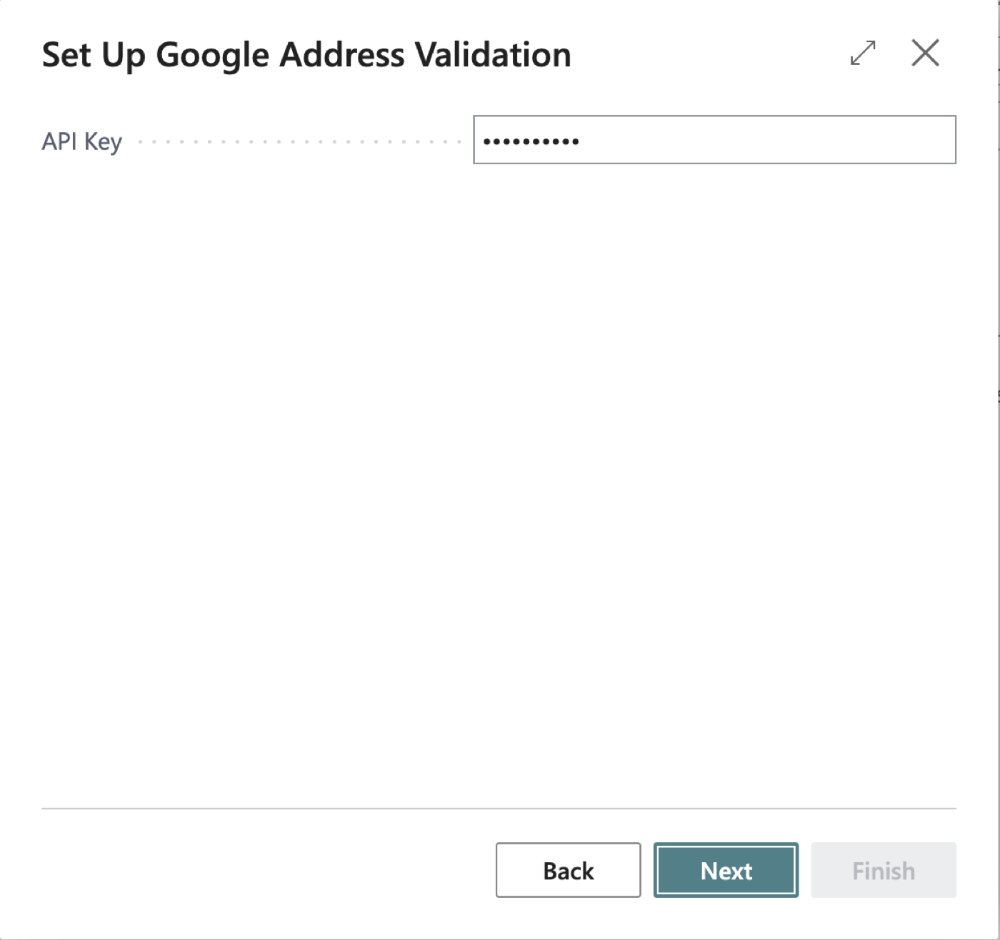
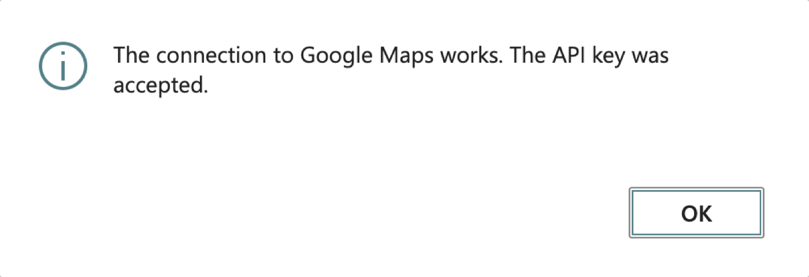

# Google side setup — what you need before Google Address Validator can work

**Written for:** the person who administers the Google account and Business Central for this extension (AJ Ansari). No Google Cloud experience assumed.
**As of:** October 17, 2026. Google's pages and prices were read on 2026-10-17 (most were last updated by Google on 2026-10-15). Console screens and prices change; where this guide says "read on", the source is named so you can recheck it.
**Applies to:** Google Address Validator 0.0.0.7 and later; the current build is 1.3.0.0. This guide is separate from `docs/4-prove/Deployment.md` (the install procedure) and `docs/4-prove/SandboxInstall.md` (uploading the package).

## What you need, in one line
**One value: a Google Maps Platform API key** from a Google Cloud project that has **billing turned on** and the **Address Validation API enabled**. You paste that key into Business Central. Nothing else from Google goes into the extension.

You do **not** need: a client ID or secret, OAuth, a service account, a JSON key file, a USPS account, a Google Maps JavaScript key, or any other Google API. The extension sends one request per address check to Google's Address Validation API and nothing else.

## Cost, in plain words
- The API is pay-as-you-go. The extension uses the **Address Validation Pro** price: **5,000 free requests a month**, then **$17.00 per 1,000** up to 100,000 a month (read on 2026-10-17: https://developers.google.com/maps/billing-and-pricing/pricing, last updated by Google 2026-10-15). At your stated volume (under 1,000 checks a month) the expected cost is **$0**.
- **One price for every country.** Address Validation Pro costs the same in all 40 countries the extension supports (from 1.2), and the 5,000 free requests a month are shared by all countries and all users of the key. Google gives a higher free allowance (35,000 a month) only to billing accounts that are billed at India pricing; that depends on your Google billing account, not on the country of the address, and no separate API key is needed for India (figures from the FRD and Google's documentation; recheck the price page). Only the United States and Puerto Rico return USPS delivery data. The list of countries Google covers was read on 2026-10-18: https://developers.google.com/maps/documentation/address-validation/coverage.
- Google still requires a **billing account with a payment method** even when you stay inside the free allowance.
- The extension's **Test Connection** is designed to cost nothing (an intentionally incomplete request). That is a design assumption: it has not been confirmed against Google's billing report (open item, TDD §14.y).
- Google's pricing page says changes to "discounts and credits" are coming; recheck the price page before go-live.

## Step 1. Sign in with a Google account
1. Use a Google account that your company controls (not a personal one if the project should outlive you). A Google Workspace account is the usual choice.
2. Sign in at <https://console.cloud.google.com/>. Accept the Google Cloud terms if asked. If you are in the European Economic Area, Google notes that the EEA Terms of Service apply from 8 July 2025.

## Step 2. Set up billing (this is the sign-up that needs a payment method)
Pick **one** of these paths.

**A. You have never used Google Cloud, Google Maps Platform or Firebase as a paying customer (new customer)**
1. In the console, use the **Activate** / **Start free** prompt (or go to <https://cloud.google.com/free>).
2. Provide a credit card or other valid payment method. Depending on your country you may also have to verify a bank account.
3. Google places a temporary authorization hold, typically $0.00 to $1.00, released within days to a month. It is not a charge.
4. You get the **Free Trial**: a **$300 credit for 90 days**, plus the Free Tier's monthly limits. The trial ends when you upgrade to a paid billing account, spend the credit, or 90 days pass. **If the trial closes without an upgrade, your resources are stopped and permanently deleted after a 30-day grace period**, so upgrade to a **Paid billing account** (console: **Billing**) before the 90 days end, or the API key will stop working. The trial cannot request quota increases. (Source, read 2026-10-17: https://docs.cloud.google.com/free/docs/free-cloud-features)

**B. You already have a paying Google Cloud / Maps Platform billing account**
1. Use it. You need a role on it that lets you link projects: **Billing Account User** (`roles/billing.user`) together with **Project Creator**, or ask the person who owns billing to do Step 3 with you.

Write down which billing account you used. You will need to choose it in Step 3.

## Step 3. Create a Google Cloud project just for this extension
Use a **new, dedicated project** (for example "BC Address Validation"). A dedicated project keeps the key, quota, budget and bill for this one use, and makes rotating or deleting it safe.
1. Console → **Manage resources** page → **Create project**.
2. Enter a project name and select the **billing account** from Step 2. (You can only select a billing account if you hold the **Billing Account User** role; otherwise link it afterwards.)
3. Leave the parent as **No organization**, or choose your organization or folder.
4. Choose **Create**. You need the **Project Creator** permission (`resourcemanager.projects.create`), which new free-trial users and new organizations have by default.
5. Confirm the project is linked to billing (console **Billing** page shows the project under the account). (Source, read 2026-10-17: https://docs.cloud.google.com/resource-manager/docs/creating-managing-projects)

## Step 4. Enable the Address Validation API on that project
1. Make sure the new project is the selected project in the console's project picker.
2. Open the Google Maps Platform in the console (<https://console.cloud.google.com/google/maps-apis>), find **Address Validation API** in the API library, and choose **Enable**.
3. If the API is not listed, enable it from the API library by searching for "Address Validation API". Google's note: an API that is not enabled cannot be added to a key's restrictions. (Source: https://developers.google.com/maps/documentation/address-validation/cloud-setup)

If this step is skipped, Business Central will later show: *The Address Validation API is not enabled in the Google Cloud project of this API key. Contact your administrator.*

## Step 5. Create the API key and restrict it
1. Console → **Google Maps Platform** → **Credentials** (also reachable from **APIs & Services → Credentials**).
2. Choose **Create credentials → API key**. Copy the key when it appears; it looks like a string of about 39 characters starting with `AIza`.
3. Open the new key (**Edit API key**) and, under **API restrictions**, choose **Restrict key**, open **Select APIs**, choose **only Address Validation API**, and **Save**. (Source, read 2026-10-17: https://developers.google.com/maps/api-security-best-practices)
4. **Application restriction (IP addresses):** Google recommends restricting server-side keys by IP address, but the addresses must match the source IP Google sees, and Google itself notes this is impractical for cloud environments with dynamic IPs. Business Central online runs the call from Microsoft's datacenters and does not give you a fixed address you control, so **do not set an IP restriction unless you have confirmed the addresses** (a wrong IP restriction makes every check fail with a "key not allowed" error). The API restriction in step 3 plus the quota cap and budget alert below are the protections this project relies on. This is a judgement, not something verified against your environment: if your Business Central environment calls out through a fixed-IP proxy, restrict to that IP.
5. Give the key a recognisable name (for example "BC address validation") so you can tell it apart later.
6. Keep the key secret: do not email or paste it into chat. It authorises billable requests on your project.

## Step 6. Set a daily quota cap (the one setting that actually stops spending)
A **budget alert only warns; it does not stop spending**. A **quota cap** makes the API stop answering when reached.
1. Console → **Google Maps Platform → Quotas**.
2. Select **Address Validation API**, find the daily quota for validation requests, choose **Edit**, enter a limit (for example **100 per day**, which is far above your expected volume), and choose **Submit request**. Review requests under **Increase Requests**. (Source, read 2026-10-17: https://developers.google.com/maps/documentation/address-validation/usage-and-billing)
3. Google's default limit is 6,000 queries per minute; when a quota is reached "your service stops responding". Business Central then shows: *The Google Maps request limit has been reached. Try again later.*
4. The cap is a go-live task recorded as FRD open question OQ-25.

## Step 7. Set a budget alert (so you find out about unexpected cost)
1. Console → **Billing → Budgets & alerts** (under Cost management) → **Create budget**.
2. Choose **Alerts only**, give it a name, and choose **Next**.
3. Scope: select the project from Step 3 (and optionally the service Maps Platform). Time range: **monthly**.
4. Amount: **Specified amount**, for example **$1** (your expected spend is $0, so any charge is worth knowing about).
5. Keep the default thresholds (50%, 90%, 100% of **Actual** spend) and make sure someone who reads email is a recipient (billing administrators are notified by default).
6. **Finish.** You need the **Billing Account Administrator** or **Billing Account Costs Manager** role, or project-level billing permissions. Google notes alerts can arrive **hours** late because usage reporting is delayed. (Source, read 2026-10-17: https://docs.cloud.google.com/billing/docs/how-to/budgets)

## Step 8. Put the key into Business Central
1. Install the extension (see `docs/4-prove/SandboxInstall.md`) and assign yourself **OBCFGAV GAV, ADMIN** (permission set name from the code).
2. Search **Assisted Setup** → **Set up Google address validation**; on the key step paste the **API key** from Step 5 and choose **Finish**. Or open **Address Validation Setup** and paste it in the **API Key** field under **Google Maps**.
   
3. On **Google Address Validation Setup**: turn **Enabled** on; leave **Provider** (Google Maps, read-only); check **Blank Country Handling** (**Let Google decide**, the default, works the country out of a record with a blank Country/Region Code; choose **Use default country** if you only check one country) and leave **Default Country/Region Code** as `US` (it is the country used for a blank-country record under Use default country; a country guessed as US or Canada that is not found costs a second request); leave **Timeout** at 10 seconds. Then open **Supported Countries** from the setup page (or search for **Google Address Validation Supported Countries**): all 40 countries are switched on after install and upgrade, so **switch off the countries whose addresses you do not want sent to Google** before users start validating. This matters most for employee and contact addresses outside the United States.
4. Choose **Test Connection**. The first time, Business Central shows a **privacy notice** for sending addresses to Google; an administrator's Agree applies to everyone. (The notice's platform text says data is shared with "Microsoft services"; that text cannot be changed by the extension, and the Google privacy link it points to is not yet confirmed — Roadmap R-12-1.)
   
5. Expected result: *The connection to Google Maps works. The API key was accepted.*
6. The key cannot be read back after you save it. If you lose it, create a new one in Step 5 and paste it again.

Also check that **Allow HttpClient Requests** is on for the extension in the environment (Business Central Admin Center / Extension Management). Whether it is on by default in your environment is open question OQ-20.

## Step 9. Make a real check
1. Open a customer with a real address in a supported country, choose **Validate Address** on the Customer Card, and follow `docs/4-prove/HumanUnitTestScript.md`.
2. Use **real addresses only**. Google's terms forbid sending made-up or artificially created addresses to the service. Brazil, Mexico, India (preview) and Japan (preview) are switched on but their results have not been seen: try a few real addresses in each country you rely on before depending on it.
3. Record what you see against the "live Google" checklist in the HumanUnitTestScript (TDD §14.y): that the key header is accepted, the error wording for a bad key and a disabled API, and that Test Connection costs nothing in the billing report.

## When something goes wrong
| Business Central says | Most likely cause | What to do |
|---|---|---|
| Google Maps rejected the API key. Contact your administrator. | Key typed wrongly, deleted, or from the wrong project | Create or copy the key again (Step 5), paste it again |
| The Address Validation API is not enabled in the Google Cloud project of this API key. | Step 4 skipped, or key belongs to another project | Enable the API on the project that owns the key |
| Billing is not enabled for the Google Cloud project of this API key. | Step 2/3 not completed, or the free trial ended | Link a paid billing account to the project |
| The API key is not allowed to call the Address Validation API. Check the key's restrictions. | API restriction excludes Address Validation, or an IP restriction does not match | Edit the key (Step 5); remove the IP restriction if unsure |
| The Google Maps request limit has been reached. Try again later. | Your daily cap (Step 6) was reached | Wait, or raise the cap |
| Google Maps is not responding. Try again later. | Network or Google outage, or HttpClient requests are off | Check **Allow HttpClient Requests**; retry later |

## Rotating the key (if it leaks, or on a schedule)
1. Console → **Google Maps Platform → Credentials** → open the key → **Rotate key**. The new key keeps the old key's restrictions and **both keys work during the transition**.
2. Paste the new key into Business Central (Step 8).
3. Confirm checks work, then choose **Delete the previous key** under **Previous Key**. (Source, read 2026-10-17: https://developers.google.com/maps/api-security-best-practices)
4. This replaces the old 72-hour USPS incident duty: there is no such duty for this Google setup; rotating the key is the response to a suspected leak.

## Checklist
- [ ] Billing account with a payment method; trial upgraded to **Paid** before it expires
- [ ] Dedicated project created and linked to billing
- [ ] Address Validation API enabled
- [ ] API key created, restricted to **Address Validation API only**, copied somewhere safe
- [ ] Daily quota cap set (Step 6)
- [ ] Budget alert set with an email recipient (Step 7)
- [ ] Key pasted in Business Central, **Enabled** on, privacy notice answered, **Test Connection** passed
- [ ] **Allow HttpClient Requests** on
- [ ] One real address checked end to end

## Not verified
- I read Google's public pages on 2026-10-17; the console screens themselves were not opened, so a button or menu may be named slightly differently in your console.
- The Google privacy link used in the extension (`https://policies.google.com/privacy`) and the app's own Terms of Use / Privacy Policy fields (OQ-29) are unconfirmed.
- Nothing in this extension has run against Google yet: the live behaviour (header accepted, exact error reasons, Test Connection billing) is the open spike in TDD §14.y.
