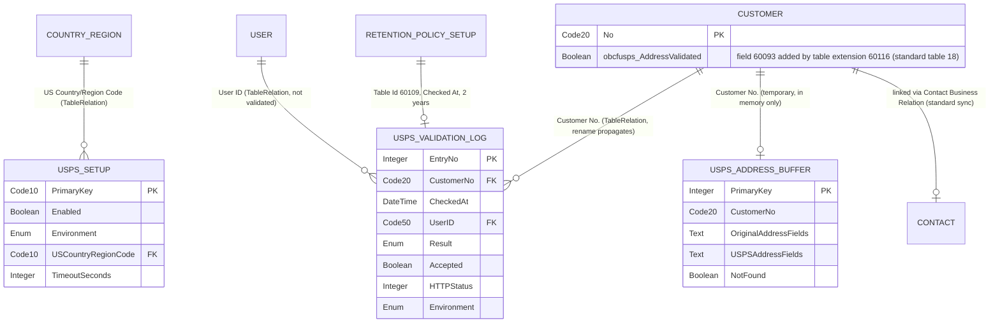

# USPS Address Validator — Technical Documentation

**Version:** 0.0.0.4 · **Date:** 2026-10-16 · **Generated from:** the AL source in `src/` (working tree on top of commit af839f4; the 0.0.0.3 and 0.0.0.4 changes are not yet committed) and `docs/4-prove/PostDevTDD.md`

## 1. Overview
USPS Address Validator (publisher OnlyBCFans, namespace `OnlyBCFans.USPSAddress`, prefix `obcfusps`, object ID ranges 60093–60122 and 60134–60142, target Cloud, runtime 17.0, platform and application 28.0.0.0) adds one action to the Customer Card, **Validate Address (USPS)**. It sends the customer's street address, city, state and ZIP to the US Postal Service Addresses API, compares the answer with what is on the customer, and lets the user accept or ignore USPS's version in a side-by-side dialog. Every check that reaches USPS writes one row to a read-only validation log, and an **Address Validated** Yes/No flag on the customer records whether the current address was confirmed. The customer's name and number are never sent.

It is for US customers only. A customer whose Country/Region Code is blank or equals the configured US code is checked; any other country is refused before anything is sent. An administrator enters the USPS Consumer Key and Consumer Secret once per company (Assisted Setup wizard or the setup card); they are kept as secrets in isolated storage. The extension talks to USPS through OAuth client credentials (token endpoint `/oauth2/v3/token`) and the address endpoint `/addresses/v3/address`, on either `https://apis.usps.com` (Production) or `https://apis-tem.usps.com` (Test, "TEM").

**This extension has no API pages and no API queries.** Nothing is exposed over OData or REST. The "API" other extensions can use is the public AL surface described in §3 (public codeunits, one interface, the Customer table extension field). Section 3 replaces the template's per-API-page sections.

## 2. Architecture
### 2.1 Schema diagram
The diagram was rendered with `@mermaid-js/mermaid-cli` under Node v24.11.1 (`npx --yes @mermaid-js/mermaid-cli -i erd.mmd -o erd.svg` exited 0 and produced an SVG) before this document was committed. Tables owned by this app: `USPS_SETUP` (60095), `USPS_VALIDATION_LOG` (60109), `USPS_ADDRESS_BUFFER` (60111, temporary, never stored). Standard (Microsoft) tables: `CUSTOMER` (18, extended by table extension 60116), `USER`, `COUNTRY_REGION`, `RETENTION_POLICY_SETUP`, `CONTACT`.

How to read it: the standard side of every relationship is the one named in capitals without an `USPS_` prefix (`COUNTRY_REGION`, `CUSTOMER`, `USER`, `RETENTION_POLICY_SETUP`, `CONTACT`); `USPS_*` tables belong to this app.
- **Setup to Country/Region:** many setup rows can point at one country in principle, but the setup table is a single-row table (Primary Key `''`), so in practice it is 1 to 0..1.
- **Log to Customer:** one customer, many log rows. `Customer No.` has a validated TableRelation, so a customer rename rewrites the log rows. This extension adds no delete check of its own.
- **Log to User:** `User ID` carries `TableRelation = User."User Name"` with `ValidateTableRelation = false`, so a log row keeps its user name even after the user is deleted.
- **Address Buffer** is a temporary table (`TableType = Temporary`): one row per check, in memory only, shared between the API client, the orchestrator, the comparison dialog and the writer. It has no database footprint.
- **Retention Policy Setup** is not a foreign key. Codeunit 60100 inserts a Retention Policy Setup row for table 60109 (filter field `Checked At`), disabled, with a custom 2-year period `OBCFUSPS-2Y`.
- **Contact** is not touched by an explicit relation. Accepting a suggestion calls `Customer.SetForceUpdateContact(true)` before `Modify(true)` so that Business Central's own Customer-to-Contact synchronisation updates the linked Contact. Whether that sync fires from code was never confirmed in a sandbox (Gap G17).

### 2.2 Modules and objects
Source folders: `src/Setup/` (module A: configuration, credentials, onboarding) and `src/Validation/` (module B: the check itself). The test app (objects 60123–60127, sibling repository `USPSAddressValidator.Tests`) is separate and not shipped to customers.

| Module | Objects (ID — type — name) | Purpose |
|---|---|---|
| A Setup | 60093 — enum — obcfusps Validation Result | Outcome of a check: ` `, Confirmed, Suggestion Accepted, Suggestion Ignored, Not Found, Error. `Extensible = false`. |
| A Setup | 60094 — enum — obcfusps USPS Environment | ` `, Production, Test (TEM). `Extensible = false`. |
| A Setup | 60095 — table — obcfusps USPS Setup | Single-row setup: Enabled, Environment, US Country/Region Code, Timeout. |
| A Setup | 60096 — page (Card) — obcfusps USPS Setup | Setup card, Administration search; Test Connection and Assisted Setup actions. |
| A Setup | 60097 — page (NavigatePage) — obcfusps USPS Setup Wizard | Assisted Setup wizard: Welcome, Credentials, Finish. |
| A Setup | 60098 — codeunit — obcfusps USPS Credential Mgt. | Stores and reads the Consumer Key, Consumer Secret and cached access token in isolated storage. `Access = Public`; setters are caller-checked. |
| A Setup | 60099 — codeunit (Install) — obcfusps USPS Install | `OnInstallAppPerCompany` calls `RegisterAll`. `Access = Internal`. |
| A Setup | 60100 — codeunit — obcfusps Setup Registration | Registers the retention policy, Assisted Setup entry and privacy notice; subscribes to Company-Initialize. `Access = Internal`. |
| A Setup | 60101 — permission set — OBCFUSPS USPS, USE | Permissions for users who validate addresses. |
| A Setup | 60102 — permission set — OBCFUSPS USPS, ADMIN | USE plus setup and log maintenance. |
| B Validation | 60109 — table — obcfusps USPS Validation Log | One row per check that reached USPS. |
| B Validation | 60110 — page (List) — obcfusps USPS Log Entries | Read-only log, newest first. |
| B Validation | 60111 — table (temporary) — obcfusps USPS Address Buffer | In-memory carrier of the original address, the USPS answer and failure details. |
| B Validation | 60112 — page (StandardDialog) — obcfusps USPS Address Compare | Side-by-side comparison dialog; OK accepts, Cancel ignores. |
| B Validation | 60113 — codeunit — obcfusps Address Validation | Orchestration and the main public entry point. `Access = Public`. |
| B Validation | 60114 — codeunit — obcfusps USPS API Client | Token handling, request building, response parsing. `Access = Public` (Gap G4). |
| B Validation | 60115 — codeunit — obcfusps USPS Http Transport | Default implementation of the transport interface (real `HttpClient`). `Access = Public`. |
| B Validation | 60116 — table extension — obcfusps Customer | Adds field 60093 and the reset triggers. |
| B Validation | 60117 — page extension — obcfusps Customer Card | Adds the field, the Validate Address (USPS) action, the log action. |
| B Validation | 60118 — codeunit — obcfusps Validation Writer | Write phase: updates the customer and inserts the log row. `Access = Public` (Gap G2). |
| B Validation | (no ID) — interface — obcfusps USPS Transport | Seam between the API client and the network, so tests can inject a fake. |

Counts: the as-built TDD's 25 allocated IDs include the 5 test-app objects; this app has 20 objects with IDs (60093–60102, 60109–60118) plus 1 interface. IDs 60103–60108, 60119–60122 and 60134–60142 are reserved growth space, unused.

## 3. API reference
**There are no API pages or API queries in this extension.** There is no route, no entity set, no OData endpoint and no webhook. Everything below is the AL surface that another extension (or a person at the UI) can use.

### 3.1 Quick-start for an administrator
1. **Get USPS credentials.** Create an application in the USPS developer portal and note its Consumer Key and Consumer Secret. (At the time of writing, USPS onboarding was reported blocked by a licence requirement; see §8.)
2. **Assign permission sets.** Give administrators `OBCFUSPS USPS, ADMIN` and everyone who validates addresses `OBCFUSPS USPS, USE`.
3. **Allow outgoing calls.** In Extension Management, open the extension's settings and set **Allow HttpClient Requests** to Yes. If it is off, a check can fail with a platform error (see Gap G5 and the troubleshooting table).
4. **Run the setup.** Open Assisted Setup, choose **Set up USPS address validation**, enter the Consumer Key and Consumer Secret, choose Finish. (The same two fields are on the setup card.)
5. **Open "USPS Address Validation Setup".** Tick **Enabled**, choose **Environment** (Production, or Test (TEM)), check **US Country/Region Code** (default `US`) and **Timeout (Seconds)** (default 10, range 1 to 60). TEM also needs your production Consumer Key and Consumer Secret.
6. **Choose Test Connection.** The first time, Business Central asks you to agree to the privacy notice for sending addresses to USPS. If you agree, the extension requests a token with your credentials. No address is sent and no address quota is used. You should see "The connection to USPS works. A token was received."
7. **Validate a customer.** Open a Customer Card whose Country/Region Code is blank or US, with a street address and either city and state or a ZIP code. Choose **Validate Address (USPS)** (promoted, also under Actions > Functions). Either you see "The address is confirmed by USPS. No changes are needed.", or the **USPS Address Suggestion** dialog opens: changed values are in bold; **OK** accepts the USPS address, **Cancel** keeps the current one.
8. **Review the log.** On the Customer Card choose **USPS Validation Log** (under the Customer menu), or search for "USPS Validation Log".

### 3.2 Public AL surface for other extensions
Object access is the one that matters: `Access = Public` objects are callable from other extensions; `internal` procedures are not. The caller-check rules in §3.3 apply to the procedures marked "caller-checked".

**Codeunit 60113 "obcfusps Address Validation" (`Access = Public`)**

| Procedure | Signature | Behaviour |
|---|---|---|
| `ValidateCustomerAddress` | `(CustomerNo: Code[20])` | Runs the check, shows the comparison dialog when the addresses differ, shows a message (e.g. the "confirmed" message) or raises an error with the user-facing text. Interactive. |
| `TryValidateCustomerAddress` | `(CustomerNo: Code[20]; var Outcome: Enum "obcfusps Validation Result"; var UserMessage: Text): Boolean` | The same check, returning instead of raising. Returns `true` for Confirmed, Suggestion Accepted, Suggestion Ignored and Not Found; `false` for any precondition failure, a refused privacy notice, an Error outcome, or a write failure. `Outcome` is cleared first and `UserMessage` carries the text to show. Note: it opens the comparison dialog (modal) when the addresses differ, so it is not for background jobs. |
| `SetTransport` | `(NewTransport: Interface "obcfusps USPS Transport")` | Replaces the HTTP transport (test seam). Caller-checked. |
| `CanModifyCustomers` | `(): Boolean` | True when the signed-in user's effective permission on table data Customer (18) includes Modify. |
| `ValuesDiffer` | `(BCValue: Text; USPSValue: Text): Boolean` | True when the two values differ after trimming leading and trailing spaces and ignoring upper/lower case. |

Preconditions checked by `TryValidateCustomerAddress`, in order, before anything is sent or logged: the customer exists; setup exists, Enabled, an Environment is chosen and both credentials are present; Country/Region Code is blank or equals the configured US code; the address is not blank and there is either a usable ZIP (at least 5 characters whose first five are digits) or both City and State; State, if filled in, is a 2-letter code; the BC privacy notice `OBCFUSPS-ADDRESS` has been agreed to.

**Codeunit 60098 "obcfusps USPS Credential Mgt." (`Access = Public`)**

| Procedure | Signature | Notes |
|---|---|---|
| `SetConsumerKey` | `(NewValue: SecretText)` | Caller-checked. `[NonDebuggable]`. Stores the key (encrypted when the tenant has encryption enabled), deletes the cached token, and completes the Assisted Setup entry when both credentials are now present. An empty value deletes the stored key. |
| `SetConsumerSecret` | `(NewValue: SecretText)` | Same as above for the secret. |
| `ClearToken` | `()` | Caller-checked. Deletes the cached access token and its expiry. |
| `HasConsumerKey`, `HasConsumerSecret`, `HasCredentials` | `(): Boolean` | Presence checks only; the values cannot be read back by other extensions. |
| `GetConsumerKey`, `GetConsumerSecret`, `GetCachedToken`, `SetCachedToken`, `CheckCallerAllowed` | `internal` | Not callable from other extensions. |

Storage keys (company scope): `OBCFUSPS-ConsumerKey`, `OBCFUSPS-ConsumerSecret`, `OBCFUSPS-AccessToken`, `OBCFUSPS-TokenValidUntil`. The token is cached until 60 seconds before USPS says it expires, and is dropped if USPS gives an `expires_in` of 60 seconds or less (or none). Changing the Environment on the setup card clears the cached token.

**Codeunit 60114 "obcfusps USPS API Client" (`Access = Public`, Gap G4)**

| Procedure | Signature | Notes |
|---|---|---|
| `SetTransport` | `(NewTransport: Interface "obcfusps USPS Transport")` | Caller-checked. |
| `TestConnection` | `(var ErrorText: Text): Boolean` | Forces a new token request. False with a user-facing reason when credentials or environment are missing or USPS refuses. |
| `ValidateAddress` | `(var TempAddressBuffer: Record "obcfusps USPS Address Buffer" temporary): Boolean` | Needs `Original *` fields filled. Gets or reuses a token, calls the address endpoint, fills the `USPS *` fields and failure details. Retries once with a fresh token if a cached token gets HTTP 401 or 403. **Any extension can call this with the company's stored credentials and no user decision and no log row**: this is Gap G4. |

**Codeunit 60118 "obcfusps Validation Writer" (`Access = Public`, Gap G2)**

| Procedure | Signature | Notes |
|---|---|---|
| `Init` | `(NewCustomerNo: Code[20]; NewOutcome: Enum "obcfusps Validation Result"; var TempResult: Record "obcfusps USPS Address Buffer" temporary; NewAccepted: Boolean; NewCanModify: Boolean)` | Sets up a write. |
| `Run` (`OnRun`) | `Codeunit.Run` | Accepted: re-reads the customer under `LockTable`, refuses to write if the customer's address no longer equals the snapshot, otherwise writes the five address fields, sets Address Validated = Yes, `SetForceUpdateContact(true)`, `Modify(true)`. Confirmed: sets the flag to Yes. Not Found: sets it to No. The flag is only changed if `NewCanModify` is true. Then inserts the log row. |
| `WasAddressChanged` | `(): Boolean` | True when the customer changed while the dialog was open, so nothing was written. |
| `InsertLogEntry` | `(LogCustomerNo; LogResult; var TempResult; LogAccepted)` | Inserts one log row from the buffer. The insert runs on the codeunit's own `tabledata "obcfusps USPS Validation Log" = i`, so **any extension can insert a log row, including a forged one, or set the flag without a USPS check**. This is Gap G2. Do not rely on the log as tamper-proof evidence. |

**Interface "obcfusps USPS Transport"** (no object ID), implemented by codeunit 60115 "obcfusps USPS Http Transport":

| Method | Signature | Contract |
|---|---|---|
| `SendTokenRequest` | `(Url: Text; RequestBody: SecretText; TimeoutMs: Integer; var HttpStatus: Integer; var ResponseBody: Text): Boolean` | POSTs the JSON body (`Content-Type: application/json`). Returns false when no HTTP response arrived (timeout, no connection, blocked); `HttpStatus` is 0 then. |
| `SendAddressRequest` | `(Url: Text; AccessToken: SecretText; TimeoutMs: Integer; var HttpStatus: Integer; var ResponseBody: Text): Boolean` | GETs the URL with `Authorization: Bearer <token>` and `Accept: application/json`. Same return contract. |

The token request body is `{"client_id", "client_secret", "grant_type": "client_credentials"}`, built with `JsonObject.WriteWithSecretsTo` so the credentials stay secret text. The address request is a GET to `/addresses/v3/address` with query parameters `streetAddress`, `secondaryAddress`, `city`, `state` (upper-cased), `ZIPCode` and `ZIPPlus4`, each only if not blank; ZIP+4 is taken from a 9- or 10-digit post code (`12345-6789` or `123456789`). The customer name and number are never sent.

### 3.3 Caller-check rules
- `SetConsumerKey`, `SetConsumerSecret`, `ClearToken` (60098), `SetTransport` (60113, 60114) read `NavApp.GetCallerModuleInfo` as their first statement and call the internal `CheckCallerAllowed`.
- A call is allowed when the caller is this app. It is also allowed from the test app (id `ebe1c8ca-a413-4f2b-9de7-37d8c1ae4d5a`) **only in a SaaS sandbox** (`Environment Information.IsSandbox()`). Anyone else, or the test app in production, gets the error "This procedure can only be called by the USPS Address Validator app."
- The caller must be read in the public procedure itself, never in a helper; in a helper it would always name this app and the check would pass for everyone.
- Procedures that are *not* caller-checked: `ValidateCustomerAddress`, `TryValidateCustomerAddress`, `CanModifyCustomers`, `ValuesDiffer`, `TestConnection`, `ValidateAddress`, every Writer procedure, and the `Has*` presence checks.

### 3.4 Customer table extension
Table extension 60116 "obcfusps Customer" extends table 18 Customer.

| Field | Type | Properties | Notes |
|---|---|---|---|
| 60093 "obcfusps Address Validated" | Boolean | Caption "Address Validated", `DataClassification = CustomerContent`, `InitValue = false`, `Editable = false` | Set to Yes when a check ends in Confirmed or Suggestion Accepted. Set to No on Not Found. Cleared (set to No) by the table extension whenever Address, Address 2, City, County (State) or Post Code is changed through validation on a customer that has the flag set. Errors leave it unchanged. Existing customers start at No. |

The table extension adds `OnAfterValidate` triggers on Address, Address 2, City, County and Post Code that call a local reset when any of the five differs from `xRec`. A direct assignment in AL code (without `Validate`) does not fire the triggers; this is how other code can leave the flag stale.

Page extension 60117 "obcfusps Customer Card" extends page 21 "Customer Card": field `Address Validated` after Post Code (read-only), action `Validate Address (USPS)` in `Functions` and promoted in `Category_Process` (it saves the card with `CurrPage.SaveRecord()` and a `Commit()` before the check), and action `USPS Validation Log` in `&Customer` (`RunPageLink = "Customer No." = field("No.")`, sorted by Customer No. and Checked At descending).

### 3.5 Tables and fields
**Table 60095 "obcfusps USPS Setup"** (`DataClassification = CustomerContent`; primary key `Primary Key`, one row, created on first open of the setup card)

| # | Field | Type | Notes |
|---|---|---|---|
| 1 | Primary Key | Code[10] | Key (clustered). |
| 2 | Enabled | Boolean | `InitValue = false`. When off, no check sends anything. |
| 3 | Environment | Enum "obcfusps USPS Environment" | `InitValue = Test`. Changing it clears the cached token. |
| 4 | US Country/Region Code | Code[10] | `InitValue = 'US'`; `TableRelation = "Country/Region"`. |
| 5 | Timeout (Seconds) | Integer | `InitValue = 10`, `MinValue = 1`, `MaxValue = 60`. |

The credentials are not in this table; they are in isolated storage (§6).

**Table 60109 "obcfusps USPS Validation Log"** (`DataClassification = CustomerContent`; primary key `Entry No.` (auto-increment); secondary key `CustomerCheckedAt` on `Customer No., Checked At`; `LookupPageId` and `DrillDownPageId` = page 60110; `OnInsert` requires `Customer No.`)

| # | Field | Type | Notes |
|---|---|---|---|
| 1 | Entry No. | Integer | Auto-increment. |
| 2 | Customer No. | Code[20] | `TableRelation = Customer."No."` (validated; rename propagates). |
| 3 | Checked At | DateTime | Set to the current date and time. The retention filter field. |
| 4 | User ID | Code[50] | `EndUserIdentifiableInformation`; `TableRelation = User."User Name"`, not validated. |
| 5 | Result | Enum "obcfusps Validation Result" | Confirmed, Suggestion Accepted, Suggestion Ignored, Not Found or Error. |
| 6 | Accepted | Boolean | True only for Suggestion Accepted that was written. |
| 7–11 | Original Address (100), Original Address 2 (50), Original City (30), Original State (30), Original ZIP Code (Code[20]) | Text/Code | What was on the customer when the check started. |
| 12–16 | USPS Address, USPS Address 2, USPS City, USPS State, USPS ZIP Code | Text[250] each | What USPS answered (ZIP and ZIP+4 joined with a dash). Blank when USPS gave no address. A write-failure Error row keeps what USPS answered. |
| 17 | DPV Confirmation | Code[10] | Caption "Delivery Point Confirmation". |
| 18, 19 | Match Codes, Correction Codes | Text[100] | Comma-joined USPS codes. |
| 20 | USPS Message | Text[2048] | USPS texts joined with "; ", or the USPS error message. |
| 21 | HTTP Status | Integer | 0 when no response arrived. |
| 22 | Environment | Enum "obcfusps USPS Environment" | Production or Test (TEM). |

**Table 60111 "obcfusps USPS Address Buffer"** (temporary): fields 1 Primary Key (Integer), 2 Customer No., 3–7 Original Address / Address 2 / City / State / ZIP Code, 8–12 USPS Address / Address 2 / City / State / ZIP Code (Text[250]), 13 DPV Confirmation, 14 Vacant, 15 Business, 16 Match Codes, 17 Correction Codes, 18 USPS Message (2048), 19 HTTP Status, 20 Not Found, 21 User Message (2048), 22 Environment. It is never saved to the database.

**Pages.** 60096 "obcfusps USPS Setup" (Card, `UsageCategory = Administration`, insert and delete not allowed; actions Test Connection (promoted) and Assisted Setup); 60097 "obcfusps USPS Setup Wizard" (NavigatePage, Back/Next/Finish, Next is enabled on the credentials step only when both fields are filled); 60110 "obcfusps USPS Log Entries" (List, `UsageCategory = Lists`, read-only, source view newest first); 60112 "obcfusps USPS Address Compare" (StandardDialog, read-only, source table 60111; shows the delivery warning for DPV code D, S or N, and notes for vacant, business and any USPS message).

### 3.6 Validation outcomes
| Result | When | Customer address changed | Address Validated |
|---|---|---|---|
| Confirmed | USPS address equals the BC address (trim, case-insensitive) | No | Set to Yes (only if the user can modify customers) |
| Suggestion Accepted | Addresses differ, user chose OK, the USPS values fit the field lengths, the user can modify customers, and the customer was not changed while the dialog was open | Yes (five fields) | Set to Yes |
| Suggestion Ignored | Addresses differ and the user chose Cancel or Esc, could not accept (no permission or a value too long), or the customer changed while the dialog was open | No | Unchanged |
| Not Found | USPS returned HTTP 404 | No | Set to No (only if the user can modify customers) |
| Error | HTTP 400, 401/403, 429, 5xx, no response, unreadable response, or a failed customer write | No | Unchanged |

Every check that gets past the preconditions and the privacy notice writes exactly one log row. A failure of a precondition (not set up, not US, address incomplete, State not 2 letters, notice not agreed) writes nothing.

## 4. Events
| Published / subscribed | Event | Object | Purpose |
|---|---|---|---|
| Subscribed | `Codeunit "Company-Initialize"`, `OnCompanyInitialize` | Codeunit 60100 "obcfusps Setup Registration" (`RegisterOnCompanyInitialize`) | Re-registers the retention policy, Assisted Setup entry and privacy notice in a newly created company. |
| Published | None | — | The extension publishes no integration or business events. |

Also, not events but install hooks: codeunit 60099 (`Subtype = Install`) runs `RegisterAll` once per company at install. There is no upgrade codeunit (§7).

## 5. Permission sets
| Set | Grants | Intended for |
|---|---|---|
| 60101 "OBCFUSPS USPS, USE" (Assignable) | Read on table data USPS Setup; RIMD on table data USPS Address Buffer (temporary); Read and Insert on table data USPS Validation Log; Execute on table 60095 and tables 60111, 60109, on codeunits 60098, 60114, 60115, 60113, 60118, 60100, and on pages 60110 and 60112 | Everyone who chooses Validate Address (USPS) |
| 60102 "OBCFUSPS USPS, ADMIN" (Assignable) | Includes USE; RIMD on table data USPS Setup; Read and Delete on table data USPS Validation Log; Execute on pages 60096 and 60097 and on codeunit 60100 | Administrators who set up credentials and may delete log rows |

Permissions the extension does **not** grant: any permission on table data Customer. A user who cannot modify customers can still run a check; the dialog then shows "You can't accept the USPS address because you don't have permission to change customers. Choose OK or Cancel to close without changes.", and Confirmed does not set the flag. Standard permission sets for Privacy Notice and Guided Experience are not included here and come from the user's other roles.

## 6. Setup and configuration
- **Setup card** (page 60096, search "USPS Address Validation Setup"): Enabled, Environment, US Country/Region Code, Timeout (Seconds), masked Consumer Key and Consumer Secret fields, a standing note that the Test (TEM) environment also uses your production credentials, and the actions Test Connection and Assisted Setup. The secret is write-only: once saved it shows as `********` and cannot be read back. Saving a key or secret deletes the cached token.
- **Assisted Setup** (Connect group, 5 minutes): "Set up USPS address validation". It is marked complete as soon as both credentials exist, from either the wizard or the setup card. The wizard only collects the credentials; environment, Enabled and Test Connection are on the setup card.
- **Credentials**: Consumer Key and Consumer Secret, company scope, in `IsolatedStorage`; stored with `SetEncrypted` when encryption is enabled in the tenant, otherwise plain `Set`. They are shared by everyone in the company, not per user.
- **Privacy notice** (Business Central Privacy Notice): id `OBCFUSPS-ADDRESS`, name "USPS Address Validation", link `https://about.usps.com/who/legal/privacy-policy/`. Created at install, on company creation, and again, if missing, before every approval check, so an upgraded environment has it. A user, or an administrator for the organisation, must agree before the first check or Test Connection. The link target has not been confirmed (FRD OQ-23), and the platform's consent text says data is shared with Microsoft services. What is sent to USPS: street address, secondary address, city, state, ZIP and ZIP+4. Never the customer name or number.
- **Retention policy**: Retention Policy Setup row for table 60109 on field `Checked At`, period code `OBCFUSPS-2Y` (custom, 2 years), **created disabled**. An administrator must enable it in Retention Policies if automatic clean-up is wanted.
- **Allow HttpClient Requests**: must be on for the extension in Extension Management for calls to reach USPS. Its default was not verified (OQ-20).
- **Networking**: outbound HTTPS to `apis.usps.com` (Production) or `apis-tem.usps.com` (Test) on the standard HTTPS port.

### 6.1 Error messages (shown to the user)
| Message | Raised when | Logged as |
|---|---|---|
| The customer was not found. | The customer number does not exist. | Not logged |
| USPS address validation is not set up. Contact your administrator. | No setup row, not Enabled, no Environment, or credentials missing. | Not logged (from the orchestrator); an Error row if it comes from the API client mid-check |
| USPS validates US addresses only. | Country/Region Code is neither blank nor the configured US code. | Not logged |
| Enter a street address and either city and state or ZIP Code. | Address blank, or no usable ZIP and City or State missing. | Not logged |
| Enter the 2-letter state code in the State field. | State filled in but not two letters. | Not logged |
| The privacy notice for sending addresses to USPS has not been agreed to, so nothing was sent. | Notice not approved (check). Test Connection says "…so the connection was not tested." | Not logged |
| USPS could not read the address: *USPS text* | HTTP 400 on the address call. | Error |
| USPS could not find this address: *USPS text* | HTTP 404. | Not Found |
| USPS rejected the credentials. Contact your administrator. | HTTP 400, 401 or 403 on the token call, or 401/403 on the address call after one token refresh. | Error |
| The hourly USPS limit has been reached. Try again later. | HTTP 429. | Error |
| USPS is not responding. Try again later. | HTTP 5xx, timeout or no connection. | Error |
| Unexpected response from USPS. Contact your administrator. | Any other status, a token reply without `access_token`, or an address reply that is not JSON or has no `address` object. | Error |
| Enter the Consumer Key and Consumer Secret first. | Test Connection with credentials missing. | n/a |
| Select the USPS environment first. | Test Connection with no environment. | n/a |
| The connection to USPS failed. *reason* USPS message: *text* | Test Connection failed. | n/a |
| The connection to USPS works. A token was received. | Test Connection succeeded. | n/a |
| The customer's address was changed while the USPS suggestion was open, so nothing was updated. Run Validate Address (USPS) again. | Customer changed under the open dialog. | Suggestion Ignored |
| You can't accept the USPS address because the USPS value for *field* is longer than *n* characters. Choose OK or Cancel to close without changes. | A USPS value does not fit the customer field. | Suggestion Ignored |
| This procedure can only be called by the USPS Address Validator app. | Caller check failed (§3.3). | n/a |

### 6.2 Troubleshooting
| Symptom | Likely cause | What to do |
|---|---|---|
| "USPS address validation is not set up." | Enabled is off, no environment chosen, or one of the two credentials is missing. | Open the setup card; tick Enabled, choose Environment, enter both credentials. |
| "USPS validates US addresses only." | Customer's Country/Region Code is something other than blank or the code in **US Country/Region Code**. | Correct the customer, or the US code on the setup card if your US code is not `US`. |
| "Enter a street address and either city and state or ZIP Code." | Address blank, or no ZIP of at least 5 digits and City or State blank. | Complete the address. |
| "Enter the 2-letter state code in the State field." | County field holds a name such as "Texas". | Use TX. |
| Nothing happens, or "…privacy notice … not been agreed to…" | Privacy notice not approved. | Agree to it when prompted (or ask an administrator). |
| Test Connection: "USPS rejected the credentials." | Wrong Consumer Key or Secret, or the wrong environment for them. | Re-enter both; check Environment. TEM uses the production credentials. |
| "The hourly USPS limit has been reached." | USPS rate limit (HTTP 429). | Wait and retry; the extension never retries by itself except for one token refresh. |
| "USPS is not responding." | USPS down, timeout, no outbound access, or Allow HttpClient Requests off. | Retry; raise **Timeout (Seconds)** (up to 60); check Allow HttpClient Requests and the firewall. |
| A raw platform error mentioning HTTP requests being blocked, and no log row | Allow HttpClient Requests is off. The extension is not expected to catch this (Gap G5). | Turn Allow HttpClient Requests on for the extension. |
| "USPS could not find this address: …" | USPS has no single match for the address (404). | Fix the address and retry. The customer's flag is set to No if it was Yes (and the user can modify customers). |
| "Unexpected response from USPS." | The reply did not have the expected shape. | Open the log row and read USPS Message and HTTP Status; report to the developer. |
| OK in the dialog does nothing, with a message that it can't be accepted | No Modify permission on Customer, or a USPS value longer than the customer field. | Ask for permission, or edit the address by hand. |
| After Accept, a linked Contact still has the old address | The Contact sync from code was not verified in a sandbox (Gap G17). | Update the Contact by hand and report it. |
| Log rows missing for a failed check | Preconditions that fail are never logged by design. | Not a defect. |
| Log grows without limit | The retention policy is created disabled. | Enable it in Retention Policies. |

## 7. Upgrade behaviour
- There is **no upgrade codeunit** in this version, and no data migration. Version 0.0.0.4 is the first set of builds; nothing was ever installed in a tenant, so no upgrade has been exercised.
- `OnInstallAppPerCompany` (codeunit 60099) registers the retention policy, Assisted Setup entry and privacy notice. The same registration runs for new companies through Company-Initialize, and the privacy notice is re-created before each approval check, so an environment installed before the notice existed still works.
- Schema: the app adds tables 60095, 60109 (and temporary 60111) and field 60093 on Customer. Packages built so far are additive only, so upload with Schema Sync Mode = Add. Check the "Package built:" block of the specific build.
- No object is obsolete. No `ObsoleteState` is used.
- Adding a new Environment or Result enum value later is a code change: both enums are `Extensible = false`.

## 8. Known limitations
Plain-language limitations carried from `docs/4-prove/PostDevTDD.md` (Part B-13) and `docs/4-prove/GapAnalysis.md`.

- **Never run in a tenant (G15).** Both packages compile with 0 errors and 0 warnings, but neither has been installed in a Business Central tenant. None of the 34 automated tests and none of the manual acceptance tests has been run. Treat the behaviour in this document as designed, not proven.
- **The real USPS service is unverified (G16).** The live contract (is `state` required, the type of `expires_in`, the shape of error bodies) has never been exercised against TEM or Production because USPS onboarding was blocked. The extension reads responses field by field and tolerates missing fields, but a real response may still surprise it.
- **Platform behaviours unchecked (G17).** Whether the Contact linked to a customer is updated when the address is accepted; the visibility of US-specific captions and the State field for a customer with a blank country; and the default of Allow HttpClient Requests.
- **Blank USPS fields can be accepted (G3).** If USPS answers HTTP 200 with an address object whose street, city, state or ZIP is blank, the extension treats it as a valid suggestion. Choosing OK would write the blanks over the customer's address and set Address Validated = Yes. Review the dialog before pressing OK.
- **Any extension can write the log and the flag (G2).** Codeunit 60118 is public: another extension could set Address Validated = Yes without a USPS check, or insert a forged log row. Do not use the log as tamper-proof evidence.
- **Any extension can use the stored credentials in a loop (G4).** Codeunit 60114 is public: another extension could call `ValidateAddress` repeatedly, with no user decision and no log row, using up the company's USPS quota.
- **A blocked HTTP call may raise instead of logging (G5).** If Allow HttpClient Requests is off, the platform may raise an error out of the HTTP call; the check would then stop with no Error row in the log. Not yet observed.
- **Only one address at a time.** There is no batch validation; the check is per customer, per user action.
- **US only.** Addresses in any other country are refused. Customers with a blank country are assumed to be US.
- **Customer only.** Vendors, contacts, ship-to addresses, sales documents and other address fields are not validated.
- **State must be a 2-letter code.** A full state name is refused before anything is sent.
- **English (United States) only.** No translation files ship.
- **USPS error text reaches the user only for HTTP 400 and 404.** For credential, quota, server and unreadable-response errors the user sees a fixed message; the full USPS text is in the log. At most two HTTPS calls per check in the normal case, three when a cached token is rejected and refreshed once.
- **The access token is stored with plain `IsolatedStorage.Set`** (the consumer key and secret use `SetEncrypted` when encryption is on). Decision stands (CR9-03).
- **Privacy notice link not confirmed (OQ-23)**, and the platform's wording says data is shared with Microsoft services; check both before release.
- **Provider change not built.** A change request (CR-1) to use a different address provider is an unsigned draft and is not in this code.
- **The test app runs only in a SaaS sandbox**; the caller check accepts it nowhere else.

## Before calling this done
- [x] Every object in the Object Register is documented in §2 or §3.
- [x] Every diagram was rendered and checked. (Node v24.11.1; `npx --yes @mermaid-js/mermaid-cli` exited 0 and wrote an SVG.)
- [x] Every example marked *illustrative* is marked so. (No request or response examples are included, because nothing has been run against USPS, so there is nothing to mark.)
