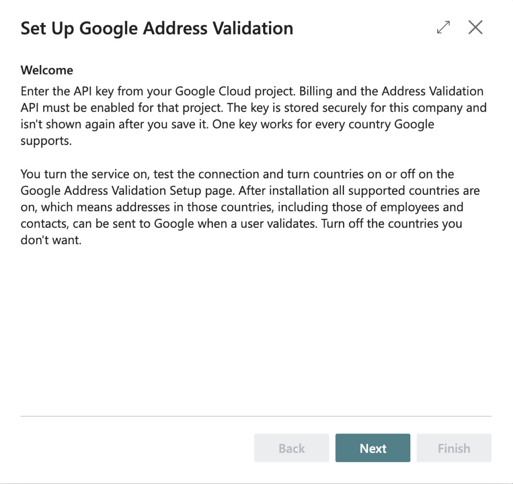
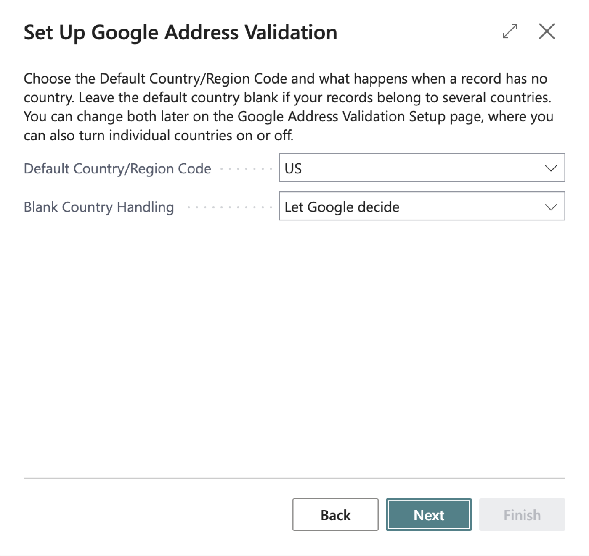
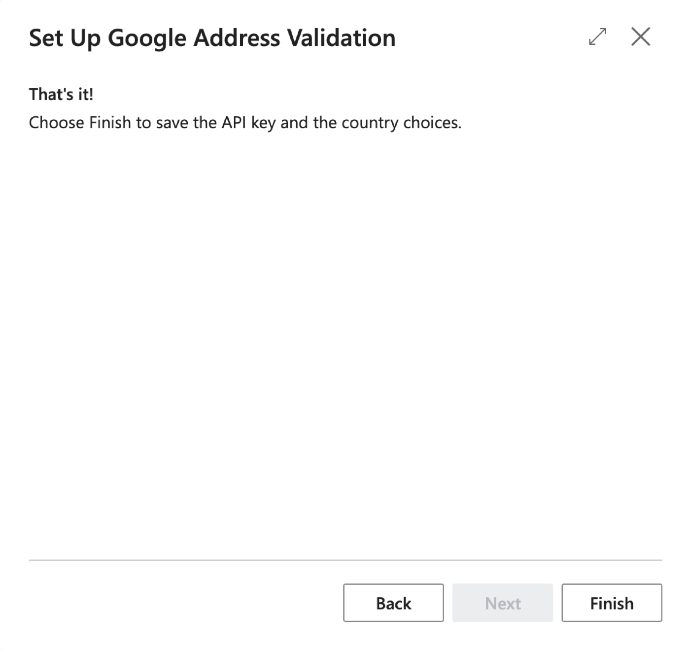
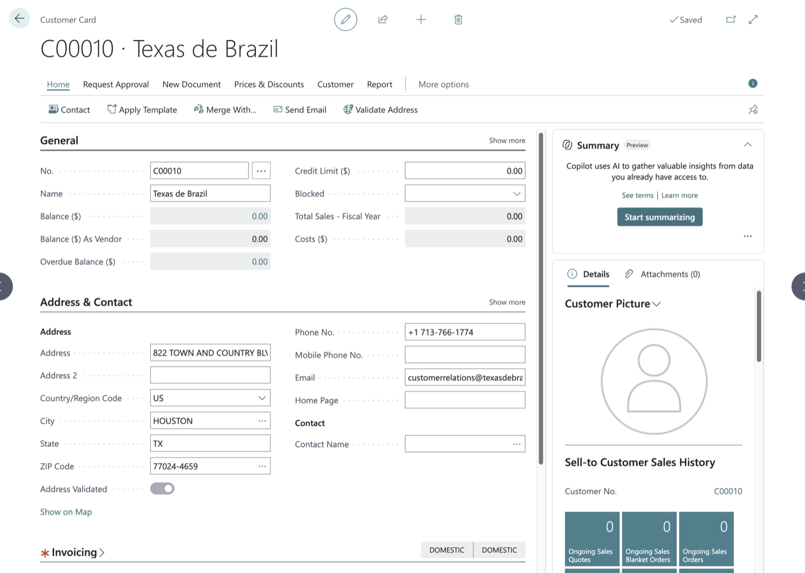
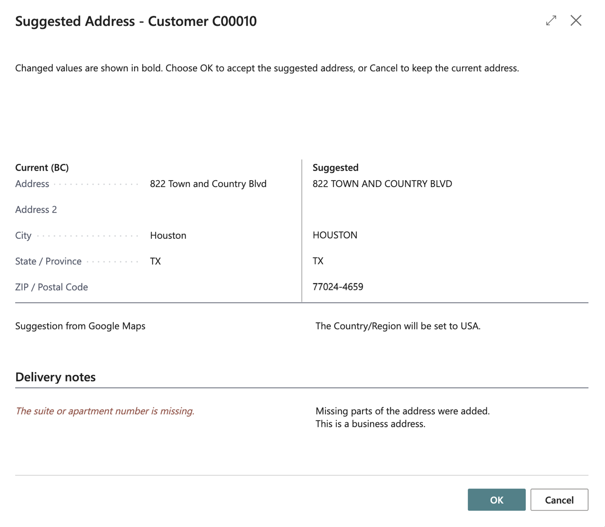
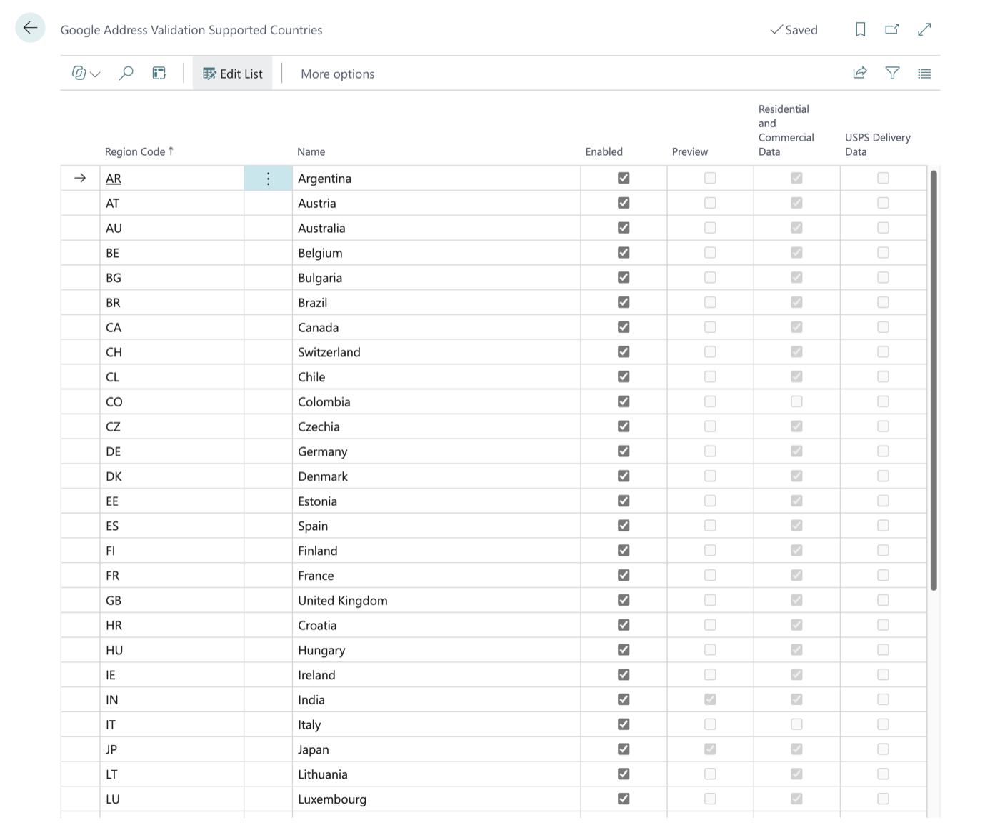

# Google Address Validator — User Guide

**Version:** 1.3.0.0 (previous build 1.2.0.5; 1.0.0.0 text kept; what 1.1 adds is in sections 4.6 to 4.11, and what 1.2 adds is in section 4.12) · **Date:** 2026-10-19 · **Language:** English (United States) · **For:** customer service and sales administration staff who maintain customers, vendors, contacts, employees, resources, locations and bank accounts, the people who maintain Company Information, and the Business Central administrator who sets the extension up

> **Version 1.3.0.3.** Works on 16 cards (Customer plus 15 more master-data cards) in the 40 countries Google covers. Version 1.0.0.0 and 1.2.0.4 passed the manual release test in a sandbox.

## 1. What this extension does for you
Google Address Validator checks an address with Google Maps while you are on the card of the record that holds it. You see your address and Google's suggested version side by side, and you can accept the suggestion with one click or keep what you have. A read-only **Address Validated** field on the record tells you whether the current address has been confirmed or accepted, and every check that reaches Google is written to a log.

**New in version 1.2:** validation is no longer limited to the United States. It works in the 40 countries and regions Google covers (section 4.12), and a blank Country/Region Code is filled in from the country Google found.

**New in version 1.1:** this works on the Customer Card (as before) and on 15 more cards: Ship-to Address, Customer Bank Account, Vendor, Order Address, Remit Address, Vendor Bank Account, Company Information (the company address and the ship-to address), Location, Responsibility Center, Bank Account, Employee, Alternative Address, Contact, Contact Alternative Address and Resource. The lists are in section 3, and the changes are in sections 4.6 to 4.11. Nothing else about the customer changed except five small points, listed in section 4.10.

## 2. Before you start
- **Permission set.** To validate addresses you need `OBCFGAV GAV, USE` ("Google Address Validator - Use"). To set the extension up, enter the API key or change the setup you need `OBCFGAV GAV, ADMIN` ("Google Address Validator Admin"). Your Business Central administrator assigns these on the **Users** page.
- **To accept a suggested address** you also need your normal permission to modify the table you are checking (customers on the Customer Card, vendors on the Vendor Card, and so on). Without it you can still run the check and see the suggestion, but you cannot accept it. The permission sets above do not include any of these; they come from your usual Business Central permissions. Where Business Central also updates a linked record (section 4.8), you need permission to modify that record too, or accepting ends in a logged error and nothing changes. Company Information normally needs an administrator.
- **Setup must be done once per company**, by an administrator (section 4.1). Until then the check tells you that validation is not set up.
- **The API key is your company's own.** It belongs to your company's Google Cloud project, which must have billing and the Address Validation API turned on. The extension does not supply a key.
- **Every check is a billable Google request.** Google's free allowance covers low volume (see the FRD: Google currently includes 5,000 free requests a month, shared by all countries, and the expected volume here is well below that; the price after that is in section 4.12), but each check you run counts as one request on your company's Google account. Check one customer when you need to; do not run checks just to try things out on real data.
- **Check one customer at a time, by hand.** There is no automatic or bulk validation, and the check is for interactive use only (not for scheduled jobs or integrations).
- **Addresses in 40 countries can be checked (from 1.2).** The record's Country/Region Code must be one of the countries on the Supported Countries page (section 4.12) and that country must be switched on. What happens to a record with a blank Country/Region Code depends on the **Blank Country Handling** setting (section 4.12): by default Google works the country out from the address. A country Google does not cover, or one an administrator switched off, is refused before anything is sent. For Company Information the rule is applied to the address being checked: the company address uses Country/Region Code, the ship-to address uses Ship-to Country/Region Code.

## 3. Getting there
- **Validating an address:** open a customer (search for **Customers**, then open the **Customer Card**). The action is **Validate Address**, shown on the ribbon and also under **Actions**, then **Functions**. The other cards have the same action (the table below).
- **The Address Validated field:** on the Customer Card, in the Address & Contact FastTab, right after **Post Code**. On the other cards it is next to the address, as the table below says.
- **The log for one record:** on the Customer Card, under **Customer**, choose **Google Address Validation Log**. The other cards have the same action in their own menu (the table below). The whole log is also found by searching for **Google Address Validation Log**, or just for **Google** or **address validation**.
- **Supported countries:** search for **Google Address Validation Supported Countries**, or open the setup page and choose **Supported Countries** (section 4.12).
- **Setup (administrator):** search for **Assisted Setup** and choose **Set up Google address validation**, or search for **Google Address Validation Setup** (searching for **Google** or **address validation** also finds the setup page, the guided setup and the log).

### 3.1 The cards that have Validate Address (version 1.1)
Every card below has a **Validate Address** action (on the ribbon and under **Actions**; where the card has a **Functions** group, it is in **Functions**), a read-only **Address Validated** field, and a **Google Address Validation Log** action. You open each card the usual way, from its list or from the record it belongs to; this version adds nothing to any list page.

**Sales and customer**

| Card | Address Validated sits | Log action is in the menu group |
|---|---|---|
| Customer Card | after Post Code | Customer |
| Ship-to Address | after Country/Region Code | Address |
| Customer Bank Account Card | after Post Code | Navigation |

**Purchasing and vendor**

| Card | Address Validated sits | Log action is in the menu group |
|---|---|---|
| Vendor Card | after Post Code | Vendor |
| Order Address | after Country/Region Code | Address |
| Remit Address | after Country/Region Code | Location |
| Vendor Bank Account Card | after Country/Region Code | Navigation |

**Company and organization**

| Card | Address Validated sits | Log action is in the menu group |
|---|---|---|
| Company Information (two actions, see 4.7) | **Address Validated** after Country/Region Code; **Ship-to Address Validated** after Ship-to Country/Region Code | Navigation |
| Location Card | after Country/Region Code | Location |
| Responsibility Center Card | after Country/Region Code | Resp. Ctr. |
| Bank Account Card | after Country/Region Code | Bank Acc. |

**People**

| Card | Address Validated sits | Log action is in the menu group |
|---|---|---|
| Employee Card | after Country/Region Code | Employee |
| Alternative Address (of an employee) | after Country/Region Code | Address |
| Contact Card (companies and persons) | at the end of the Address group | Contact |
| Contact Alternative Address Card | after Country/Region Code | Alt. Contact Address |
| Resource Card (persons and machines) | after Country/Region Code | Resource |

> **Note:** the menu-group names above come from the code and from Business Central's standard pages; the exact wording on your US-localized pages was not seen. If a name differs, look in the card's other menus. Where a card shows **Address Validated** in a place you did not expect, tell your administrator; the anchors were checked on the standard (W1) pages only.

## 4. Tasks

### 4.1 Set up the extension for the first time (administrator)
1. Search for **Assisted Setup** and choose **Set up Google address validation** (its description reads "Enter the Google Maps API key used to validate addresses."). The guided page is titled **Set Up Google Address Validation**.
2. On the **Welcome** step read the text and choose **Next**. It reminds you that billing and the Address Validation API must be enabled in your Google Cloud project, and that you turn the service on and test the connection on the Google Address Validation Setup page afterwards.

   
3. On the **Google Maps API Key** step enter the **API Key** from your Google Cloud project. The field is masked. **Next** stays unavailable until it is filled in. If a key is already saved (you run the wizard again), the field shows it masked and you can simply choose **Next** to keep it.

   
4. On the **Countries** step choose the **Default Country/Region Code** (for example `US`; leave it blank if your records belong to several countries) and **Blank Country Handling** (**Let Google decide** is the default). Nothing is filled in for you: the default country is blank until you choose one. A message tells you if the country is not covered by Google or is switched off.

   
5. On the last step (**That's it!**) choose **Finish** to save the key and the country choices. The key is stored securely for this company and is not shown again.

   
6. Search for **Google Address Validation Setup** and open it (the setup card). Check these fields:
   - **Enabled** – switch this **on**. It starts off, and nothing is sent to Google Maps while it is off.
   - **Provider** – shows **Google Maps**. It is set by the extension and cannot be changed.
   - **Blank Country Handling** – what happens to a record whose Country/Region Code is blank (from 1.2.0.3). **Let Google decide** (the default) works the country out from the address; **Use default country** treats every such record as an address in the Default Country/Region Code. Section 4.12 explains both; if you only check addresses in one country, read it before you start.
   - **Default Country/Region Code** – the country used for a record whose Country/Region Code is blank when Blank Country Handling is **Use default country** (blank until you choose one in the wizard or here). It does not limit validation to the United States (section 4.12). If you enter a country that is not on the Supported Countries page, is switched off, or has no ISO Code, a message tells you; the value is still saved.
   - **Timeout (Seconds)** – how long to wait for Google Maps to answer before the check fails (starts at 10).
   - **API Key** (under **Google Maps**) – shown masked. You can enter or replace the key here instead of using the wizard. It cannot be read back after you save it. Below it, a note advises: *Use an API key that is restricted to the Address Validation API, and set a daily quota and a budget alert in the Google Cloud console.*

   
7. Choose **Test Connection**. The first time, Business Central asks you to agree to a privacy notice, "Google Address Validation", because customer addresses are sent to Google. Choose to agree. When the key works, you see *The connection to Google Maps works. The API key was accepted.* Test Connection checks the key, the API and billing only; no address is checked and no customer data is sent.

   
> **Note:** the privacy notice dialog's wording is supplied by Business Central itself and mentions "Microsoft services"; the extension cannot change it. Your administrator has the details in the Deployment guide.

### 4.2 Validate a customer's address
1. Open the **Customer Card** of a customer in a supported country (section 4.12).
2. Make sure **Address** and either a **Post Code** (ZIP / postal code) or a **City** are filled in. In the United States and Canada a city needs its **State** too, as the 2-letter code (for example `WA` or `ON`).
3. Choose **Validate Address**. Any unsaved changes on the card are saved first, so Google checks what you see.

   
4. The first time you validate, Business Central may show the privacy notice for sending addresses to Google. If an administrator has already agreed, you are not asked again. If you do not agree, nothing is sent and nothing is logged.
5. Wait a moment while Google answers. What happens next depends on the answer:
   - **The address is already right.** A message says *The address is confirmed by Google Maps. No changes are needed.* Nothing on the customer is changed, except that **Address Validated** is switched on. Differences in upper or lower case, periods, commas or extra spaces alone do not count as a difference. If Google has a delivery warning, it is added to the message (*Note: …*).
   - **Google suggests a different address.** The **Suggested Address** window opens. Continue with 4.3.
   - **Google cannot confirm the address to the building, or an error occurs.** You see a message. Section 5 explains each one.
> **Tip:** the check is deliberately one customer at a time, on request. Each one is a billable Google request.

### 4.3 Read the Suggested Address window and accept or ignore

1. The window opens with the line *Changed values are shown in bold. Choose OK to accept the suggested address, or Cancel to keep the current address.* It shows two columns: **Current (BC)**, which is what is on the customer now, and **Suggested**. The rows are Address, Address 2, City, State / Province and ZIP / Postal Code. Anything Google would change is shown in **bold**.
2. Directly under the columns, the line **Suggestion from Google Maps** tells you where the suggestion came from.
3. Under **Delivery notes** you may see a highlighted warning and notes:
   - *The suite or apartment number is missing.*
   - *The suite or apartment number could not be confirmed.*
   - *USPS could not confirm this address as deliverable.*
   - *Part of the address was replaced, for example the ZIP Code.*
   - *Missing parts of the address were added.*
   - *The spelling of part of the address was corrected.*
   - *Some parts of the address could not be confirmed.*
   - *USPS data reports that this address is vacant.*
   - *This is a business address.*
   - *This is a PO box.*
   - any other message Google returned.
   A warning does not stop you from accepting; use your judgment, or find out the missing detail from the customer first.
4. To **accept**, choose **OK**. The customer's Address, Address 2, City, State and ZIP Code are replaced with exactly what is shown as suggested (outside the US and Canada, a value Google does not return, such as a state, keeps what the record had), and **Address Validated** is switched on. If the customer's **Country/Region Code** is blank, it is filled in with the country Google found (section 4.12); a country that is already filled in is never changed. When this will happen, the window shows the line *The Country/Region will be set to (country).* Because the customer is updated through the normal save, Business Central also keeps the linked contact's address in step.
5. To **ignore**, choose **Cancel** (or close the window). Nothing on the customer changes, and **Address Validated** stays as it was. The check is still logged, as Suggestion Ignored.
6. Sometimes OK cannot accept the suggestion. A line titled *Reason you can't accept* then explains why, and OK behaves like Cancel:
   - *You can't accept the suggested address because you don't have permission to change customers. Choose OK or Cancel to close without changes.*
   - *You can't accept the suggested address because the suggested value for Address (or Address 2, City, State, ZIP Code) is longer than N characters. Choose OK or Cancel to close without changes.* Nothing is cut off; correct the address by hand if you want to.
   - If someone changed the customer's address while the window was open, nothing is updated and you see *The customer's address was changed while the suggested address was open, so nothing was updated. Run Validate Address again.*
> **Note:** accepting does not update open sales or service documents; they keep the address they were created with. The customer's **Tax Area Code** is also not re-evaluated after a new address is accepted, so check it yourself if tax depends on the address.

### 4.4 Understand the Address Validated field
- It is **No** for every new customer, and for existing customers when the extension is installed. You cannot edit it by hand.
- It becomes **Yes** when a check ends with the address confirmed or the suggestion accepted. (For someone without permission to modify customers, a confirmed address does not set it.)
- **A blank country is filled in (from 1.1.0.12).** When a check ends with the suggestion accepted, or with the address confirmed (for someone allowed to modify the record), and the record's **Country/Region Code** is blank, the extension fills it in with the Country/Region whose ISO Code matches the country Google found (for example `DE` for Germany), or, when Google names no country, with the country that was assumed for the check (the Default Country/Region Code under **Use default country**, or the United States or Canada when the address looked like one; section 4.12). This does not switch **Address Validated** back to **No**. A country that is already filled in is never changed, and *could not confirm* never fills it in. If no Country/Region matches, it stays blank. It uses the record's own address: on Company Information, the ship-to check fills in the Ship-to Country/Region Code. The same applies on every card in section 4.6. (Before 1.2 only the US code was filled in, and a record with another country was not checked at all.)
- It stays as it was when you ignore a suggestion, when you cannot accept one, and when an error happens.
- It goes back to **No** when Google cannot confirm the address to the building (for people allowed to modify customers), and when someone later edits the customer's Address, Address 2, City, State or ZIP Code. **The country is part of the validated address:** from version 1.1.0.4 any change of **Country/Region Code**, including from blank to the US code, sets the field back to **No**, even when Business Central keeps the street, city, state and ZIP Code as they were (which it does when **Require Country/Region Code in Addresses** is switched on in General Ledger Setup). On Company Information the company's **Country/Region Code** resets **Address Validated** and **Ship-to Country/Region Code** resets **Ship-to Address Validated** (section 4.10). Version 1.0.0.0 did not count the country.
- The same rules apply on every other card (section 4.6). For a linked record, such as a contact, the field can also change because Business Central copied the address from the record it is linked to (section 4.8).
> **Note:** changes made by an import or another integration that bypass the normal field checks may not reset the field.

### 4.5 View the Google Address Validation Log
1. On the Customer Card choose **Customer**, then **Google Address Validation Log** to see that customer's checks, newest first. Or search for **Google Address Validation Log** (or just **Google**) for the whole log.
2. Each line shows the **Entry No.**, the **Source Table** (the kind of record, for example Vendor), the **Record No.** (the number or key of the record that was checked: the customer, vendor or employee number; for a record with a two-part key, such as a ship-to address, both parts with a slash, for example *C00010 / MAIN*; it is blank for Company Information, which has no number; it never contains a name), the **Address Type** (Main, or Ship-to for the company's ship-to address), when it was checked (**Checked At**), who ran it (**User ID**), the **Result** (Confirmed, Suggestion Accepted, Suggestion Ignored, Not Found or Error), whether it was **Accepted**, the address that was sent (the **Original** columns), the suggested address (kept only for Confirmed and Suggestion Accepted), **Delivery Point Confirmation**, **Validation Granularity**, **Next Action**, **Provider Message**, **HTTP Status** (0 means no answer was received), **Provider** and **Address Complete**. Three columns are hidden to keep the list short and can be shown through **Personalization** (choose the gear icon, then **Personalize**, and add the column): **Customer No.** (filled only for checks of a customer's address, and kept for entries written by version 1.0.0.0; **Record No.** now carries the same number), **Source** (the table and the key as one text, for example *Vendor 10000* or *Ship-to Address C00010 MAIN*; it never contains a name) and **Source Table No.**.
3. The log is read-only. Only administrators can delete entries, and normally this happens by itself through the Retention Policy once an administrator has switched it on. **The log keeps the record's key and address until the Retention Policy deletes the row**, also after the record was deleted or marked Privacy Blocked. If a record is renamed (its number or code changes), its entries stay with it; the **Record No.** and **Source** text keep the key they had when the check ran. **Source** is stored text, written in the language of the user who ran the check (English (United States) in this version); it is not translated again later.
   - **Who sees which entries (from 1.1.0.4).** You see only the entries whose source table you may read yourself: a user who can read customers but not employees sees the customer entries and no Employee, Alternative Address or Resource entry, whether the log is opened from a card, by search, or with Open in Excel / analysis mode. Administrators (`OBCFGAV GAV, ADMIN`) can read the whole log. This rule was confirmed by AJ Ansari on 2026-10-18; it has not been tested in a tenant.
4. On every card, including the Customer Card, the **Google Address Validation Log** action shows only the entries for that one record, newest first. On Company Information it shows the entries of both the company address and the ship-to address; the **Address Type** column tells them apart. Entries written by version 1.0.0.0 are kept: after the upgrade each one shows as a Customer entry, with Record No. the customer number and Address Type Main.
> **Tip:** the log is also where to look for Google's own text of an error, which the pop-up message does not always show.

### 4.6 Validate an address on the other cards (version 1.1)
1. Open the card (section 3.1) and make sure the address is filled in as for a customer (section 4.2): **Address**, and either **City** and **State** or a **Post Code** (ZIP Code), with the 2-letter state.
2. Choose **Validate Address**. Unsaved changes are saved first. Everything after that works exactly as in sections 4.2 and 4.3: the same privacy notice, the same **Suggested Address** window, the same messages, the same rule that nothing is changed until you choose **OK**.
3. What is different from a customer:
   - The **Address Validated** field and the log belong to the card you are on.
   - If you cannot accept, the reason line says *You can't accept the suggested address because you don't have permission to change <records> records.* (for example *Vendor records*).
   - If someone edits the record while the window is open, the message is *The address was changed while the suggested address was open, so nothing was updated. Run Validate Address again.* (the customer message keeps its own wording).
   - If the record is deleted while the window is open, you see *The <table> record no longer exists, so nothing was updated.*
4. A record that Business Central does not support is refused with *Address validation is not available for this record.* Nothing is sent and nothing is logged. In normal use you cannot trigger this from a card.
5. As for customers, the check is one record at a time and on request. There is no bulk or automatic validation, and no list-page action.

### 4.7 Company Information has two addresses
The Company Information card has two actions and two fields, because it holds two addresses.
1. **Validate Address** checks the company address (Address, Address 2, City, County/State, Post Code/ZIP, Country/Region Code) and sets **Address Validated**.
2. **Validate Ship-to Address** checks the Ship-to fields (Ship-to Address, Ship-to Address 2, Ship-to City, Ship-to County, Ship-to Post Code, Ship-to Country/Region Code) and sets **Ship-to Address Validated**.
3. They are independent. Each has its own comparison window, its own write and its own log entry. Editing a company address field resets only **Address Validated**; editing a ship-to field resets only **Ship-to Address Validated**. Validating one never changes the other address.
4. The **Google Address Validation Log** action on this card shows the entries of both addresses; the **Address Type** column says which one.
5. Changing Company Information normally needs an administrator, so without that permission you can run the check but cannot accept.

### 4.8 What happens to linked records
Business Central keeps some records in step with each other. When you accept a suggestion, or when a check confirms or does not find an address, the **Address Validated** field of the linked record follows, so that the two records do not disagree. You do not have to validate the linked record separately.
- **Customer, Vendor and Bank Account and their Contact.** Accepting a suggestion on a customer, vendor or bank account (the company's own, not the Customer or Vendor Bank Account) updates the linked contact's address, as Business Central already did, and the contact's **Address Validated** takes the same value. A check that ends in *confirmed* or *could not confirm* also sets or clears the contact's field. This extra step is Business Central's standard update of the linked contact, so the contact's **Last Date Modified** and, if the Change Log is on for contacts, its Change Log entries change. It is run only when the contact's indicator actually differs from the new one, so a repeated check that changes nothing leaves the contact alone. The same holds for a **Vendor**, a **Bank Account** and an **Employee** (whose linked **Resource** is updated). This extra step happens after the check is saved. If it fails, or you may not modify contacts, the contact is left as it was and the check still counts: you do not see an error.
- **Contact and what is linked to it.** Accepting a suggestion on a contact (and a *confirmed* or *could not confirm* result on a contact) lets Business Central update the linked customer, vendor, bank account and employee. **For a contact this update is part of the same save, so if it fails you see an error, the check is logged as Error and the contact is unchanged** (unlike the customer, vendor, bank account and employee above, where a failure is silent). *This rule was confirmed by the product owner, AJ Ansari, on 2026-10-18: the update of the linked records is standard Business Central behaviour and is kept.* When **Inherit Address Details** is on in Marketing Setup, the persons of a company contact whose address was the company's also take the new address and the company's field; a person follows its company's field **only when the company's address (country included) or field changed**. A person who is linked to a company takes the company's address and field in the same way.
- **A person contact stays on its own.** A person keeps its own **Address Validated** and can be validated on its own. Accepting on a person never changes the company contact.
- **Employee and Resource.** Accepting on an employee that has a linked resource updates the resource's address and its field. A check that cannot find the employee's address clears the resource's field as well.
- **Editing a linked record.** If someone edits the address on a contact, the linked customer's, vendor's, bank account's or employee's field is cleared too when Business Central copies the new address across.
- **No linked record:** Ship-to Address, Customer Bank Account, Vendor Bank Account, Order Address, Remit Address, Company Information, Location, Responsibility Center, Alternative Address, Contact Alternative Address and Resource have no linked record that is updated.
- **No duplicate window.** When you accept a suggestion on a company contact, Business Central's usual *possible duplicate contact* window is not shown. The address is simply saved. The duplicate check still runs the next time someone edits the contact.

### 4.9 Privacy Blocked records
A customer, vendor, contact, employee or resource whose **Privacy Blocked** is switched on is not validated. Choosing **Validate Address** shows *Address validation is not available for this record because it is blocked due to privacy.* Nothing is sent to Google and nothing is logged.
The same applies to the records that belong to a blocked one: the ship-to addresses and bank accounts of a blocked customer, the order addresses, remit addresses and bank accounts of a blocked vendor, the alternative addresses of a blocked employee, and the alternative addresses of a blocked contact. Other cards have no such field and are not affected. This also applies to customers, which 1.0.0.0 did not do.

### 4.10 What did not change, and the small changes for customers
- **Documents and transactions are untouched.** There is no **Validate Address** on sales, purchase, transfer, service or any other document, on posted documents or on journals, and an accepted suggestion does not update an address that was copied onto a document earlier. Jobs, job tasks, service items, work centers, machine centers, unions and templates are not included either. There is no action on any list page.
- **Customers behave as in 1.0.0.0, with six exceptions:**
  1. A customer with **Privacy Blocked** on is refused (section 4.9).
  2. If the customer is deleted while the suggestion window is open, you see *The Customer record no longer exists, so nothing was updated.*
  3. A check that ends in *confirmed* or *could not confirm* also updates the linked contact's **Address Validated** (section 4.8).
  4. A change of **Country/Region Code** (also from blank to the US code) sets **Address Validated** back to **No**, whether or not Business Central clears City, State or ZIP Code.
  5. The *possible duplicate contact* window no longer interrupts an accept (section 4.8).
  6. A blank **Country/Region Code** is filled in when a check ends in an accepted suggestion or a confirmed address (section 4.4; in 1.2 with the country Google found, in 1.1 with the setup's US code). This one applies to every card, not only to customers.
  The 1.0.0.0 customer messages read as before, except the three that named the United States: the *US addresses only* message is gone, and the *incomplete address* and *state code* messages and the State / ZIP captions are now worded for any country (section 5).

### 4.11 After upgrading from 1.0.0.0
- Nothing has to be set up again. Your key, setup, log and the customers' **Address Validated** values are kept.
- Each old log entry now shows as a Customer entry (section 4.5).
- From 1.1.0.10 the **Record No.** column of every old log entry is filled once, by an automatic upgrade step: from the customer number where there is one, otherwise from the number or key of the record that was checked. It stays blank when that record no longer exists, and for Company Information entries (which have no number).
- Each customer that was validated has its linked contact marked validated too, when the contact's address is the same as the customer's.
- Every record in the new tables starts at **No**. Nothing is validated automatically.
- A company created after the upgrade shows the Assisted Setup description *Enter the Google Maps API key used to validate addresses.* Companies that existed before keep the earlier wording (*...validate customer addresses.*).

### 4.12 Supported countries

Version 1.2 checks addresses in the 40 countries and regions that Google's Address Validation service covers, not only the United States. The list below was read from Google's coverage page on 2026-10-18: <https://developers.google.com/maps/documentation/address-validation/coverage>. Google can change it; the page is the authority.

| Code | Country | Preview | Residential data | USPS data |
|---|---|---|---|---|
| AR | Argentina | No | Yes | No |
| AT | Austria | No | Yes | No |
| AU | Australia | No | Yes | No |
| BE | Belgium | No | Yes | No |
| BG | Bulgaria | No | Yes | No |
| BR | Brazil | No | Yes | No |
| CA | Canada | No | Yes | No |
| CH | Switzerland | No | Yes | No |
| CL | Chile | No | Yes | No |
| CO | Colombia | No | No | No |
| CZ | Czechia | No | Yes | No |
| DE | Germany | No | Yes | No |
| DK | Denmark | No | Yes | No |
| EE | Estonia | No | Yes | No |
| ES | Spain | No | Yes | No |
| FI | Finland | No | Yes | No |
| FR | France | No | Yes | No |
| GB | United Kingdom | No | Yes | No |
| HR | Croatia | No | Yes | No |
| HU | Hungary | No | Yes | No |
| IE | Ireland | No | Yes | No |
| IN | India | Yes | Yes | No |
| IT | Italy | No | No | No |
| JP | Japan | Yes | Yes | No |
| LT | Lithuania | No | Yes | No |
| LU | Luxembourg | No | Yes | No |
| LV | Latvia | No | Yes | No |
| MX | Mexico | No | Yes | No |
| MY | Malaysia | No | Yes | No |
| NL | Netherlands | No | Yes | No |
| NO | Norway | No | Yes | No |
| NZ | New Zealand | No | Yes | No |
| PL | Poland | No | Yes | No |
| PR | Puerto Rico | No | Yes | Yes |
| PT | Portugal | No | Yes | No |
| SE | Sweden | No | Yes | No |
| SG | Singapore | No | No | No |
| SI | Slovenia | No | Yes | No |
| SK | Slovakia | No | Yes | No |
| US | United States | No | Yes | Yes |

**Preview** means Google lists the country as not yet generally available, so results can change (India and Japan). **Residential data** means Google can tell residential from commercial addresses; it does not for Colombia, Italy and Singapore. **USPS data** means the answer also carries US Postal Service delivery data (the standardized address and the deliverability notes); only the United States and Puerto Rico have it.

**Open the list.** Search for **Google Address Validation Supported Countries** (Tell Me), or open **Google Address Validation Setup** and choose **Supported Countries**. The page shows the 40 rows. You cannot add or delete a row. The only field you can change is **Enabled**, and only if you have the administrator permission set; for everyone else the page is read-only. The page fills itself the first time it is opened if the table is empty.

**What Enabled does.** Every row starts **on**. A country that is switched off is refused before anything is sent to Google: the user sees *Address validation isn't turned on for (country). Ask your administrator to turn it on in Google Address Validation Supported Countries.* Nothing is logged.

**Which country is checked.** The record's own **Country/Region Code** decides. The extension turns it into Google's two-letter region code through the **ISO Code** of that country on the **Countries/Regions** page (a country coded `UK` with no ISO Code is sent as GB). If the code is blank, the **Blank Country Handling** setting on the setup page decides (from 1.2.0.3):

- **Let Google decide** (the default for new and upgraded installations). The extension looks at the address. If the **State** is a US state or territory code (the 50 states, DC, PR, AA, AE or AP) and the **ZIP Code** has 5 or 9 digits, it is treated as a **United States** address, so you still get US Postal Service delivery data. If the **Post Code** looks like a Canadian postal code (A1A 1A1), it is treated as a **Canadian** address. Otherwise no country is sent and **Google works out the country** from the address, so a Danish address with no country is found in Denmark and the country is filled in when you accept it. Whatever Google finds must be a country on the list and switched on, or the check ends as Not Found. **If a United States or Canada guess ends as Not Found, the check is sent once more without a country** (an Italian address in the province of Milan, state MI with a 5-digit postal code, looks American at first). That second request is billed too, so a failed guess costs two requests instead of one; only the second answer is logged.
- **Use default country.** Every record with a blank country is checked as an address in the **Default Country/Region Code** (blank until you choose one), whatever the address looks like. If the default is blank, no country is sent and nothing is guessed. Choose this in a company that only checks addresses in one country.

A country that is not on the list is refused with *Google Maps can't validate addresses in (country).* A country with no ISO Code that cannot be read as a two-letter code is refused with a message that asks for its ISO Code on the Countries/Regions page.

**What a record needs.** For the United States and Puerto Rico: a street, and either a ZIP Code or a city and a 2-letter state (as before). For Canada: a street, and either a postal code (A1A 1A1) or a city and a 2-letter province. For every other country: a street, and a city or a postal code; no state is needed. If something is missing, the message *Enter a street address and either a ZIP / postal code or a city (in the US and Canada, a city needs its state or province too).* appears and nothing is sent.

**Country fill-in.** When the record's Country/Region Code is blank and you accept a suggestion (or a check confirms the address and you may modify the record), the code is filled in from the country Google found, for example `DE` for Germany or `DK` for Denmark. It looks up the Country/Region whose ISO Code matches. A country that is already filled in is never changed, and *could not confirm* never fills it in. The Suggested Address window shows the line *The Country/Region will be set to (country).* when that will happen. If no Country/Region matches, the field stays blank.

**When Google finds a different country.** If the record has a country and Google finds the address in another one, the check ends as Not Found with *Google Maps found this address in (country Google found), but the record says (record's country). Check the country and try again.* The record is not changed. Puerto Rico and the United States are treated as one for this comparison. If the record has no country and Google finds the address in a country that is switched off or not on the list, the check also ends as Not Found, with the two messages above, and the country stays blank.

**Data protection.** All 40 countries are switched on when the extension is installed and when it is upgraded to 1.2. That means addresses outside the United States, including employee and contact addresses, can be sent to Google when a user chooses Validate Address. Nothing is sent unless a user chooses it. Administrators who do not want some countries checked should switch them off on the Supported Countries page. Agree to the privacy notice only after deciding this.

**Cost.** Every country uses the same Google Address Validation Pro price: the first 5,000 requests a month are free, then it is about $17 per 1,000. The free allowance is shared by all countries and all users of the key. India has its own price line with 35,000 free requests a month. Check Google's current price list; these figures were read from the FRD and Google's documentation.

**Limits of Let Google decide.** (1) A United States address whose state is missing or spelled out, or whose ZIP Code is not 5 or 9 digits, is not recognized as American; no country is sent, so it gets **no US Postal Service delivery data**. In a company that checks only US addresses, choose **Use default country**. (2) When you install 1.2.0.3 or later over an earlier 1.2 build, the setting becomes **Let Google decide** for the existing setup, which changes how blank-country records were checked before (they used the Default Country/Region Code). There is no upgrade step; **administrators should review Blank Country Handling** after the upgrade. (3) The guess cannot tell a United States address from another country's address that uses a US state code and a 5-digit postal code; the repeat without a country in the check above is what rescues those, and filling in the country on the record is the sure way.

> **Note:** nothing of this has been run against the live Google service, and nothing of the blank-country handling has been installed or tested. What Google answers when no country is sent (for example for a Danish or an Italian address), and how Google answers in each country (for example whether the state comes back as a code or a name, and what Brazil, Mexico, India and Japan return) has not been seen. Try a few real addresses in each country you rely on before you depend on it.

## 5. Messages you may see
| Message | What it means | What to do |
|---|---|---|
| Address validation is not set up. Contact your administrator. | The service is switched off, or the API key is missing. Nothing was sent. | Tell your administrator (section 4.1). |
| Google Maps can't validate addresses in *(country)*. | Google does not cover the record's country (for example Russia), so nothing was sent or logged. (Replaces the earlier *US addresses only* message.) | Nothing to do. If the country code is wrong, correct it. |
| Address validation isn't turned on for *(country)*. Ask your administrator to turn it on in Google Address Validation Supported Countries. | The country is covered but an administrator switched it off. Nothing was sent or logged. | Ask your administrator (section 4.12). |
| Google Maps can't tell which country *(country)* is. Fill in the ISO Code of this country or region on the Countries/Regions page and try again. | The record's country has no ISO Code and is not a two-letter code that can be used. Nothing was sent. | Administrator: fill in the ISO Code on the Countries/Regions page. |
| Enter a street address and either a ZIP / postal code or a city (in the US and Canada, a city needs its state or province too). | There is no street, or no postal code or city (in the US and Canada: no usable ZIP or postal code and no city with its state or province). | Fill them in, save, and run the check again. |
| Enter the 2-letter state or province code in the State field. | In the US, Puerto Rico or Canada the State is not a 2-letter code such as `WA` or `ON`. | Use the 2-letter code. |
| Google Maps found this address in *(country found)*, but the record says *(record's country)*. Check the country and try again. | Google found the address in a different country than the record's. Logged as Not Found. The record is not changed. | Check the country and the address. |
| The privacy notice for sending addresses to Google Maps has not been agreed to, so nothing was sent. | You (or your administrator) did not agree to the privacy notice. | Run the action again and agree, or ask your administrator. |
| The customer was not found. | The customer could not be read when the check started. | Reopen the customer and try again. |
| The record was not found. | The record on another card could not be read when the check started. | Reopen the card and try again. |
| Address validation is not available for this record. | The record is not one the extension can validate. Nothing was sent or logged. | Nothing to do; report it if you saw it on a card from section 3.1. |
| Address validation is not available for this record because it is blocked due to privacy. | **Privacy Blocked** is on for the record or for the customer, vendor, employee or contact it belongs to (4.9). Nothing was sent or logged. | Nothing to do, unless the block should not be there. |
| The address was changed while the suggested address was open, so nothing was updated. Run Validate Address again. | Same as the customer message below, shown on every other card. | Run the check again. |
| You can't accept the suggested address because you don't have permission to change *(table)* records. Choose OK or Cancel to close without changes. | You may run the check but may not modify this kind of record. Logged as Suggestion Ignored. | Ask for modify permission on that table. |
| The *(table)* record no longer exists, so nothing was updated. | The record was deleted while the suggestion window was open. Logged as Error. | Nothing to do. |
| Google Maps couldn't confirm this address. *(Please check the …)* | Google answered but could not confirm the address to the building, then try again. Logged as Not Found. **Address Validated** goes back to No if you may modify customers. | Check the spelling and add the missing detail (suite number, ZIP Code), then try again. |
| The address is confirmed by Google Maps. No changes are needed. *(Note: …)* | The address matches. The note, if any, is a delivery warning such as a missing suite number. | Nothing, or find the missing detail. |
| Google Maps rejected the API key. Contact your administrator. | The key was refused. Logged as Error. | Administrator: check or replace the key and run **Test Connection**. |
| The Address Validation API is not enabled in the Google Cloud project of this API key. Contact your administrator. | The API is turned off in the Google project. Logged as Error. | Administrator: enable the Address Validation API. |
| Billing is not enabled for the Google Cloud project of this API key. Contact your administrator. | Google requires billing to be on. Logged as Error. | Administrator: enable billing for the project. |
| The API key is not allowed to call the Address Validation API. Check the key's restrictions. Contact your administrator. | The key's restrictions exclude this API. Logged as Error. | Administrator: change the key restriction in Google Cloud. |
| Google Maps refused the request: *(Google text)* | Google refused for another reason. Logged as Error. | Report the text to your administrator. |
| Google Maps could not read the address: *(Google text)* | Google rejected the request as malformed. Logged as Error. | Check the address for odd characters and try again. |
| The Google Maps request limit has been reached. Try again later. | A quota or the daily cap set in Google Cloud was reached. All users share the one key. Logged as Error. | Wait and try again later; the administrator can review the cap. |
| Google Maps is not responding. Try again later. | Google had a server problem, took longer than **Timeout (Seconds)**, or could not be reached. Logged as Error. | Try again later. If it keeps happening, tell your administrator; the environment may not be allowed to make outside web calls (see the Deployment guide). |
| Unexpected response from Google Maps. Contact your administrator. | Google answered in a way the extension cannot read. Logged as Error. | Tell your administrator. |
| The customer's address was changed while the suggested address was open, so nothing was updated. Run Validate Address again. | Someone edited the address while the window was open. | Run the check again. |
| The connection to Google Maps failed. *(reason)* Google message: *(text)* | Shown by **Test Connection** when the key, API or billing is not accepted. | Administrator: fix the Google Cloud setting named in the reason and try again. |
| Enter the API key first. | Test Connection or Finish was attempted without a key. | Enter the API key. |
| The privacy notice for sending addresses to Google Maps has not been agreed to, so the connection was not tested. | Test Connection needs the privacy notice to be agreed to. | Run it again and agree. |
| This procedure can only be called by the Google Address Validator app. | Another extension tried to start a check. Not available to other extensions. | Report it to your administrator. |
| (a Business Central error text after you chose OK) | Google's answer was fine but saving the customer failed (for example no permission to modify the linked contact, or another extension stopped the save). The customer is unchanged and the check is logged as Error. | Report the text to your administrator. |

## 6. Frequently asked questions
**Q.** Does the extension change my customer's address by itself?
**A.** Never. The address changes only when you choose **OK** in the suggestion window.

**Q.** Are the customer's name or number sent to Google?
**A.** No. Only the address, city, state and ZIP / postal code are sent, together with the two-letter country code when the record's country is known.

**Q.** Does it cost money?
**A.** Each check is one request on your company's own Google Cloud project (two when a guessed country for a record without a country fails and the check is repeated, section 4.12). Google's free allowance (5,000 requests a month, shared by all countries; a billing account on India pricing gets 35,000) covers low volume, then it is about $17 per 1,000 (section 4.12). Your administrator should have a daily cap and a budget alert set there.

**Q.** Can I check an address outside the United States?
**A.** Yes, from version 1.2, in the 40 countries on the Supported Countries page (section 4.12), unless an administrator switched the country off.

**Q.** Can I validate all my customers at once?
**A.** No. This version works one record at a time, on request.

**Q.** Why is Address Validated switched off again?
**A.** Someone edited the address after it was validated, someone changed the Country/Region Code (even from blank to the US code), or a later check could not confirm it (section 4.4). On a contact, employee or other linked record it can also follow the record it is linked to (section 4.8).

**Q.** Can I check a Ship-to Address, vendor or contact?
**A.** Yes, from version 1.1. The cards are listed in section 3.1. Sales documents, purchase documents, lists and the other tables in section 4.10 cannot be checked.

**Q.** I validated a vendor. Why did its contact change as well?
**A.** Business Central keeps a vendor's contact in step with the vendor, and the extension keeps the **Address Validated** field in step too (section 4.8).

**Q.** Why does Validate Address say the record is blocked due to privacy?
**A.** **Privacy Blocked** is on for it or for the customer, vendor, employee or contact it belongs to (section 4.9).

**Q.** I validated the company address. Why is the ship-to address still not validated?
**A.** They are checked separately (section 4.7).

**Q.** Why does the Google Address Validation Log not show entries I know exist?
**A.** The log shows you only the entries of the kinds of record you may read yourself (section 4.5). Ask your administrator if you need to see more.

**Q.** I deleted a record. Why is its entry still in the log?
**A.** The log keeps the record's key and address until the Retention Policy deletes the row (section 4.5).

**Q.** Why can I see the suggestion but not accept it?
**A.** Accepting needs permission to modify customers. The reason line in the window tells you.

**Q.** Why does a note say "USPS"?
**A.** Google's answer includes US Postal Service delivery data for addresses in the United States and Puerto Rico; the wording of those notes comes from that data. Other countries do not have it.

## 7. Getting help
Contact your Business Central administrator. Include the customer number, the time of the check, the exact message you saw, and the matching line from the **Google Address Validation Log** (its **Provider Message** and **HTTP Status** columns). Administrators can find installation, Google Cloud and permission details in `docs/4-prove/Deployment.md`.

The Google Address Validation Log is cleaned up by Business Central's Retention Policy, which an administrator must switch on (it starts switched off). The planned retention is 2 years.

## Before calling this done
- [x] Every user-facing page and action from the Object Register appears in a task (setup wizard, setup card and Test Connection, Customer Card action, Address Validated field, comparison window, log), and every card added in 1.1 is listed in section 3.1.
- [x] Terminology matches this language's BC translation (glossary), not a literal translation. N/A beyond US wording: single language en-US, no translation files.
- [x] Screenshots or captions, if any, are from the actual build. No screenshots; captions were checked against the code of version 1.2.0.4 (the 1.0.0.0 parts passed a sandbox release test). Versions 1.1 and 1.2 (1.2.0.4 included, with the supported countries page, the country rules and Blank Country Handling) have not been installed or run in a tenant yet, so the menu-group names and field positions on the new cards, and the wording of Business Central's own pages, are unconfirmed.
